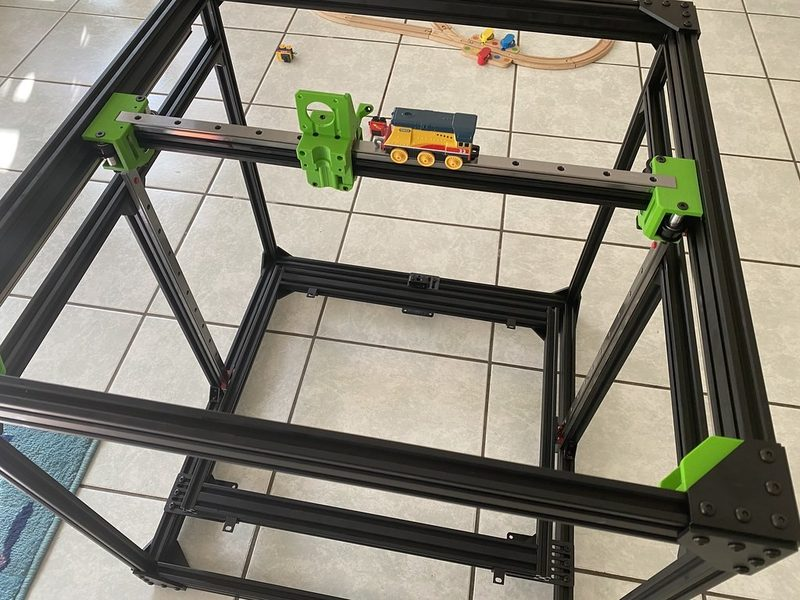

# Rat Rig V-Core Pro 1.3

[Catalog row](../../README.md#ratrig-v-core-pro) · [Gallery](../../GALLERY.md)

| Field | Value |
| --- | --- |
| Section | Legacy designs |
| Project page | [https://github.com/Rat-Rig/V-Core-Pro-1.3](https://github.com/Rat-Rig/V-Core-Pro-1.3) |
| Author | Rat Rig family |
| About | Final V-Core Pro: a CoreXY on 2020 and 2040 V-slot with 3 mm aluminium plates, MGN15 rails on all axes, and a three-point kinematic bed on three Z motors with TR8x8 lead screws. It ships with the EVA 2 carriage and is also an upgrade kit for the Pro 1.1 and 1.2. Replaced by the Rat Rig V-Core 3. No update since 2021-03. |
| Build volume (X×Y×Z) | 300: 300×300×300 400: 400×400×400 500: 500×500×500 |
| Exterior (W×D×H) | — |
| Latest version | Pro 1.3 [2021-03](https://github.com/Rat-Rig/V-Core-Pro-1.3/commit/9c0d56da3873094cb1c4e60dda2a2c02fb13f4dd) |
| Stars Likes Views |  |
| Links | [CAD](https://github.com/Rat-Rig/V-Core-Pro-1.3/tree/HEAD/cad) [BOM](https://github.com/Rat-Rig/V-Core-Pro-1.3/tree/HEAD/docs/bom) [Manual](https://wiki.ratrig.com/build-guides/v-core-13) |
| Groups | [Facebook](https://www.facebook.com/groups/ratrig3dprintercommunity) EN 19.9K [Discord](https://discord.gg/ratrig) EN 13.8K [Reddit](https://www.reddit.com/r/RatRig/) EN 3K |

## Pictures (1)

<table>
<tr><td align="center" width="33%"> Version: V-Core Pro 1.2 Photo: <a href="https://www.flickr.com/photos/silvalis/">silvalis</a></td></tr>
</table>
