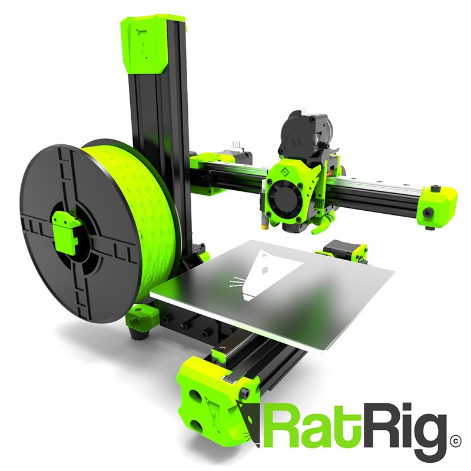
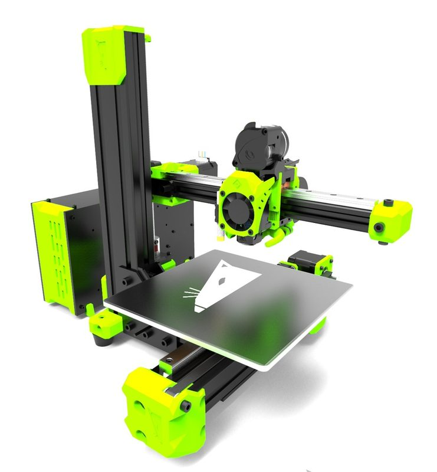
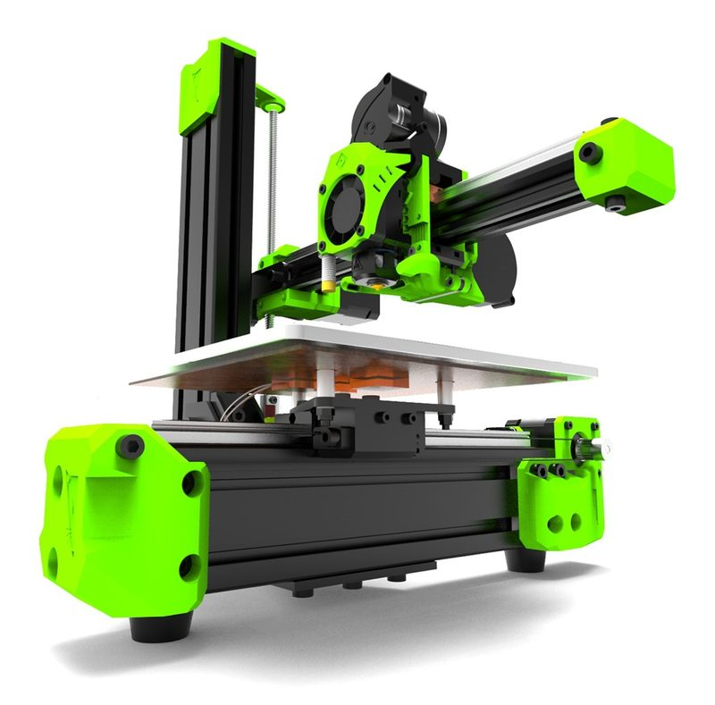
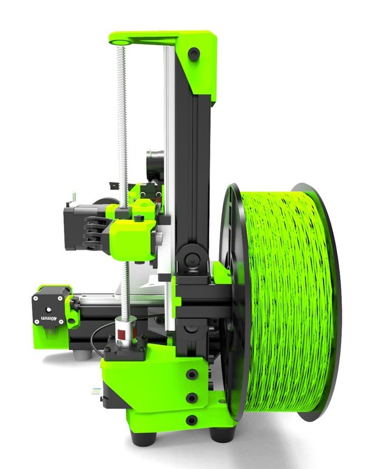
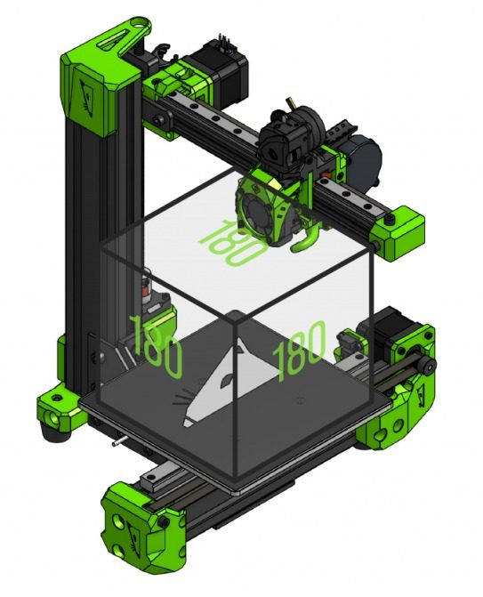
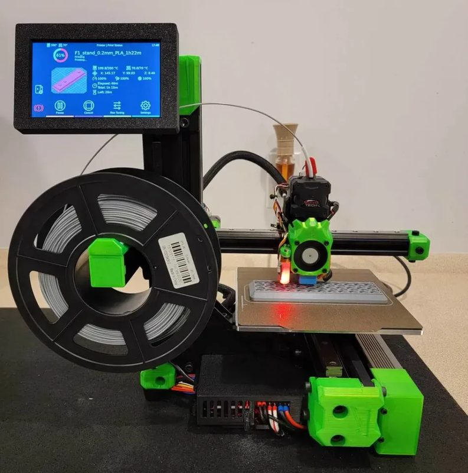
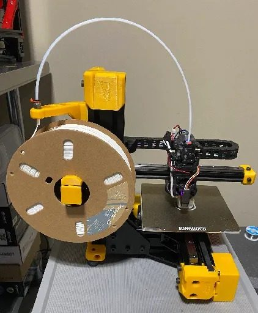
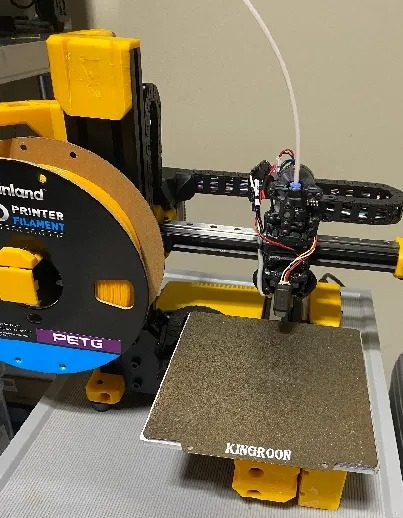
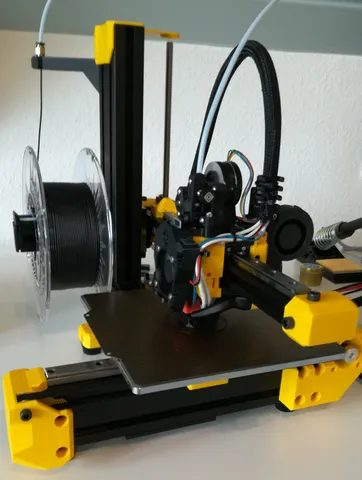

# Rat Rig V-Minion

[Catalog row](../../README.md#ratrig-v-minion) · [Gallery](../../GALLERY.md)

| Field | Value |
| --- | --- |
| Section | Cartesian · Small (≤180 mm on both X/Y axes) |
| Project page | [https://github.com/Rat-Rig/V-Minion](https://github.com/Rat-Rig/V-Minion) |
| Author | Rat Rig family |
| About | Compact 180 mm cantilevered Cartesian with linear rails. |
| Build volume (X×Y×Z) | 180×180×180 |
| Exterior (W×D×H) | — |
| Latest version | CAD [2022-10](https://github.com/Rat-Rig/V-Minion/commit/0d6aa315f221d786c41d46ef504606d659443221) |
| Stars Likes Views |  [💙⁠320](https://www.thingiverse.com/thing:5259421) [🧡⁠126](https://www.printables.com/model/240711) [⏯️⁠46.8K](https://www.youtube.com/watch?v=XnDXDmX2tS0) [❤️⁠428](https://www.youtube.com/watch?v=XnDXDmX2tS0) |
| Links | [Files](https://github.com/Rat-Rig/V-Minion/tree/main/cad) [Manual](https://rat-rig.github.io/V-Minion/) |
| Groups | [Facebook](https://www.facebook.com/groups/ratrig3dprintercommunity) EN 19.9K [Discord](https://discord.gg/ratrig) EN 13.8K [Reddit](https://www.reddit.com/r/RatRig/) EN 3K |

## Pictures (9)

<table>
<tr><td align="center" width="33%"></td><td align="center" width="33%"></td><td align="center" width="33%"></td></tr>
<tr><td align="center" width="33%"></td><td align="center" width="33%"></td><td align="center" width="33%"></td></tr>
<tr><td align="center" width="33%"></td><td align="center" width="33%"></td><td align="center" width="33%"></td></tr>
</table>
