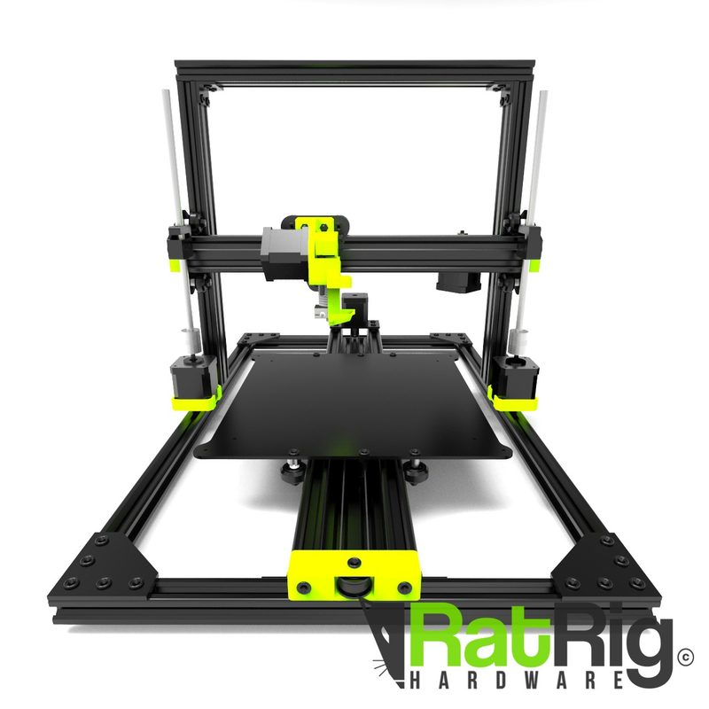
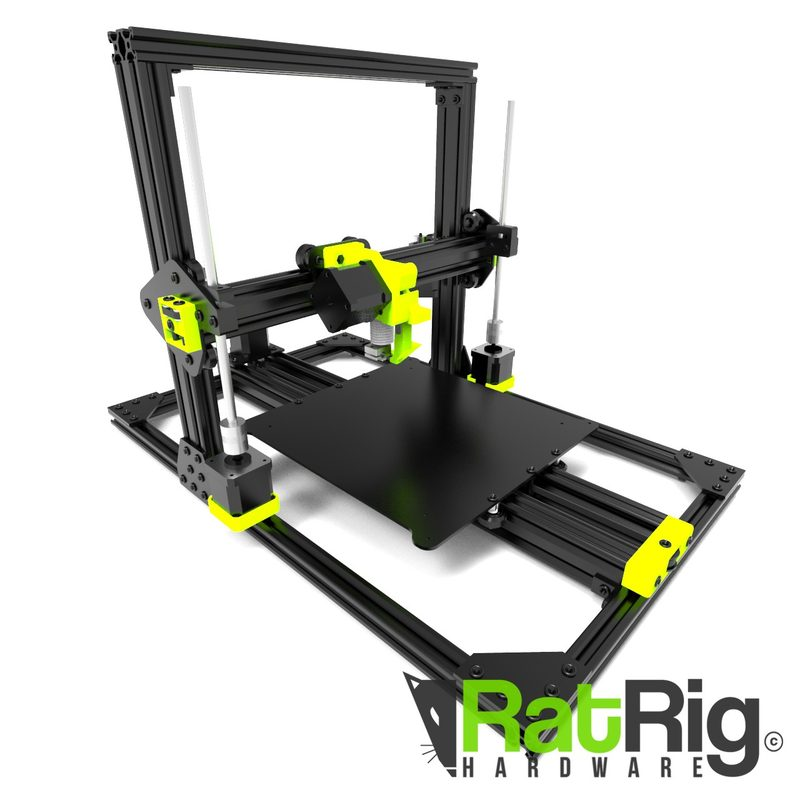
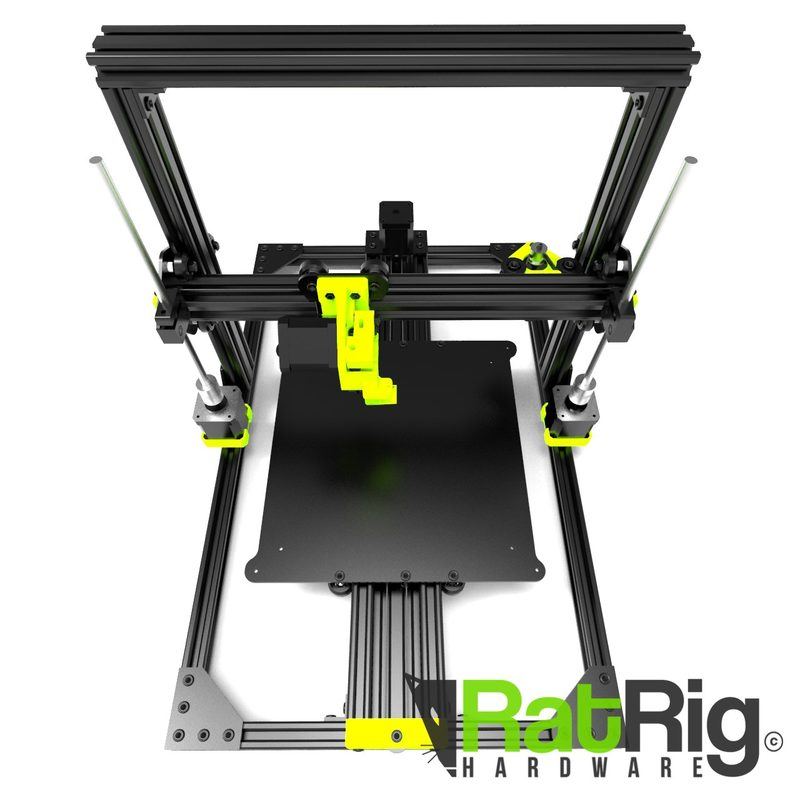
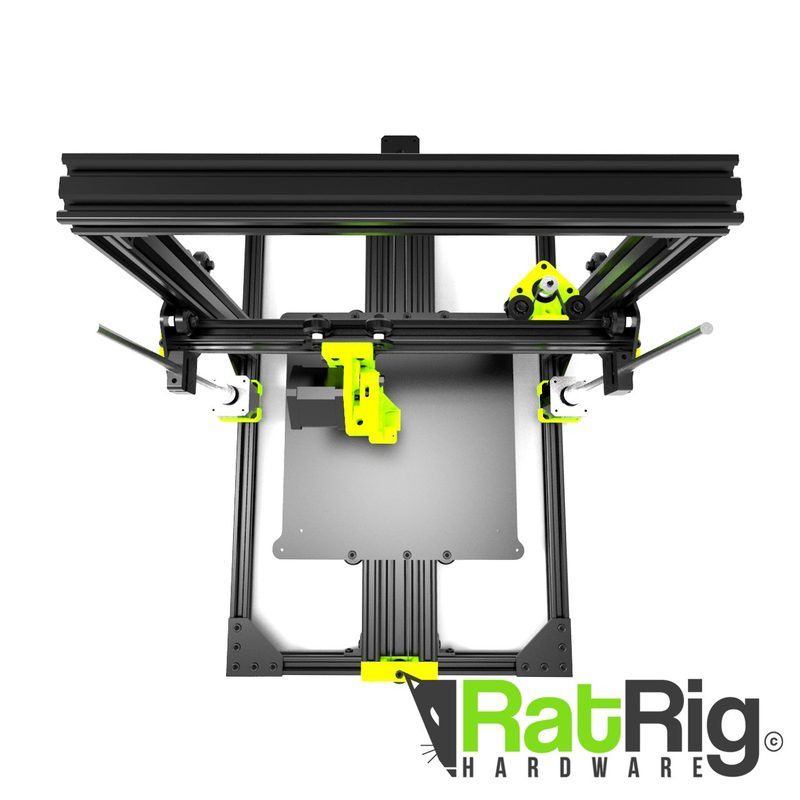

# Rat Rig V-Origin

[Catalog row](../../README.md#ratrig-v-origin) · [Gallery](../../GALLERY.md)

| Field | Value |
| --- | --- |
| Section | Legacy designs |
| Project page | [https://www.thingiverse.com/thing:3443230](https://www.thingiverse.com/thing:3443230) |
| Author | Rat Rig family |
| About | Cartesian bedslinger on OpenBuilds parts, with aluminium plates and few printed parts. Rat Rig marks it deprecated. No update since 2019-02. |
| Build volume (X×Y×Z) | 250×250×295 |
| Exterior (W×D×H) | 405×580×? |
| Latest version | Files [2019-02](https://www.thingiverse.com/thing:3443230/files) |
| Stars Likes Views | [💙⁠91](https://www.thingiverse.com/thing:3443230) [⏯️⁠12.4K](https://www.youtube.com/watch?v=6ELITCsie2c) [❤️⁠131](https://www.youtube.com/watch?v=6ELITCsie2c) |
| Links | [CAD](https://a360.co/2vkpXRS) [STL](https://www.thingiverse.com/thing:3443230/files) [BOM](https://docs.google.com/spreadsheets/d/1NneQarmi92Av1yabjeuD9ZWnH-XDte1QXwP40EmKBBo/edit) [Manual](https://drive.google.com/file/d/1G6Gle4UKW4M9TjeicbE7cGz7B_opFSlW/view) [Video](https://drive.google.com/drive/folders/1TaIGtnsjPD9w8f2wQuvZ7oanVlsiz9wN) |
| Groups | [Facebook](https://www.facebook.com/groups/ratrig3dprintercommunity) EN 19.9K [Discord](https://discord.gg/ratrig) EN 13.8K [Reddit](https://www.reddit.com/r/RatRig/) EN 3K |
| License | [CC BY 4.0 (Thingiverse)](https://www.thingiverse.com/thing:3443230) |

## Pictures (5)

<table>
<tr><td align="center" width="33%"> Photo: <a href="https://www.youtube.com/channel/UCQVGC2PuLRlS_uKmcNUPReg">Rat Rig</a></td><td align="center" width="33%"> Photo: <a href="https://www.thingiverse.com/ratrigprinters">Rat Rig</a></td><td align="center" width="33%"> Photo: <a href="https://www.thingiverse.com/ratrigprinters">Rat Rig</a></td></tr>
<tr><td align="center" width="33%"> Photo: <a href="https://www.thingiverse.com/ratrigprinters">Rat Rig</a></td><td align="center" width="33%"> Photo: <a href="https://www.thingiverse.com/ratrigprinters">Rat Rig</a></td></tr>
</table>
