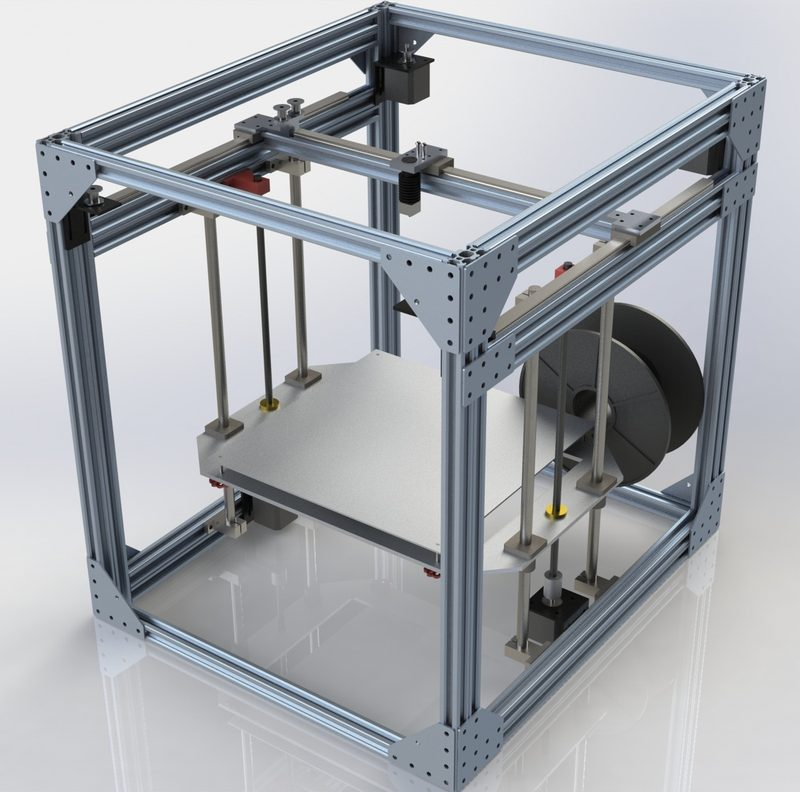
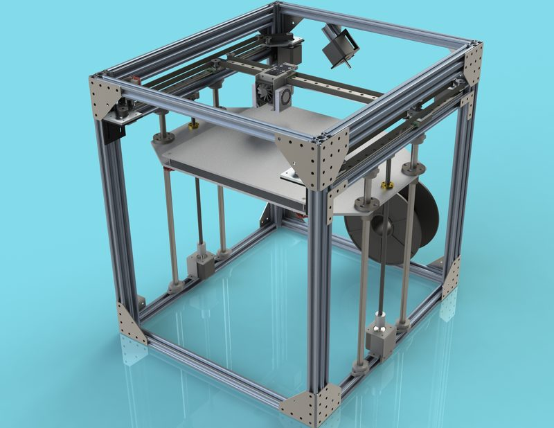
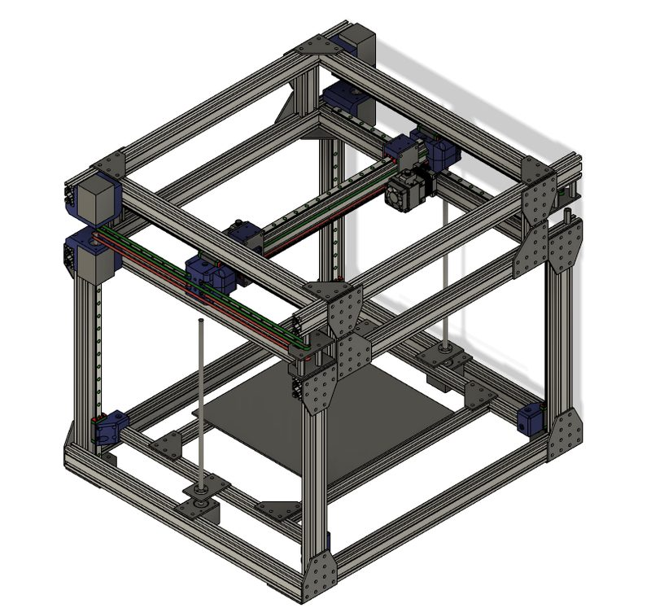
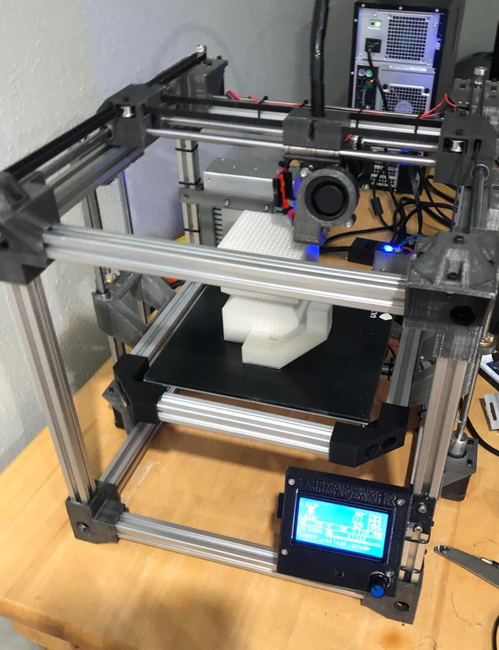

# RepRap H-Bot Project

[Catalog row](../../README.md#reprap-h-bot) · [Gallery](../../GALLERY.md)

| Field | Value |
| --- | --- |
| Section | Historical designs |
| Project page | — |
| Author | RepRap |
| About | H-bot project from an earlier version of this list; its wiki page now redirects to CoreXY. The original project page and files are lost. If you know where they are, a short PR is welcome. |
| Build volume (X×Y×Z) | — |
| Exterior (W×D×H) | — |
| Latest version | — |
| Stars Likes Views | — |
| Links | — |
| Groups | — |

## Pictures (4)

<table>
<tr><td align="center" width="33%"></td><td align="center" width="33%"></td><td align="center" width="33%"></td></tr>
<tr><td align="center" width="33%"></td></tr>
</table>
