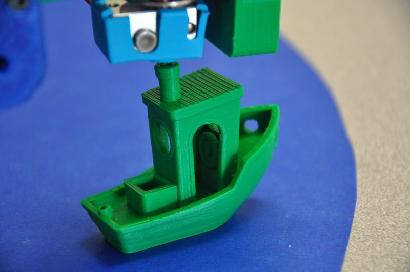
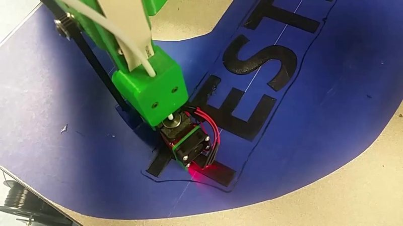
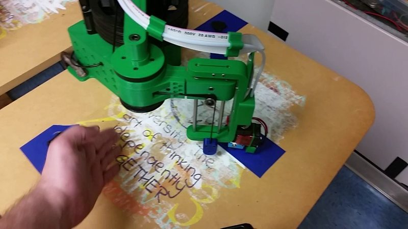
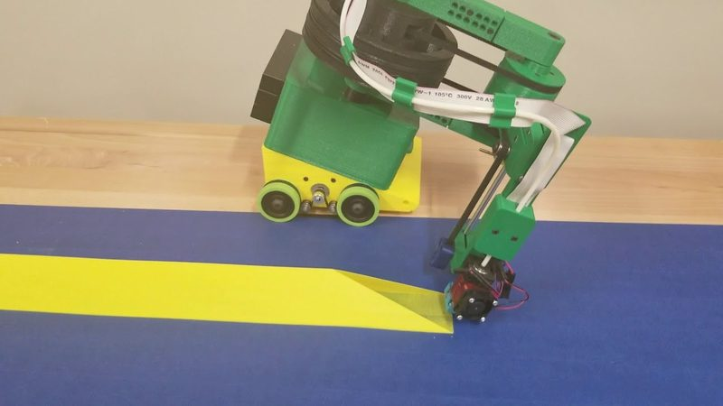

# RepRap HELIOS

[Catalog row](../../README.md#reprap-helios) · [Gallery](../../GALLERY.md)

| Field | Value |
| --- | --- |
| Section | Historical designs |
| Project page | [https://github.com/NicholasSeward/proto_RepRap_HELIOS](https://github.com/NicholasSeward/proto_RepRap_HELIOS) |
| Author | Nicholas Seward |
| About | Printed SCARA arm with every stepper fixed in the base, over a half-ring bed much larger than the machine. The repo holds the v0.1 prototype files, and the author asks people not to build this version. |
| Build volume (X×Y×Z) | half ring Ø600×100 |
| Exterior (W×D×H) | — |
| Latest version | CAD [2017-05](https://github.com/NicholasSeward/proto_RepRap_HELIOS/commit/c704cb023661720901c8685f7688f451f7705a44) |
| Stars Likes Views |  [⏯️⁠47.8K](https://www.youtube.com/watch?v=CJ2F-YjHe2k) [❤️⁠841](https://www.youtube.com/watch?v=CJ2F-YjHe2k) |
| Links | [CAD](https://github.com/NicholasSeward/proto_RepRap_HELIOS/tree/master) [FW](https://github.com/NicholasSeward/proto_RepRap_HELIOS/tree/master/Smootieware) [Config](https://github.com/NicholasSeward/proto_RepRap_HELIOS/blob/master/assets/config.txt) [Video](https://www.youtube.com/watch?v=CJ2F-YjHe2k) |
| Groups | [Forum](https://reprap.org/forum/list.php?185) EN |
| License | [not stated](https://github.com/NicholasSeward/proto_RepRap_HELIOS) |

## Pictures (5)

<table>
<tr><td align="center" width="33%"> Version: v0.1 prototype Photo: <a href="https://github.com/NicholasSeward">Nicholas Seward</a></td><td align="center" width="33%"> Photo: <a href="https://github.com/NicholasSeward">Nicholas Seward</a></td><td align="center" width="33%"> Photo: <a href="https://www.youtube.com/@NicholasSeward">Nicholas Seward</a></td></tr>
<tr><td align="center" width="33%"> Photo: <a href="https://www.youtube.com/@NicholasSeward">Nicholas Seward</a></td><td align="center" width="33%"> Version: rolling variant on a wheeled base (2019) Photo: <a href="https://www.youtube.com/@NicholasSeward">Nicholas Seward</a></td></tr>
</table>
