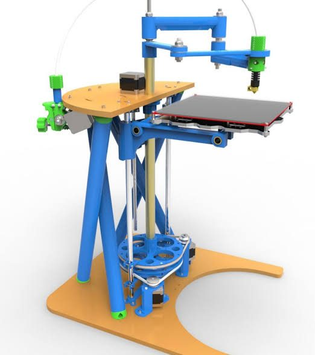
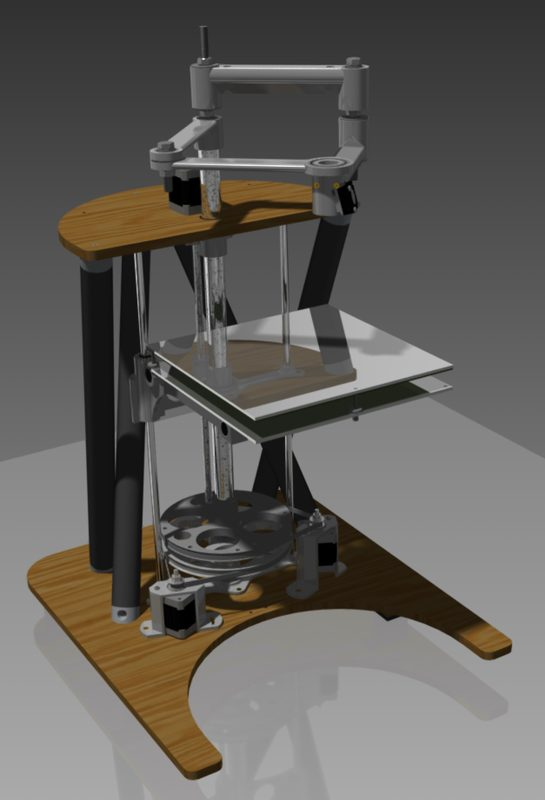
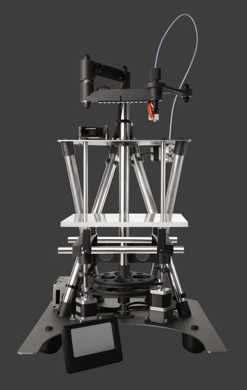
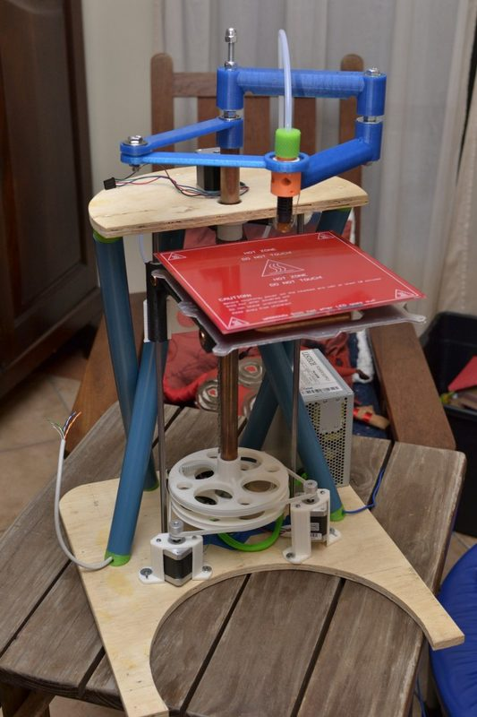
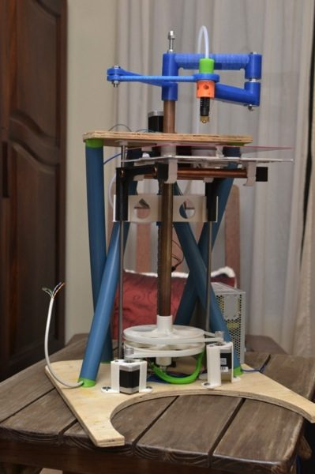
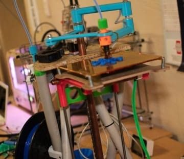
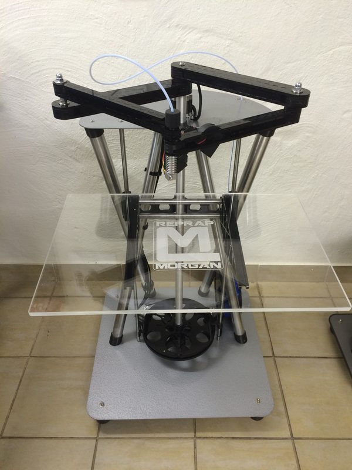
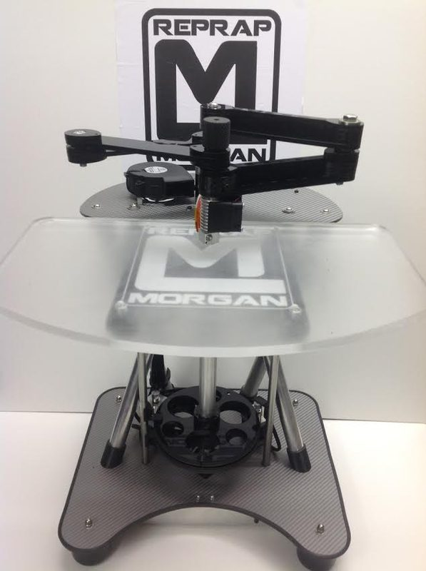

# RepRap Morgan

[Catalog row](../../README.md#reprap-morgan) · [Gallery](../../GALLERY.md)

| Field | Value |
| --- | --- |
| Section | Historical designs |
| Project page | [https://reprap.org/wiki/RepRap_Morgan](https://reprap.org/wiki/RepRap_Morgan) |
| Author | RepRap |
| About | Articulated-arm SCARA printer, and the best-known SCARA RepRap. |
| Build volume (X×Y×Z) | v1: 200×200×200 Pro 2: 380×220×200 |
| Exterior (W×D×H) | — |
| Latest version | Morgan [2014-04](https://github.com/qharley/Morgan/commit/1a3a870c02bc2af414fe2b5ddd31c06150a97c84) |
| Stars Likes Views | [⏯️⁠50.9K](https://www.youtube.com/watch?v=oSmo7iZ10Bk) [❤️⁠123](https://www.youtube.com/watch?v=oSmo7iZ10Bk) |
| Links | — |
| Groups | [Forum](https://reprap.org/forum/list.php?185) EN |

## Pictures (8)

<table>
<tr><td align="center" width="33%"></td><td align="center" width="33%"></td><td align="center" width="33%"></td></tr>
<tr><td align="center" width="33%"></td><td align="center" width="33%"></td><td align="center" width="33%"></td></tr>
<tr><td align="center" width="33%"></td><td align="center" width="33%"></td></tr>
</table>
