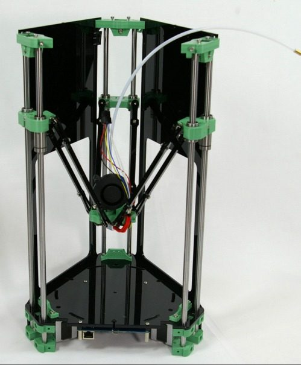
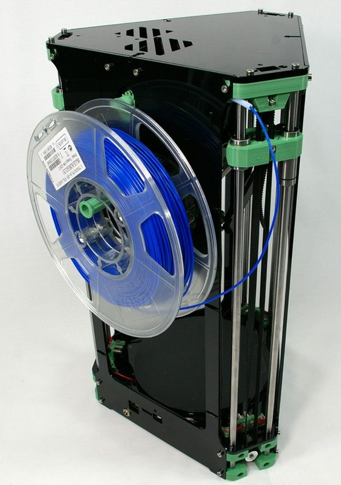
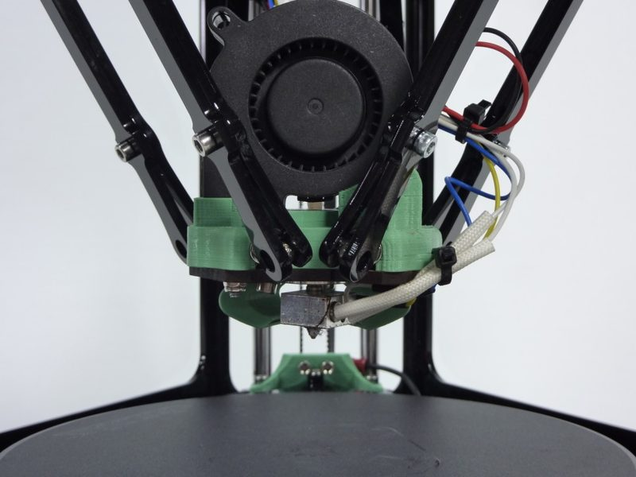
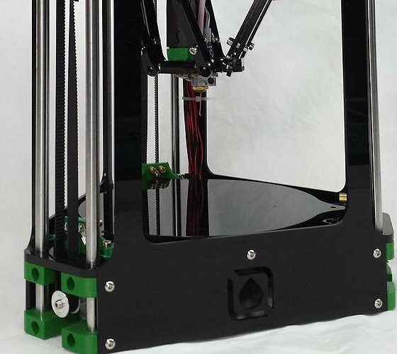

# RepRapPro Fisher 1

[Catalog row](../../README.md#reprappro-fisher) · [Gallery](../../GALLERY.md)

| Field | Value |
| --- | --- |
| Section | Legacy designs |
| Project page | [https://github.com/reprappro/Fisher](https://github.com/reprappro/Fisher) |
| Author | RepRapPro |
| About | Compact panel-frame delta with released STEP, DXF, and STL files and complete archived build instructions. RepRapPro closed, and there is no update since 2015. |
| Build volume (X×Y×Z) | Ø150×150 |
| Exterior (W×D×H) | — |
| Latest version | Fisher 1 [2015-10](https://github.com/reprappro/Fisher/commit/3763feae76a749156fb1b7430c6995d73042990d) |
| Stars Likes Views |  [⏯️⁠5.1K](https://www.youtube.com/watch?v=AAedSxTJ1j8) [❤️⁠18](https://www.youtube.com/watch?v=AAedSxTJ1j8) |
| Links | [STEP](https://github.com/reprappro/Fisher/tree/master/step) [Manual](https://reprapltd.com/reprappro/documentation/fisher-1/index.html) |
| Groups | [Forum](https://reprap.org/forum/list.php?409) EN [Forum](https://reprap.org/forum/list.php?178) EN |
| License | [GPL-2.0](https://github.com/reprappro/Fisher/blob/master/LICENSE) |

## Pictures (5)

<table>
<tr><td align="center" width="33%"> Photo: <a href="https://reprap.org/wiki/User:SallyRepRap">SallyRepRap</a></td><td align="center" width="33%"> Photo: <a href="https://github.com/reprappro">RepRapPro</a></td><td align="center" width="33%"> Photo: <a href="https://github.com/reprappro">RepRapPro</a></td></tr>
<tr><td align="center" width="33%"> Photo: <a href="https://github.com/reprappro">RepRapPro</a></td><td align="center" width="33%"> Photo: <a href="https://github.com/reprappro">RepRapPro</a></td></tr>
</table>
