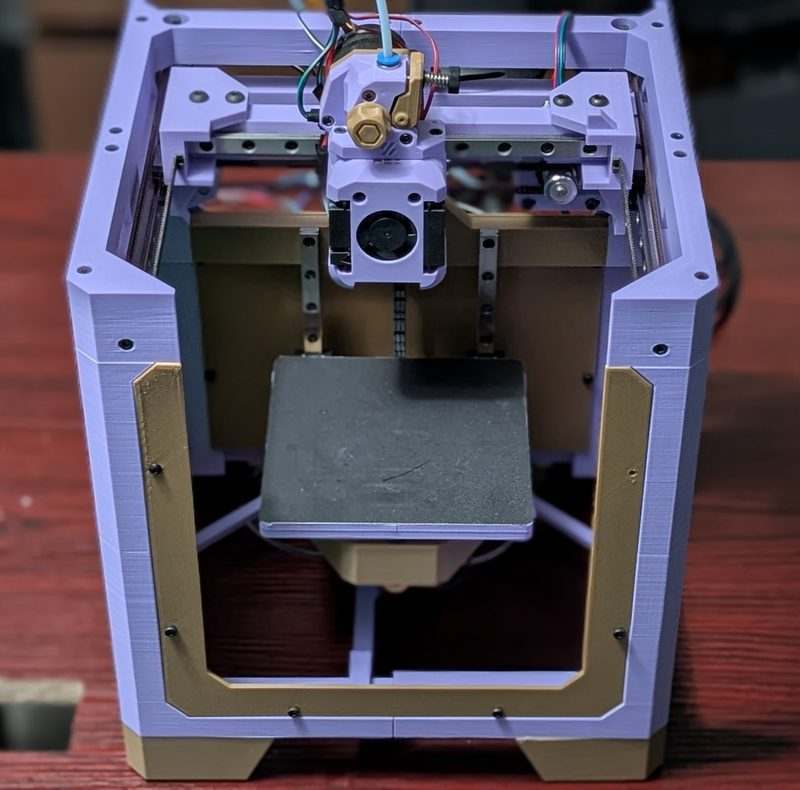
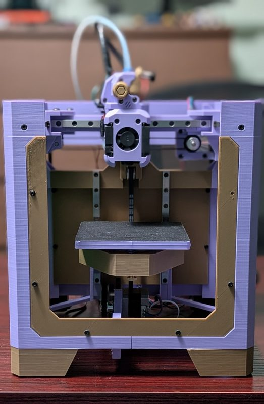
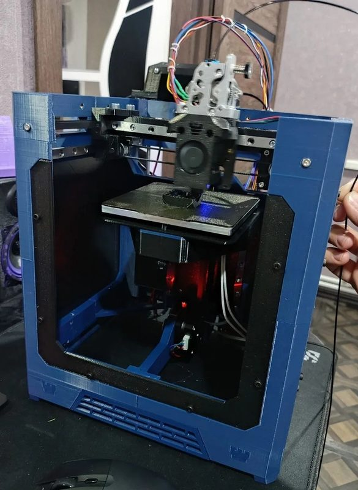
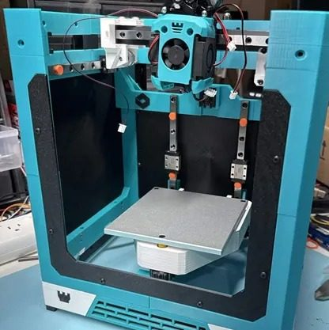

# Rook MK2

[Catalog row](../../README.md#rook-mk2) · [Gallery](../../GALLERY.md)

| Field | Value |
| --- | --- |
| Section | Cartesian · Small (≤180 mm on both X/Y axes) |
| Project page | [https://www.printables.com/model/1644597-rook-mk2](https://www.printables.com/model/1644597-rook-mk2) |
| Author | Rolohaun / Rook family |
| About | Fully printed frame; creator labels this a beta release. |
| Build volume (X×Y×Z) | 120×120×? |
| Exterior (W×D×H) | — |
| Latest version | MK2 beta [2026-03](https://www.printables.com/model/1644597-rook-mk2) |
| Stars Likes Views | [🧡⁠429](https://www.printables.com/model/1644597-rook-mk2) [⏯️⁠8.3K](https://www.youtube.com/watch?v=Rsd_QlY3pGE) [❤️⁠398](https://www.youtube.com/watch?v=Rsd_QlY3pGE) |
| Links | [BOM](https://docs.google.com/spreadsheets/d/18EqrtU4kwdb6v4gPMTdCcCdBVbxlF5-EhFE0hZtxHoA/edit) [CAD](https://cad.onshape.com/documents/5010167e95003ed32232fd0e/w/756fbf38edf59fb734f7365c/e/e647ceb1e4681ba492e8722b) |
| Groups | [Discord](https://discord.gg/rolohaun-3d-946191040682008666) EN 7.8K |

## Pictures (5)

<table>
<tr><td align="center" width="33%"></td><td align="center" width="33%"></td><td align="center" width="33%"></td></tr>
<tr><td align="center" width="33%"></td><td align="center" width="33%"></td></tr>
</table>
