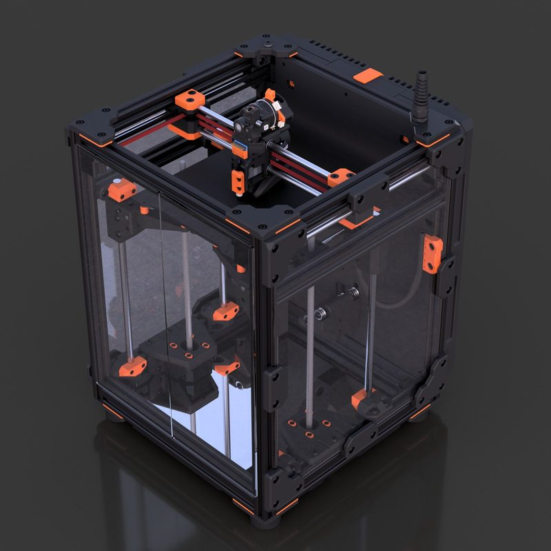
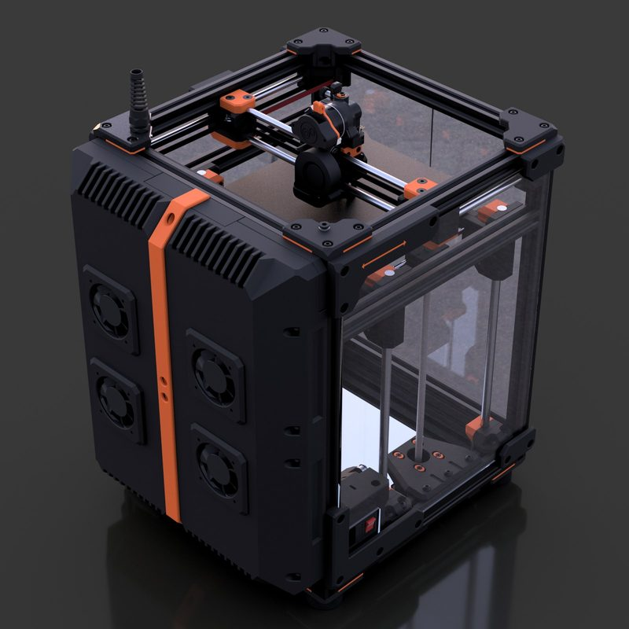
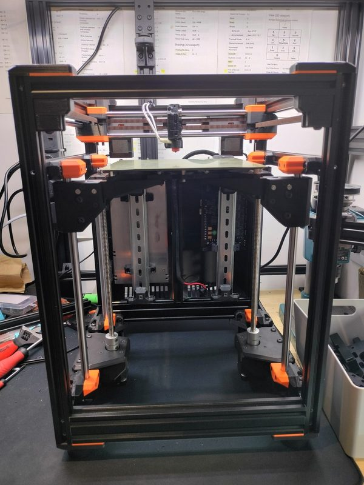
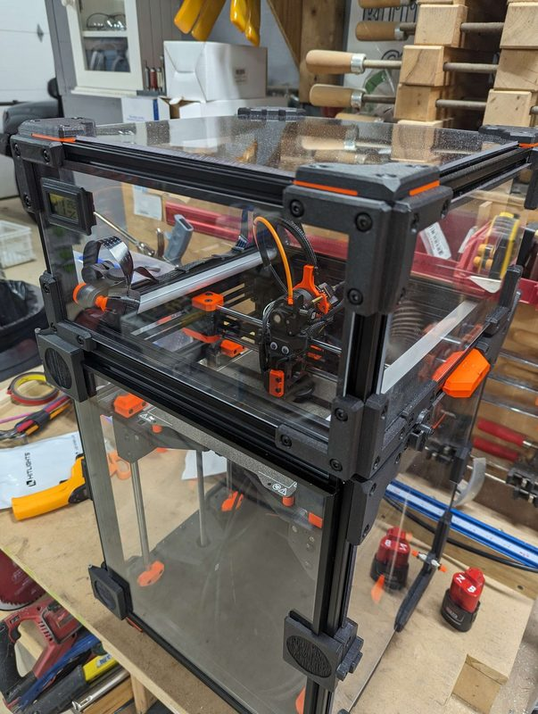
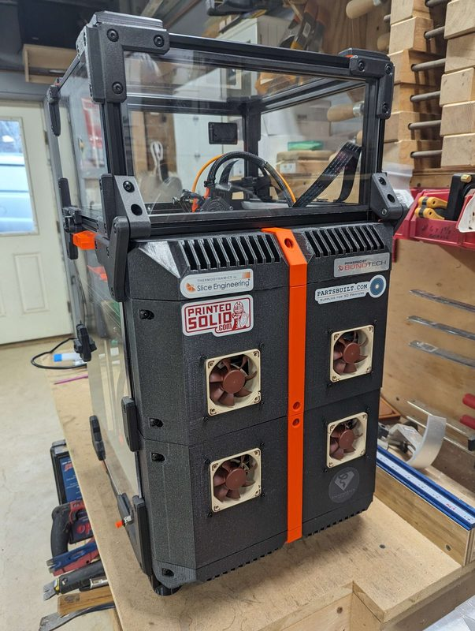
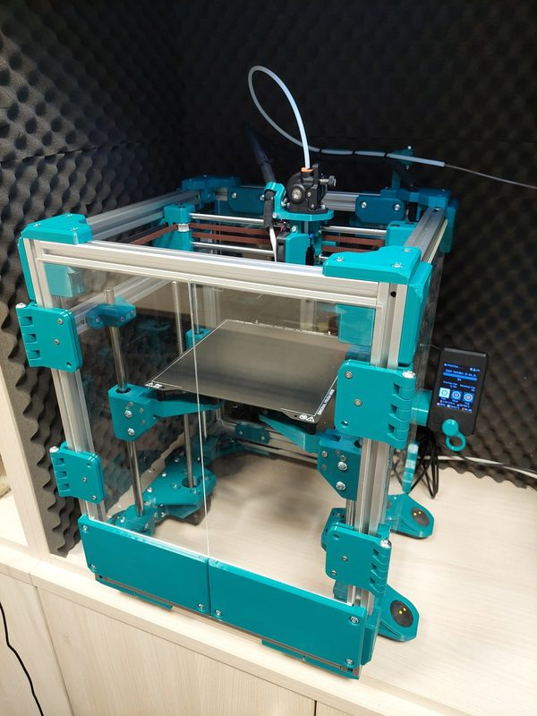
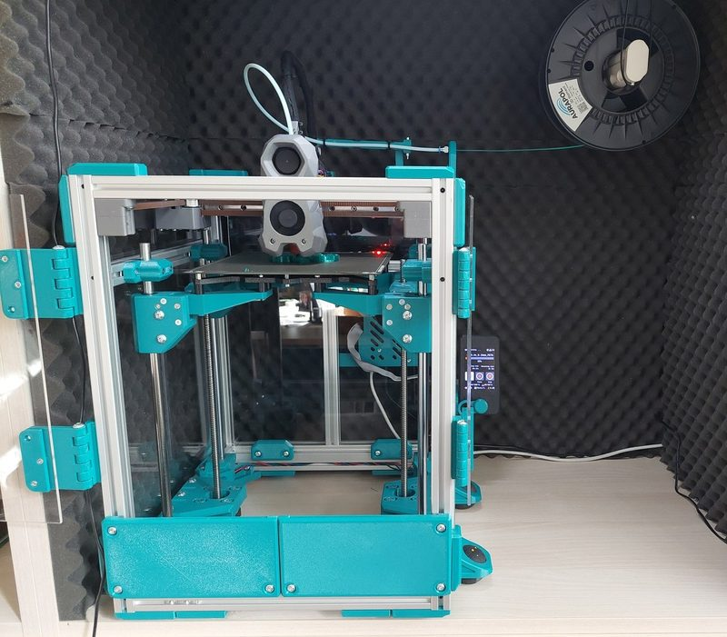

# Satsuma 180

[Catalog row](../../README.md#satsuma) · [Gallery](../../GALLERY.md)

| Field | Value |
| --- | --- |
| Section | Conversions |
| Project page | [https://www.printables.com/model/487266-satsuma-180-v10](https://www.printables.com/model/487266-satsuma-180-v10) |
| Author | Squirrelbrain |
| About | CoreXY that reuses Prusa MINI parts, including the bed, and uses square nuts instead of heat-set inserts. The row covers Satsuma 180 v1.0 and the smaller [Satsuma 120](https://www.printables.com/model/564986-satsuma-120-beta) beta. |
| Build volume (X×Y×Z) | 180: 180×180×? 120: 120×120×? |
| Exterior (W×D×H) | — |
| Latest version | v1.0 [2023-12](https://www.printables.com/model/487266-satsuma-180-v10/files) |
| Stars Likes Views | [🧡⁠1.1K](https://www.printables.com/model/487266-satsuma-180-v10) |
| Links | [Files](https://www.printables.com/model/487266-satsuma-180-v10/files) 180 [BOM](https://docs.google.com/spreadsheets/d/1j9XkWJjpuDxKR5D-tsqN0p6wRn4Gp6H0tIH2ABmrAIE/edit) 180 [Files](https://www.printables.com/model/564986-satsuma-120-beta/files) 120 |
| Groups | — |
| License | [GPL-3.0 (Satsuma 180, Printables), CC BY-SA (Satsuma 120, Printables)](https://www.printables.com/model/487266-satsuma-180-v10) |

## Pictures (8)

<table>
<tr><td align="center" width="33%"> Version: Satsuma 120 beta Photo: <a href="https://www.printables.com/@Squirrelbrain">Squirrelbrain</a></td><td align="center" width="33%"> Version: Satsuma 180 v1.0 Photo: <a href="https://www.printables.com/@Squirrelbrain">Squirrelbrain</a></td><td align="center" width="33%"> Version: Satsuma 180 v1.0 Photo: <a href="https://www.printables.com/@Squirrelbrain">Squirrelbrain</a></td></tr>
<tr><td align="center" width="33%"> Version: Satsuma 180 Photo: <a href="https://www.printables.com/@Squirrelbrain">Squirrelbrain</a></td><td align="center" width="33%"> Version: Satsuma 180 Photo: <a href="https://www.printables.com/@JohnNguyen_1400987">JohnNguyen</a></td><td align="center" width="33%"> Version: Satsuma 180 Photo: <a href="https://www.printables.com/@JohnNguyen_1400987">JohnNguyen</a></td></tr>
<tr><td align="center" width="33%"> Version: Satsuma 180 Photo: <a href="https://www.printables.com/@mail2sad_1397987">Print2sad</a></td><td align="center" width="33%"> Version: CoreMINI+ rail mod of Satsuma 180 Photo: <a href="https://www.printables.com/@mail2sad_1397987">Print2sad</a></td></tr>
</table>
