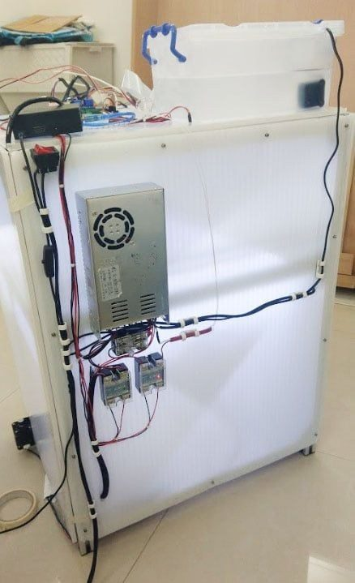
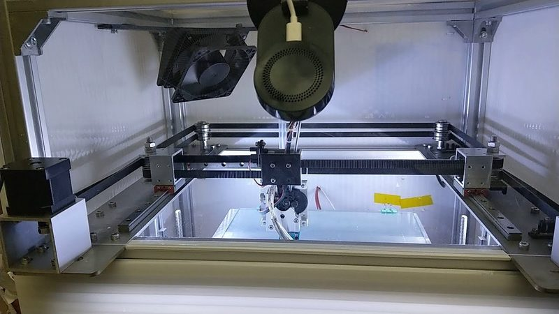
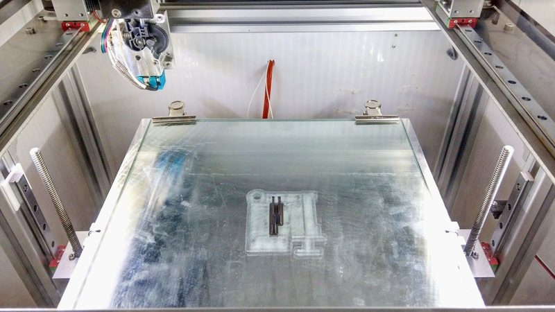
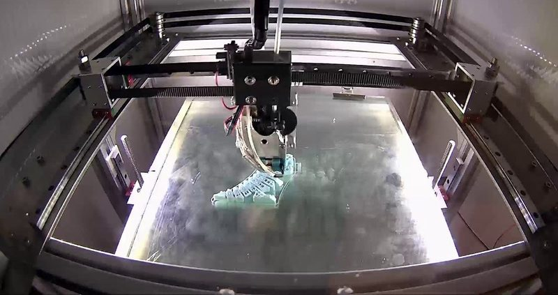
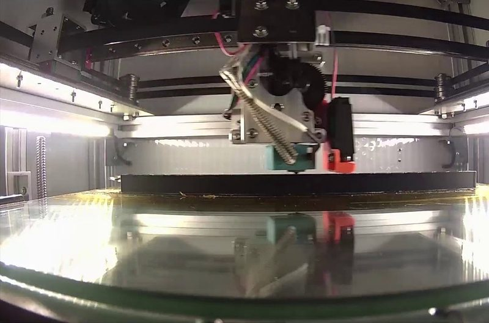
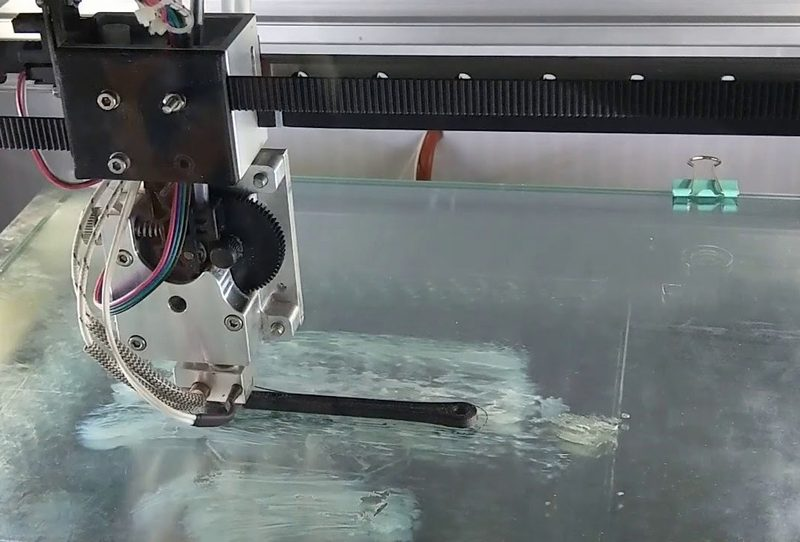

# SecKit SK-300 / SK-600

[Catalog row](../../README.md#seckit-sk-300) · [Gallery](../../GALLERY.md)

| Field | Value |
| --- | --- |
| Section | Legacy designs |
| Project page | [https://github.com/SecKit/SK-300_SK-600](https://github.com/SecKit/SK-300_SK-600) |
| Author | SecKit family |
| About | All-metal CoreXY frame kit on 3030 extrusion with MGN12 rails, servo XY motors, and a water-cooled extruder. SK-300 and SK-600 differ in Z height. No update since 2019-11. |
| Build volume (X×Y×Z) | SK-300: ?×?×300 SK-600: ?×?×600 |
| Exterior (W×D×H) | — |
| Latest version | Files [2019-11](https://github.com/SecKit/SK-300_SK-600/commit/79827b6d206d8ea0f3f24df997df5e887371b192) |
| Stars Likes Views |  [💙⁠27](https://www.thingiverse.com/thing:3611127) [⏯️⁠5.9K](https://www.youtube.com/watch?v=K5naAu8HsZ4) [❤️⁠25](https://www.youtube.com/watch?v=K5naAu8HsZ4) |
| Links | [STL](https://github.com/SecKit/SK-300_SK-600/tree/master/printed%20parts%20STL) [Files](https://github.com/SecKit/SK-300_SK-600/tree/master/frame%20spec) [Manual](https://github.com/SecKit/SK-300_SK-600/blob/master/assembly%20manual/%5Ben%5D%20SecKit%20SK-300%20Assembly%20Manual.pdf) |
| Groups | [Facebook](https://www.facebook.com/groups/SecKitCoreXY3DP/) EN 2.6K |
| License | [CC BY-NC 4.0 (Thingiverse)](https://www.thingiverse.com/thing:3611127) |

## Pictures (7)

<table>
<tr><td align="center" width="33%"> Version: SK-300 Photo: <a href="https://github.com/SecKit">SecKit</a></td><td align="center" width="33%"> Version: SK-300 Photo: <a href="https://github.com/SecKit">SecKit</a></td><td align="center" width="33%"> Photo: <a href="https://www.youtube.com/@seckit3dp">SecKit</a></td></tr>
<tr><td align="center" width="33%"> Photo: <a href="https://github.com/SecKit">SecKit</a></td><td align="center" width="33%"> Photo: <a href="https://www.youtube.com/@seckit3dp">SecKit</a></td><td align="center" width="33%"> Photo: <a href="https://www.youtube.com/@seckit3dp">SecKit</a></td></tr>
<tr><td align="center" width="33%"> Photo: <a href="https://www.youtube.com/@seckit3dp">SecKit</a></td></tr>
</table>
