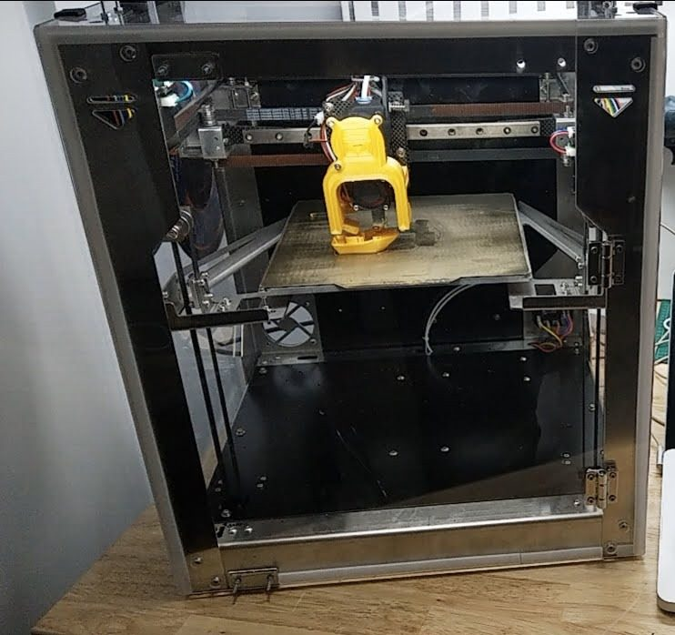
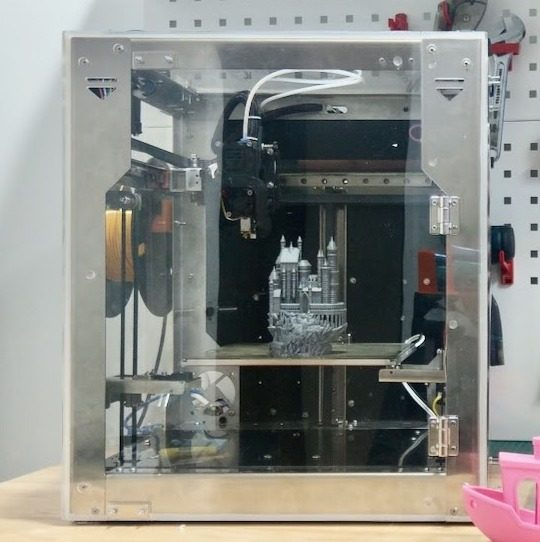
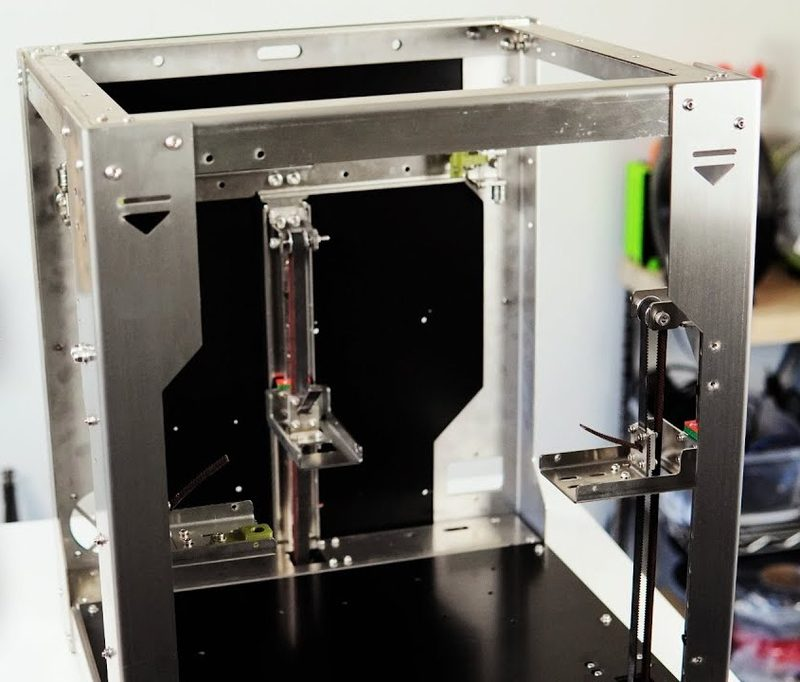
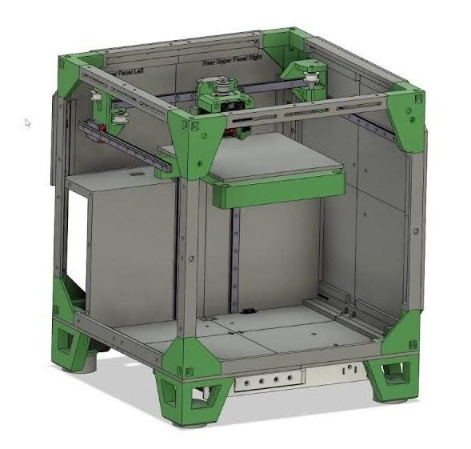

# SecKit SK-Cube

[Catalog row](../../README.md#seckit-sk-cube) · [Gallery](../../GALLERY.md)

| Field | Value |
| --- | --- |
| Section | Legacy designs |
| Project page | [https://github.com/SecKit/SK-Cube](https://github.com/SecKit/SK-Cube) |
| Author | SecKit family |
| About | Smaller self-sourceable 200 mm CoreXY. No update since 2024-10. |
| Build volume (X×Y×Z) | 200×200×200 |
| Exterior (W×D×H) | — |
| Latest version | CAD [2024-10](https://github.com/SecKit/SK-Cube/commit/511a88e391036c4d58976461c35562cc03a3d76a) |
| Stars Likes Views |  [⏯️⁠4.4K](https://www.youtube.com/watch?v=wUzZTefc6xk) [❤️⁠42](https://www.youtube.com/watch?v=wUzZTefc6xk) |
| Links | [STEP](https://github.com/SecKit/SK-Cube/tree/main/STEP%20files) [BOM](https://github.com/SecKit/SK-Cube/tree/main/self-sourcing%20components) [Manual](https://sites.google.com/view/seckit-wiki/sk-cube-200x200x200/assembly-manual/sk-cube-assembly-manual) |
| Groups | [Facebook](https://www.facebook.com/groups/SecKitCoreXY3DP/) EN 2.6K |

## Pictures (5)

<table>
<tr><td align="center" width="33%"></td><td align="center" width="33%"></td><td align="center" width="33%"></td></tr>
<tr><td align="center" width="33%"></td><td align="center" width="33%"></td></tr>
</table>
