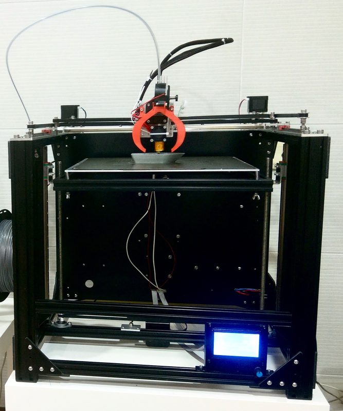
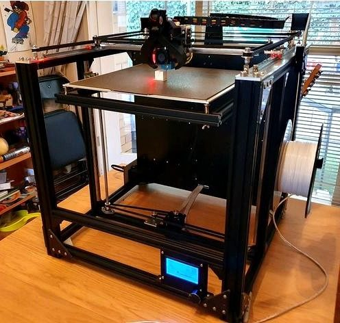
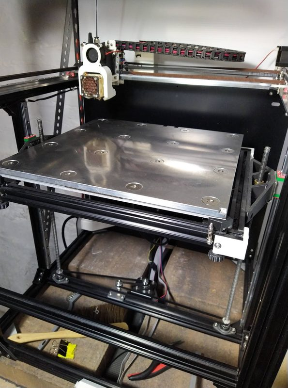
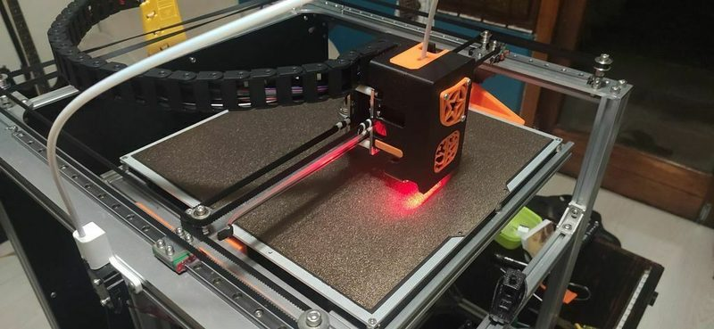
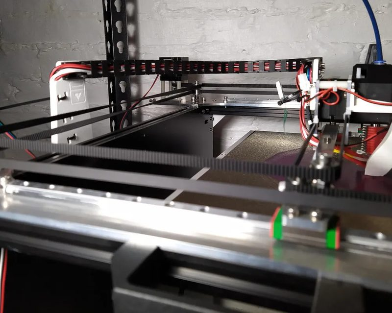
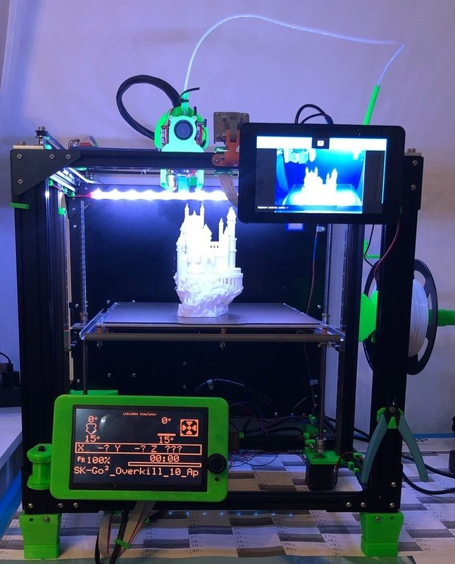
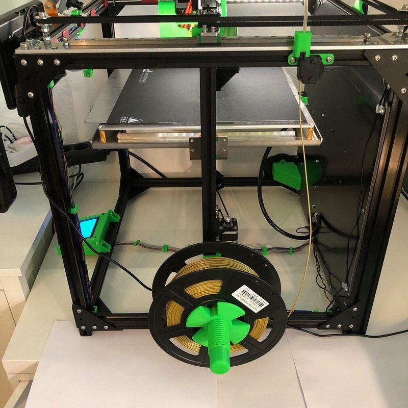
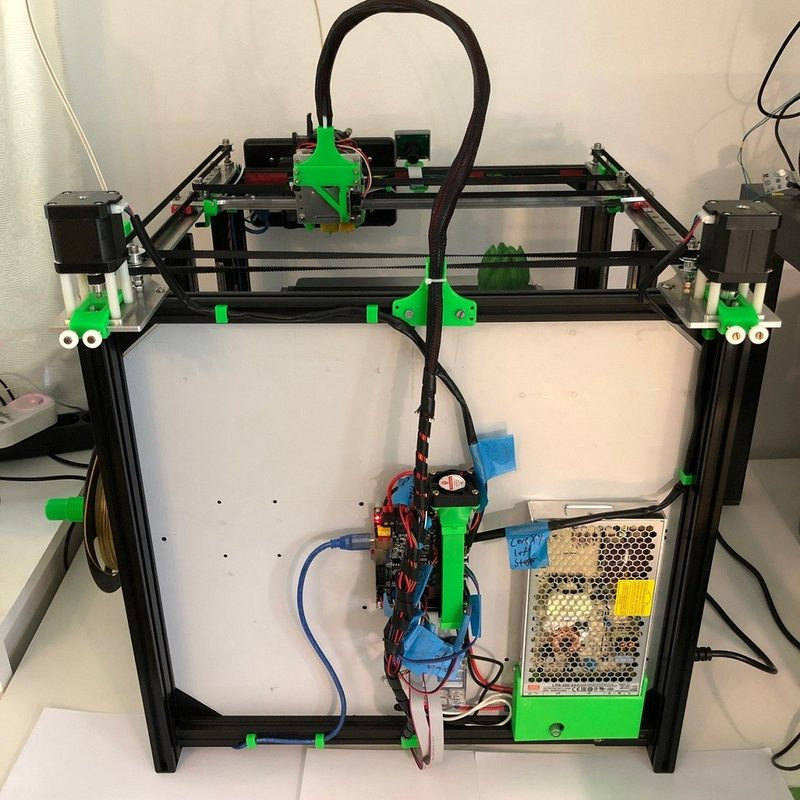
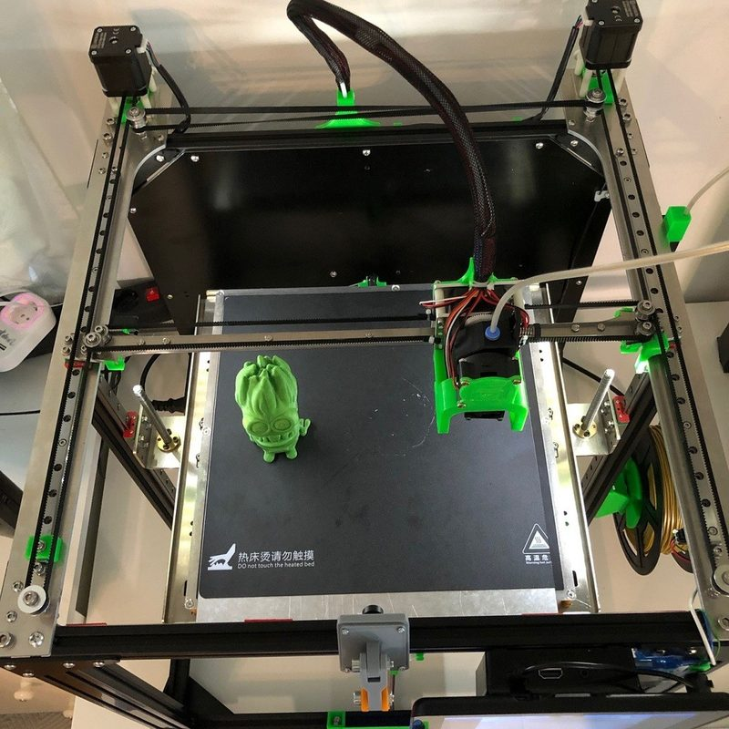

# SecKit SK-Go

[Catalog row](../../README.md#seckit-sk-go) · [Gallery](../../GALLERY.md)

| Field | Value |
| --- | --- |
| Section | CoreXY · Large (≥300 × 300 mm) |
| Project page | [https://github.com/SecKit/SK-Go_SK-Mini](https://github.com/SecKit/SK-Go_SK-Mini) |
| Author | SecKit family |
| About | Extrusion-frame design with a self-sourcing path. |
| Build volume (X×Y×Z) | 310×310×350 |
| Exterior (W×D×H) | 520×500×500 |
| Latest version | Go3 [2024-07](https://github.com/SecKit/SK-Go_SK-Mini/commit/36d0f9fadb08e65ddb99c8e1aae8fd9637878261) |
| Stars Likes Views |  [💙⁠105](https://www.thingiverse.com/thing:3881156) [⏯️⁠5.7K](https://www.youtube.com/watch?v=ZBiTbyRcIaE) [❤️⁠54](https://www.youtube.com/watch?v=ZBiTbyRcIaE) |
| Links | [STEP](https://github.com/SecKit/SK-Go_SK-Mini/tree/HEAD/Go3%20%28AE2-310eu%20v3%29/STEP%20files) [Manual](https://sites.google.com/view/seckit-wiki/sk-go-310x310x350) |
| Groups | [Facebook](https://www.facebook.com/groups/SecKitCoreXY3DP/) EN 2.6K |
| License | [CC BY-NC-SA 4.0 (GitHub), CC BY 4.0 (Thingiverse)](https://github.com/SecKit/SK-Go_SK-Mini/blob/master/Go3%20(AE2-310eu%20v3)/STEP%20files/README.md) |

## Pictures (10)

<table>
<tr><td align="center" width="33%"> Photo: <a href="https://github.com/SecKit">SecKit</a></td><td align="center" width="33%"> Photo: <a href="https://github.com/SecKit">SecKit</a></td><td align="center" width="33%"></td></tr>
<tr><td align="center" width="33%"> Photo: Benoît Barbé</td><td align="center" width="33%"></td><td align="center" width="33%"> Photo: <a href="https://makerworld.com/en/@bounetphoto">bounetphoto</a></td></tr>
<tr><td align="center" width="33%"> Version: SK-Go2 Photo: <a href="https://www.printables.com/@caesar_1111_261164">caesar_1111</a></td><td align="center" width="33%"> Version: SK-Go2 Photo: <a href="https://www.printables.com/@caesar_1111_261164">caesar_1111</a></td><td align="center" width="33%"> Version: SK-Go2 Photo: <a href="https://www.printables.com/@caesar_1111_261164">caesar_1111</a></td></tr>
<tr><td align="center" width="33%"> Version: SK-Go2 Photo: <a href="https://www.printables.com/@caesar_1111_261164">caesar_1111</a></td></tr>
</table>

## Other homes of the files

- [Thingiverse](https://www.thingiverse.com/thing:3881156): 24 files of the first SK-Go, links to GitHub. CC BY 4.0.
- Wayback Machine: [latest snapshot](https://web.archive.org/web/20251206224908/https://github.com/SecKit/SK-Go_SK-Mini), 2025-12-06.
