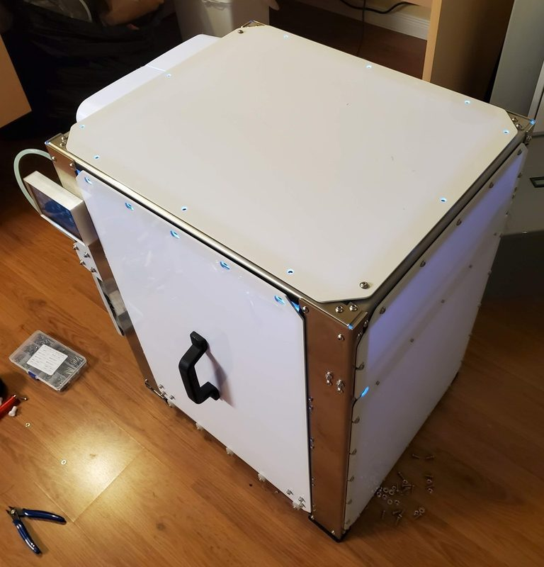
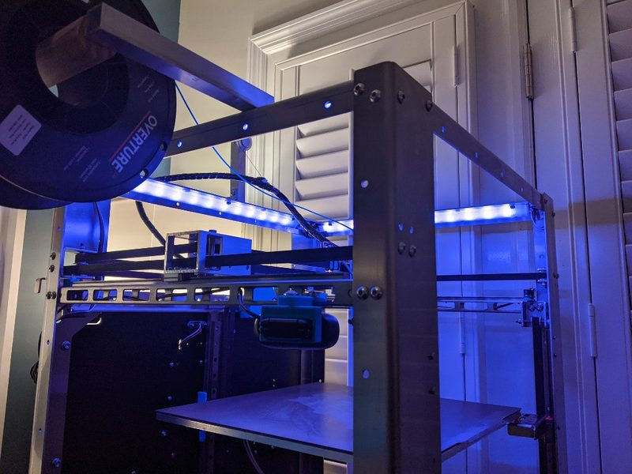
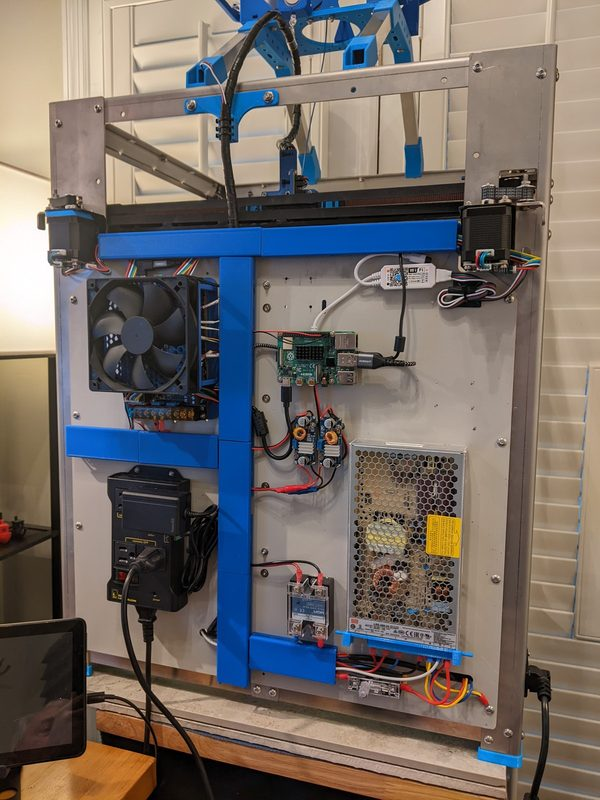
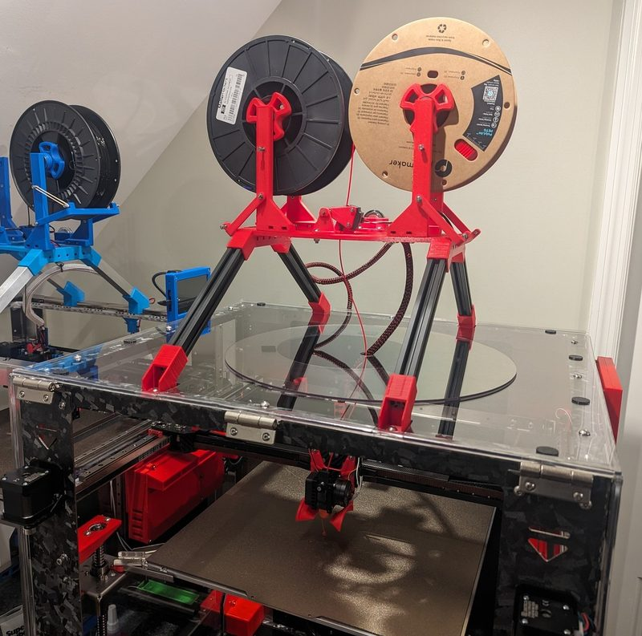

# SecKit SK-Tank

[Catalog row](../../README.md#seckit-sk-tank) · [Gallery](../../GALLERY.md)

| Field | Value |
| --- | --- |
| Section | CoreXY · Large (≥300 × 300 mm) |
| Project page | [https://github.com/SecKit/SK-Tank](https://github.com/SecKit/SK-Tank) |
| Author | SecKit family |
| About | All-metal frame kit design in two versions, v1 with 350 mm and v2 with 400 mm XY. |
| Build volume (X×Y×Z) | v1: 350×350×400 v2: 400×400×400 |
| Exterior (W×D×H) | 560×530×710 |
| Latest version | STEP [2025-03](https://github.com/SecKit/SK-Tank/commit/ae56719d14c6fef099e959b14f3daf03f4c1f8b8) |
| Stars Likes Views |  [⏯️⁠5.1K](https://www.youtube.com/watch?v=aX0A48tPdEk) [❤️⁠62](https://www.youtube.com/watch?v=aX0A48tPdEk) |
| Links | [Manual](https://sites.google.com/view/seckit-wiki/sk-tank-v2-400x400x400/assembly-manuals/sk-tank-v2-assembly-manual) v2 [Manual](https://sites.google.com/view/seckit-wiki/sk-tank-350x350x400) v1 |
| Groups | [Facebook](https://www.facebook.com/groups/SecKitCoreXY3DP/) EN 2.6K |
| License | [CC BY-NC-SA 4.0](https://github.com/SecKit/SK-Tank/blob/master/v2/STEP%20files/README.md) |

## Pictures (9)

<table>
<tr><td align="center" width="33%"> Photo: <a href="https://github.com/SecKit">SecKit</a></td><td align="center" width="33%"> Photo: <a href="https://www.printables.com/@10htts_260797">10htts</a></td><td align="center" width="33%"> Photo: <a href="https://www.printables.com/@10htts_260797">10htts</a></td></tr>
<tr><td align="center" width="33%"> Photo: <a href="https://www.printables.com/@10htts_260797">10htts</a></td><td align="center" width="33%"> Photo: <a href="https://www.printables.com/@10htts_260797">10htts</a></td><td align="center" width="33%"> Photo: <a href="https://www.printables.com/@10htts_260797">10htts</a></td></tr>
<tr><td align="center" width="33%"> Version: v1 Photo: <a href="https://www.printables.com/@declinox_225273">declinox</a></td><td align="center" width="33%"> Version: v1 Photo: <a href="https://www.printables.com/@declinox_225273">declinox</a></td><td align="center" width="33%"> Version: v2 Photo: <a href="https://www.printables.com/@declinox_225273">declinox</a></td></tr>
</table>

## Other homes of the files

- Wayback Machine: [latest snapshot](https://web.archive.org/web/20251011145638/https://github.com/SecKit/SK-Tank), 2025-10-11.
