# Sextupteron

[Catalog row](../../README.md#sextupteron) · [Gallery](../../GALLERY.md)

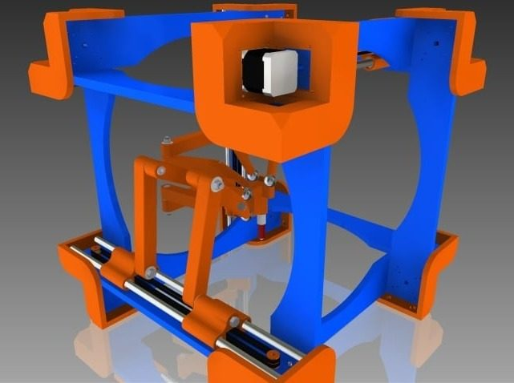

| Field | Value |
| --- | --- |
| Section | Concepts and prototypes |
| Project page | [https://www.thingiverse.com/thing:124215](https://www.thingiverse.com/thing:124215) |
| Author | Nicholas Seward |
| About | Parallel Cartesian robot with six degrees of freedom, a variant of the Tripteron and Quadrupteron. Six belt-driven carriages on rods move arms that hold a central hub, so the nozzle moves and tilts. At the center it tilts up to 58 degrees each way. The author never built it. It needs custom firmware and a non-planar slicer. |
| Build type | 6-DOF parallel Cartesian |
| Build volume (X×Y×Z) | 200×200×200 |
| Exterior (W×D×H) | 500×500×500 |
| Latest version | Files [2013-07](https://www.thingiverse.com/thing:124215/files) |
| Stars Likes Views | [💙⁠211](https://www.thingiverse.com/thing:124215) [⏯️⁠25.5K](https://www.youtube.com/watch?v=2kXdsU2bBp0) [❤️⁠255](https://www.youtube.com/watch?v=2kXdsU2bBp0) |
| Links | [Files](https://www.thingiverse.com/thing:124215/files) [Wiki](https://reprap.org/wiki/Sextupteron) [Video](https://www.youtube.com/watch?v=2kXdsU2bBp0) |
| Groups | [Forum](https://reprap.org/forum/read.php?178,229935) EN inactive |

## Pictures (14)

<table>
<tr><td align="center" width="33%"> Photo: <a href="https://www.youtube.com/@NicholasSeward">Nicholas J Seward</a></td><td align="center" width="33%"><a href="1-sextupteron.jpg">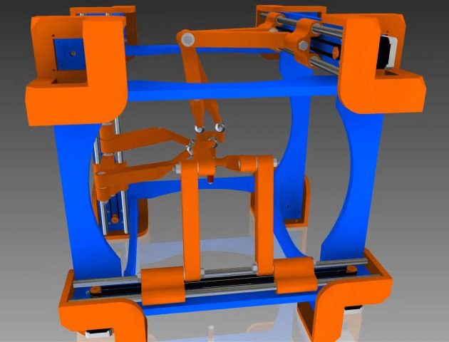</a> Version: Extreme Photo: <a href="https://www.youtube.com/@NicholasSeward">Nicholas J Seward</a></td><td align="center" width="33%"><a href="2-sextupteron.jpg">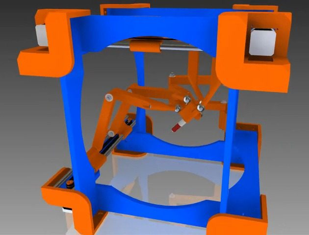</a> Version: Extreme Photo: <a href="https://www.youtube.com/@NicholasSeward">Nicholas J Seward</a></td></tr>
<tr><td align="center" width="33%"><a href="3-sextupteron.jpg">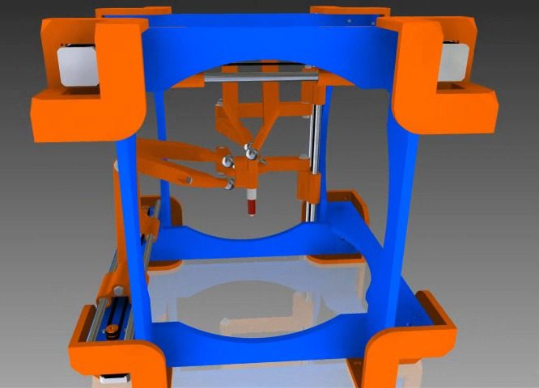</a> Version: Extreme Photo: <a href="https://www.youtube.com/@NicholasSeward">Nicholas J Seward</a></td><td align="center" width="33%"><a href="4-sextupteron.jpg">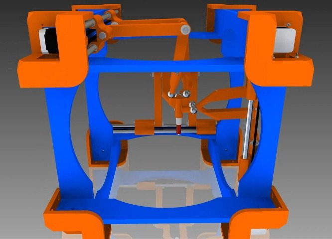</a> Version: Extreme Photo: <a href="https://www.youtube.com/@NicholasSeward">Nicholas J Seward</a></td><td align="center" width="33%"><a href="5-sextupteron.jpg">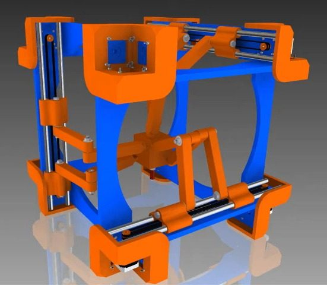</a> Photo: <a href="https://www.youtube.com/@NicholasSeward">Nicholas J Seward</a></td></tr>
<tr><td align="center" width="33%"><a href="6-sextupteron.jpg">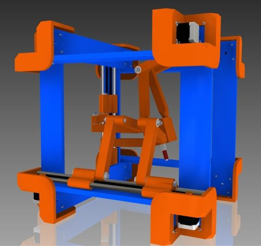</a> Photo: <a href="https://www.youtube.com/@NicholasSeward">Nicholas J Seward</a></td><td align="center" width="33%"><a href="7-sextupteron.jpg">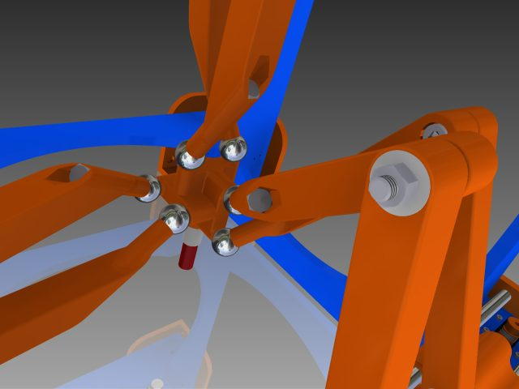</a> Photo: <a href="https://www.youtube.com/@NicholasSeward">Nicholas J Seward</a></td><td align="center" width="33%"><a href="8-sextupteron.jpg">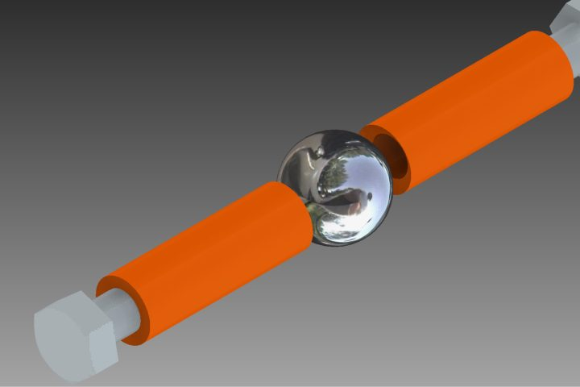</a> Photo: <a href="https://www.youtube.com/@NicholasSeward">Nicholas J Seward</a></td></tr>
<tr><td align="center" width="33%"><a href="9-sextupteron.jpg">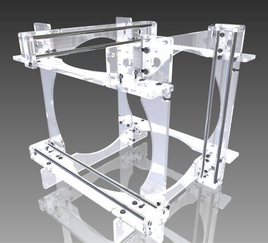</a> Version: Laser-cut Photo: <a href="https://www.youtube.com/@NicholasSeward">Nicholas J Seward</a></td><td align="center" width="33%"><a href="10-sextupteron.jpg">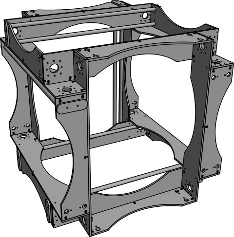</a> Version: Laser-cut Photo: <a href="https://www.youtube.com/@NicholasSeward">Nicholas J Seward</a></td><td align="center" width="33%"><a href="11-sextupteron.jpg">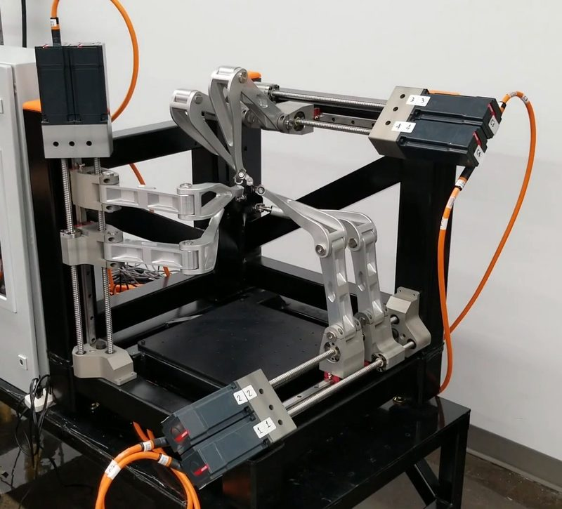</a> Version: Hexapteron, ÉTS prototype Photo: <a href="https://www.youtube.com/@CoRoETS">CoRoETS</a></td></tr>
<tr><td align="center" width="33%"><a href="12-sextupteron.jpg">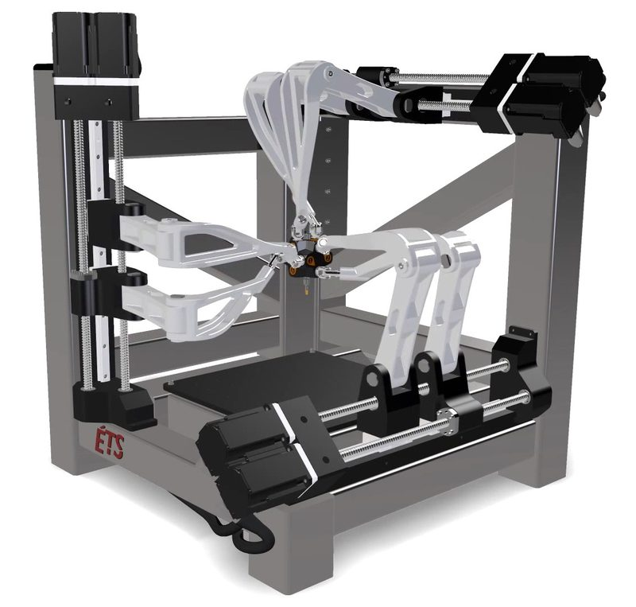</a> Version: Hexapteron, ÉTS prototype Photo: <a href="https://www.youtube.com/@CoRoETS">CoRoETS</a></td><td align="center" width="33%"><a href="13-sextupteron.jpg">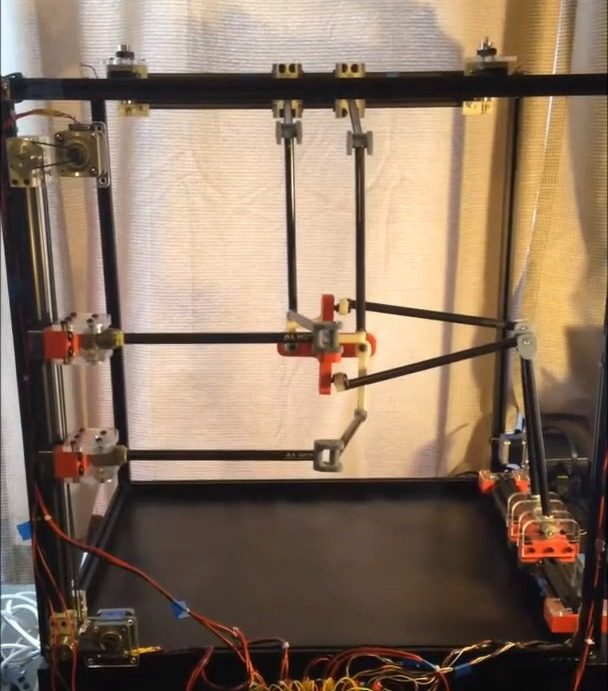</a> Version: Hexapteron, home build Photo: <a href="https://www.youtube.com/@Prometheus27111992">Prometheus27111992</a></td></tr>
</table>
