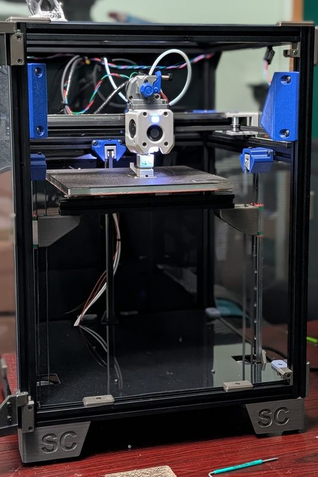
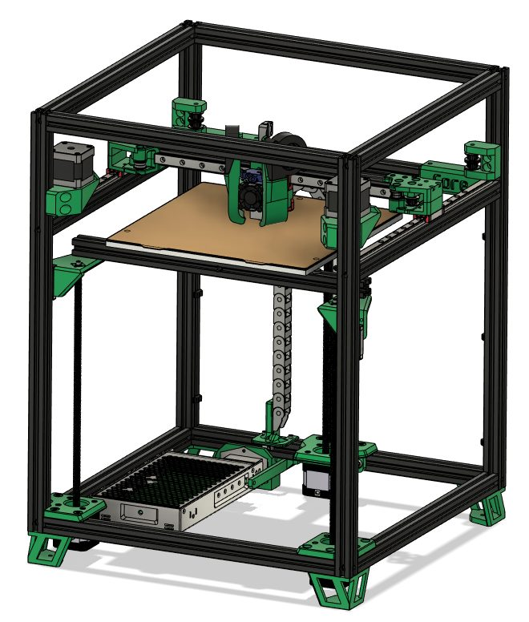
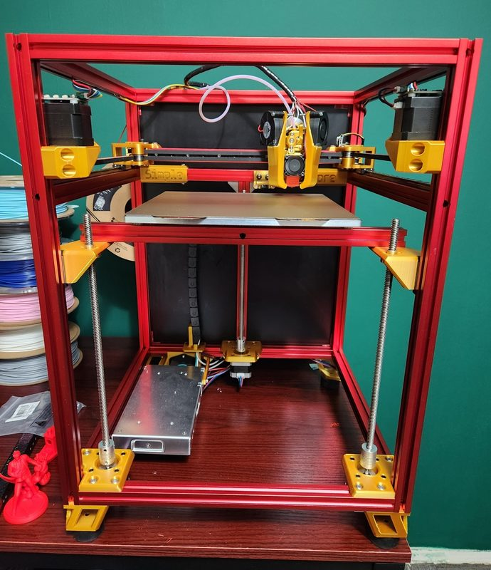
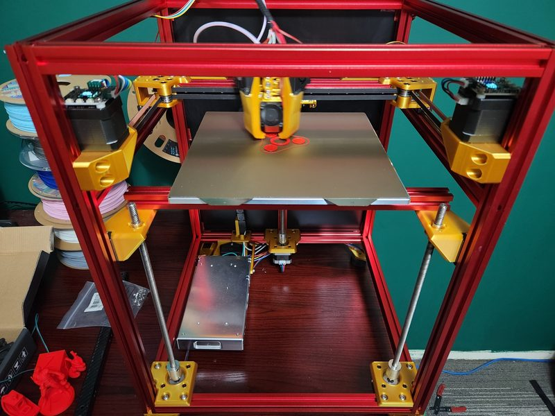

# SimpleCore

[Catalog row](../../README.md#simplecore) · [Gallery](../../GALLERY.md)

| Field | Value |
| --- | --- |
| Section | CoreXY · Medium (181–299 mm representative X/Y size) |
| Project page | [https://www.printables.com/model/1473500-simplecore](https://www.printables.com/model/1473500-simplecore) |
| Author | Rolohaun |
| About | Budget-friendly CoreXY with triple-Z bed and an expandable frame. |
| Build volume (X×Y×Z) | 215×220×220 |
| Exterior (W×D×H) | — |
| Latest version | Update [2026-06](https://www.printables.com/model/1473500-simplecore) |
| Stars Likes Views | [🧡⁠298](https://www.printables.com/model/1473500-simplecore) [⏯️⁠89.7K](https://www.youtube.com/watch?v=HWfT2JbMOvM) [❤️⁠1.8K](https://www.youtube.com/watch?v=HWfT2JbMOvM) |
| Links | [Files](https://www.printables.com/model/1473500-simplecore/files) [STEP](https://github.com/rolohaun/SimpleCore/blob/HEAD/CAD/SimpleCore%20MK1.step) |
| Groups | [Discord](https://discord.gg/rolohaun-3d-946191040682008666) EN 7.8K |
| License | [CC BY-NC-SA 4.0](https://www.printables.com/model/1473500-simplecore) |

## Pictures (5)

<table>
<tr><td align="center" width="33%"> Photo: <a href="https://www.printables.com/@Rolohaun">Rolohaun Design</a></td><td align="center" width="33%"> Photo: <a href="https://www.printables.com/@Rolohaun">Rolohaun Design</a></td><td align="center" width="33%"> Photo: <a href="https://github.com/rolohaun">Rolohaun</a></td></tr>
<tr><td align="center" width="33%"> Photo: <a href="https://github.com/rolohaun">Rolohaun</a></td><td align="center" width="33%"> Photo: <a href="https://github.com/rolohaun">Rolohaun</a></td></tr>
</table>
