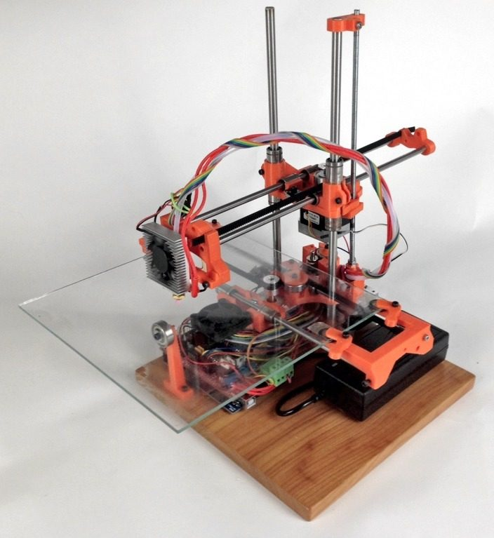
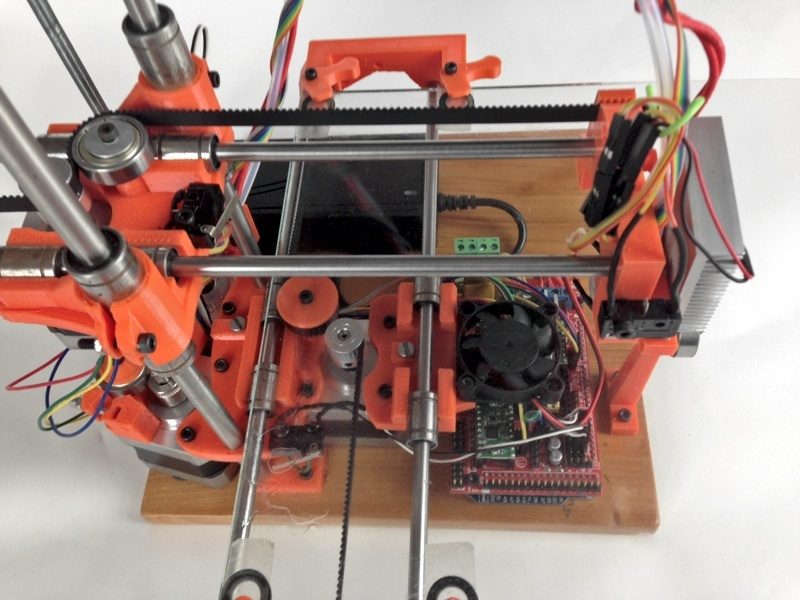
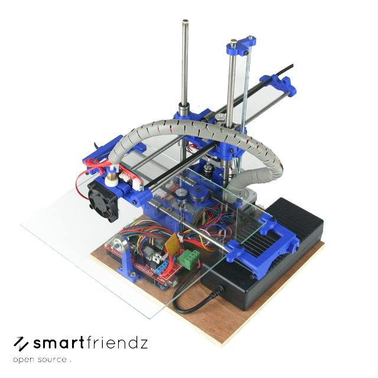
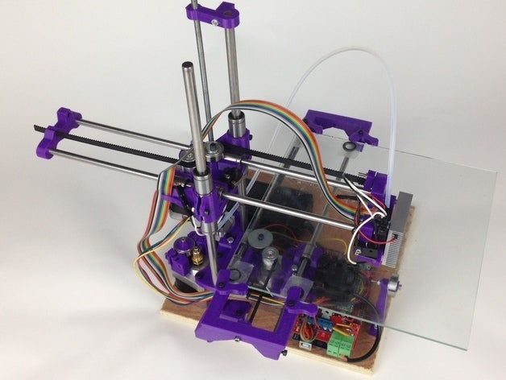
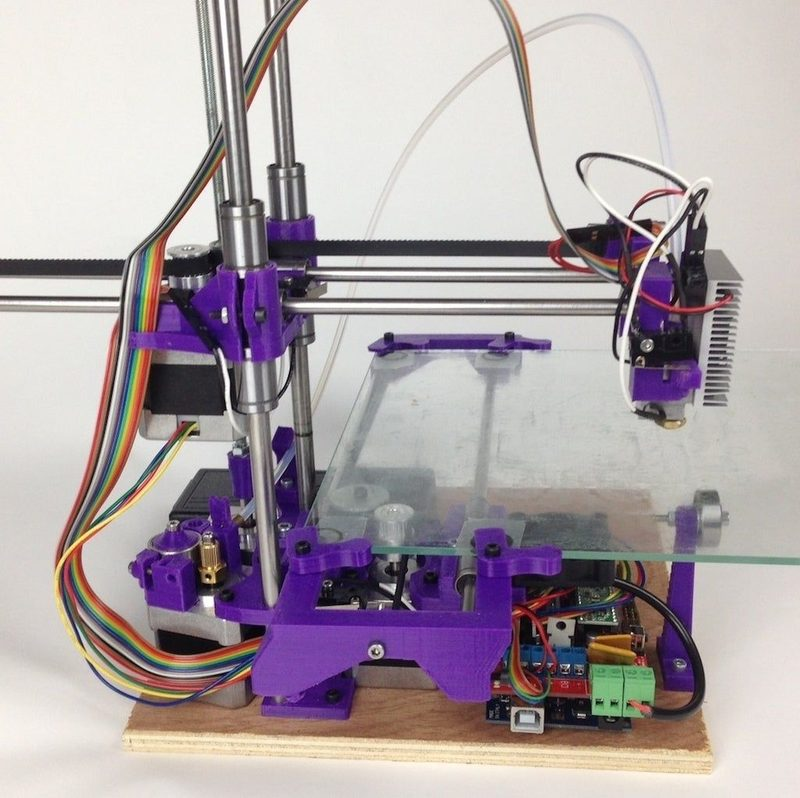
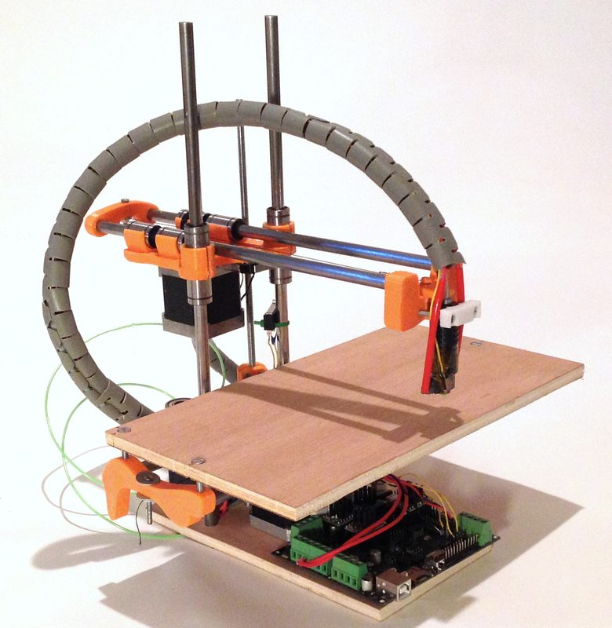
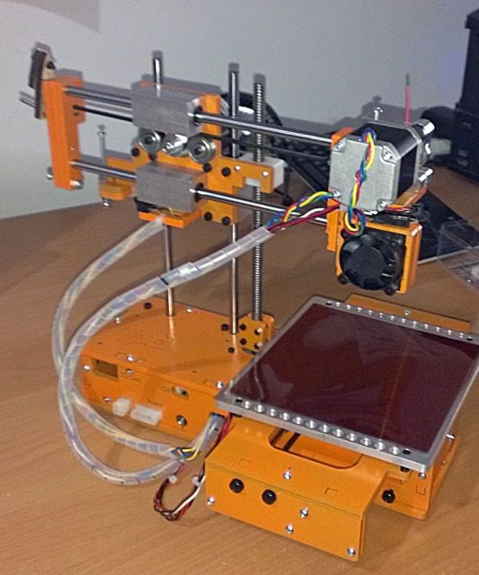

# Smartrap

[Catalog row](../../README.md#smartrap) · [Gallery](../../GALLERY.md)

| Field | Value |
| --- | --- |
| Section | Historical designs |
| Project page | [https://reprap.org/wiki/Smartrap_mini](https://reprap.org/wiki/Smartrap_mini) |
| Author | Smartfriendz |
| About | Compact, low-part-count Cartesian RepRap design with a large following. |
| Build volume (X×Y×Z) | 250×250×200 |
| Exterior (W×D×H) | — |
| Latest version | CAD [2015-07](https://github.com/smartfriendz/smartrap/commit/5ff51f4ab0f82a5eb2dacf58f4ec6b549e961622) |
| Stars Likes Views | [💙⁠2.4K](https://www.thingiverse.com/thing:177256) |
| Links | — |
| Groups | [Forum](https://reprap.org/forum/list.php?344) EN [Facebook](https://www.facebook.com/groups/Smartrap/) EN 64 |
| License | [GPL-2.0](https://github.com/smartfriendz/smartrap/blob/master/LICENSE) |

## Pictures (7)

<table>
<tr><td align="center" width="33%"> Photo: <a href="https://reprap.org/wiki/User:Smartfriendz">Smartfriendz</a></td><td align="center" width="33%"> Photo: <a href="https://www.thingiverse.com/smartfriendz">Smartfriendz</a></td><td align="center" width="33%"> Photo: <a href="https://www.thingiverse.com/smartfriendz">Smartfriendz</a></td></tr>
<tr><td align="center" width="33%"> Photo: <a href="https://www.thingiverse.com/w6design">W6Design</a></td><td align="center" width="33%"> Photo: <a href="https://www.thingiverse.com/w6design">W6Design</a></td><td align="center" width="33%"> Photo: <a href="https://reprap.org/wiki/User:Smartfriendz">Smartfriendz</a></td></tr>
<tr><td align="center" width="33%"> Photo: <a href="https://3ddunia.weebly.com/">3D Dunia</a></td></tr>
</table>

## Other homes of the files

- Wayback Machine: [latest snapshot](https://web.archive.org/web/20260602102944/https://reprap.org/wiki/Smartrap_mini), 2026-06-02.
