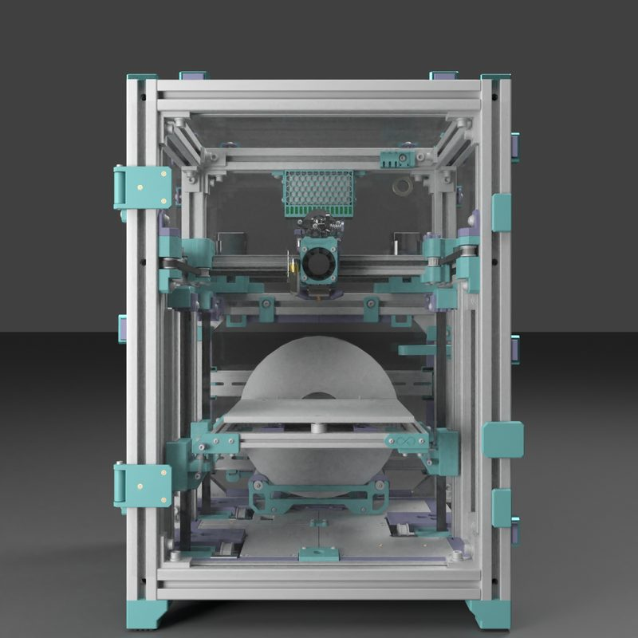
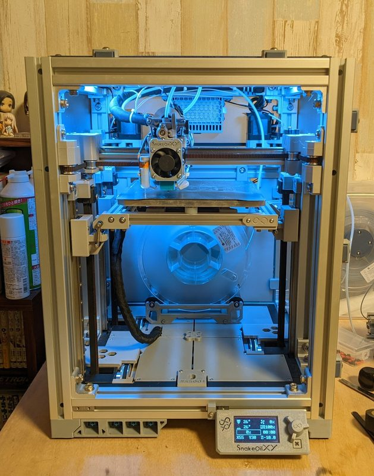
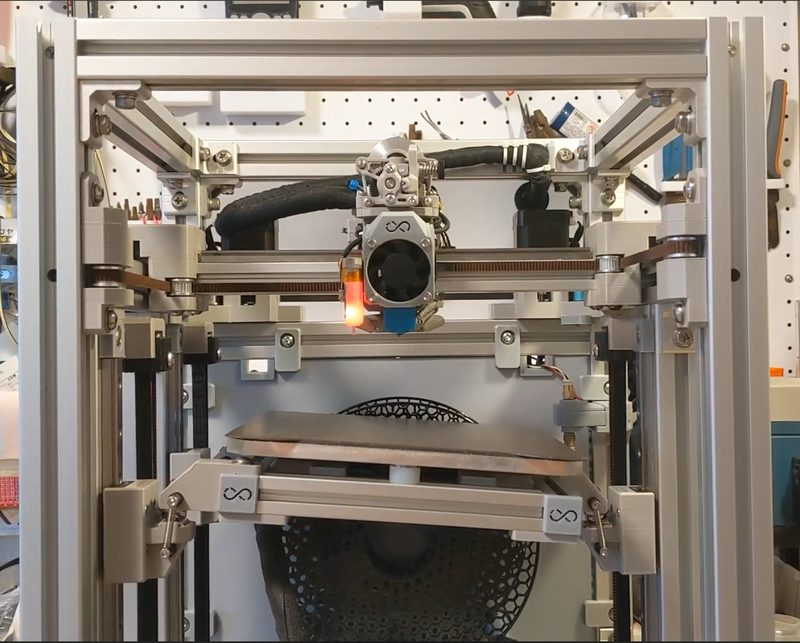
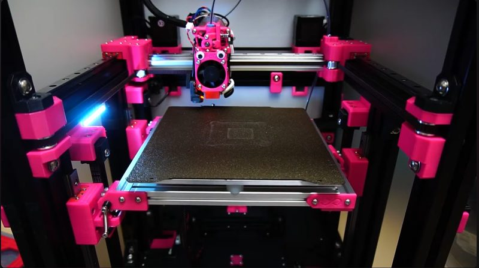

# SnakeOil XY

[Catalog row](../../README.md#snakeoil-xy) · [Gallery](../../GALLERY.md)

| Field | Value |
| --- | --- |
| Section | CoreXY · Medium (181–299 mm representative X/Y size) |
| Project page | [https://github.com/SnakeOilXY/SnakeOil-XY](https://github.com/SnakeOilXY/SnakeOil-XY) |
| Author | SnakeOilXY |
| About | Configurable CoreXY with standard, IDEX, and four-motor options; its latest documented release is Beta 3. |
| Build volume (X×Y×Z) | 180: 180×180×180 250: 250×240×230 |
| Exterior (W×D×H) | 180: 400×390×520 250: 490×450×570 |
| Latest version | Beta 3 [2023-01](https://github.com/SnakeOilXY/SnakeOil-XY#beta-3-release-2023-01-28) |
| Stars Likes Views |  [🧡⁠119](https://www.printables.com/model/115487-snakeoilxy-3d-printer-design) [⏯️⁠44K](https://www.youtube.com/watch?v=pQPhEykthEg) [❤️⁠420](https://www.youtube.com/watch?v=pQPhEykthEg) |
| Links | [CAD](https://github.com/SnakeOilXY/SnakeOil-XY/tree/master/CAD) [Manual](https://github.com/SnakeOilXY/SnakeOil-XY/tree/master/Doc) |
| Groups | [Discord](https://discord.gg/WZVP2HuAag) EN 1.3K |
| License | [GPL-3.0](https://github.com/SnakeOilXY/SnakeOil-XY/blob/master/LICENSE) |

## Pictures (5)

<table>
<tr><td align="center" width="33%"> Photo: <a href="https://github.com/ChipCE">Chip</a></td><td align="center" width="33%"> Photo: <a href="https://github.com/ChipCE">Chip</a></td><td align="center" width="33%"> Photo: <a href="https://www.printables.com/@Chip">Chip</a></td></tr>
<tr><td align="center" width="33%"> Photo: <a href="https://github.com/ChipCE">Chip</a></td><td align="center" width="33%"></td></tr>
</table>
