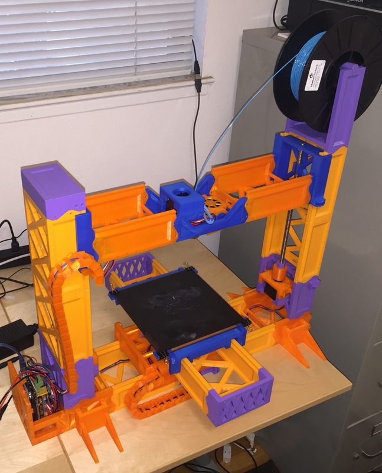
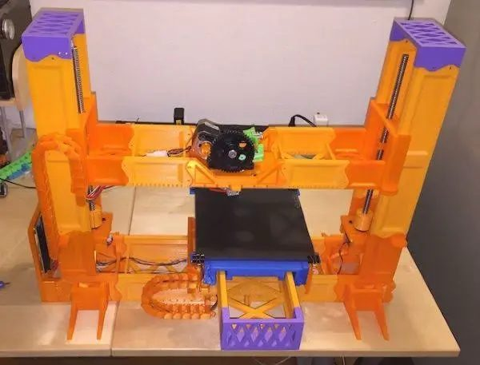
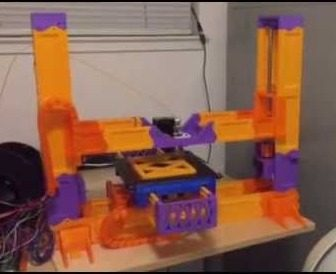
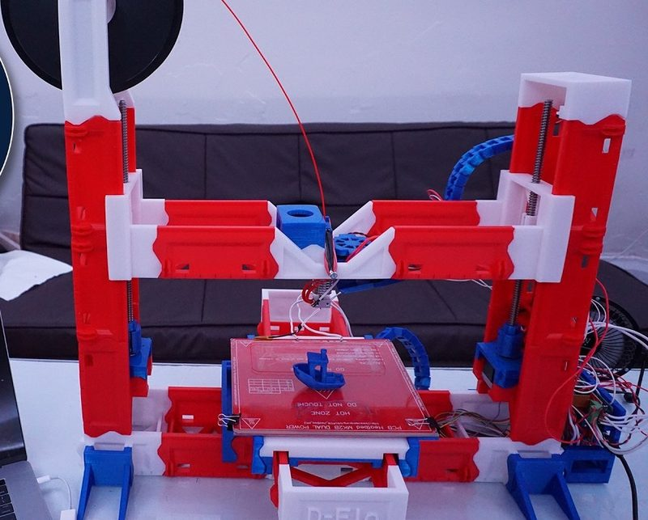

# Snappy

[Catalog row](../../README.md#snappy) · [Gallery](../../GALLERY.md)

| Field | Value |
| --- | --- |
| Section | Historical designs |
| Project page | [https://github.com/revarbat/snappy-reprap](https://github.com/revarbat/snappy-reprap) |
| Author | revarbat |
| About | Mostly printed, snap-together Cartesian RepRap. One of the first printers made almost entirely of printed parts. |
| Build volume (X×Y×Z) | 198×198×220 |
| Exterior (W×D×H) | — |
| Latest version | v3.0.3 [2018-02](https://github.com/revarbat/snappy-reprap/releases/tag/snappy_3.0.3) |
| Stars Likes Views |  [💙⁠1.1K](https://www.thingiverse.com/thing:1828359) [⏯️⁠54.6K](https://www.youtube.com/watch?v=3KJbrb0P8jQ) [❤️⁠172](https://www.youtube.com/watch?v=3KJbrb0P8jQ) |
| Links | [Manual](https://github.com/revarbat/snappy-reprap/tree/HEAD/docs) |
| Groups | [Forum](https://reprap.org/forum/list.php?151) EN |
| License | [GPL-2.0](https://github.com/revarbat/snappy-reprap/blob/master/LICENSE) |

## Pictures (5)

<table>
<tr><td align="center" width="33%"> Photo: <a href="https://github.com/revarbat">Revar Desmera</a></td><td align="center" width="33%"> Photo: <a href="https://github.com/revarbat">Revar Desmera</a></td><td align="center" width="33%"> Photo: <a href="https://github.com/revarbat">Revar Desmera</a></td></tr>
<tr><td align="center" width="33%"> Photo: <a href="https://www.youtube.com/@RevarDesmera">Revar Desmera</a></td><td align="center" width="33%"> Photo: <a href="https://www.youtube.com/@DrDFlo">Dr. D-Flo</a></td></tr>
</table>

## Mods and variants

- [FrankenSnappy](https://www.thingiverse.com/thing:4571980) by mcsgroi: scales the snap-together frame to about 12×12×12 in, with new motor holders and a Titan extruder mount. CC BY-NC 4.0.

## Other homes of the files

- [Thingiverse, v3.0](https://www.thingiverse.com/thing:2780361): 41 files. The page points to GitHub for the OpenSCAD source. GPL-2.0.
- [Thingiverse, earlier version](https://www.thingiverse.com/thing:1828359): 27 files. GPL-2.0.
- [RepRap wiki](https://reprap.org/wiki/Snappy): overview and build notes.
- Wayback Machine: [latest snapshot](https://web.archive.org/web/20260314014744/https://github.com/revarbat/snappy-reprap), 2026-03-14.
