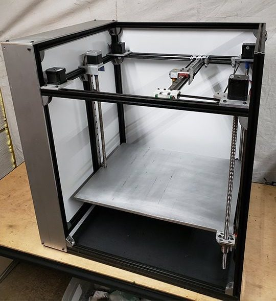
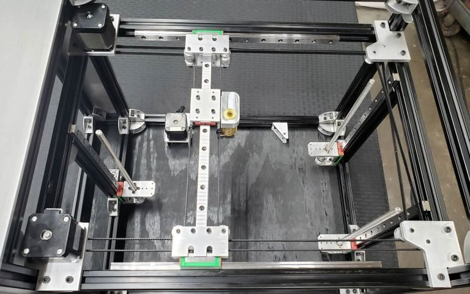
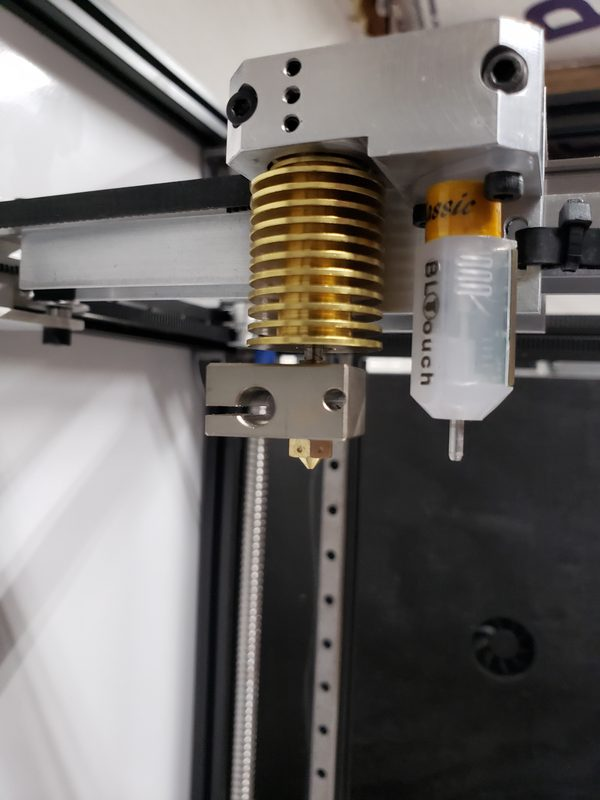
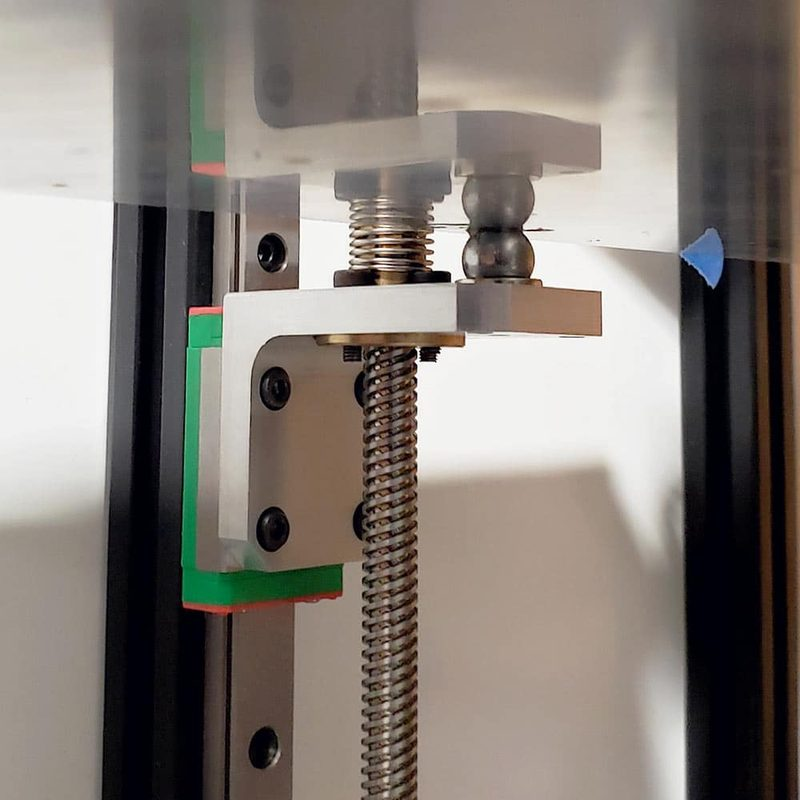
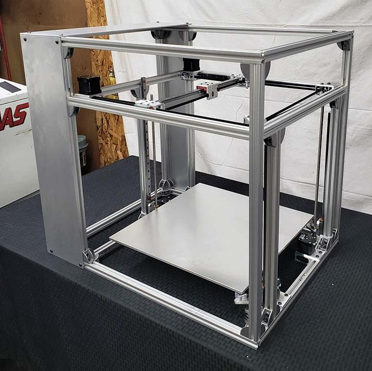
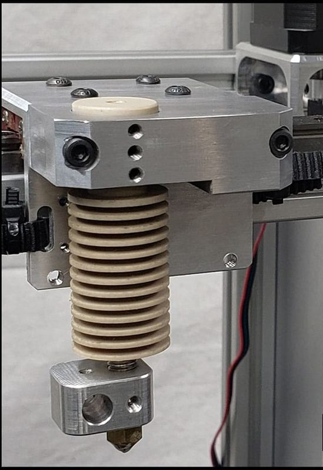
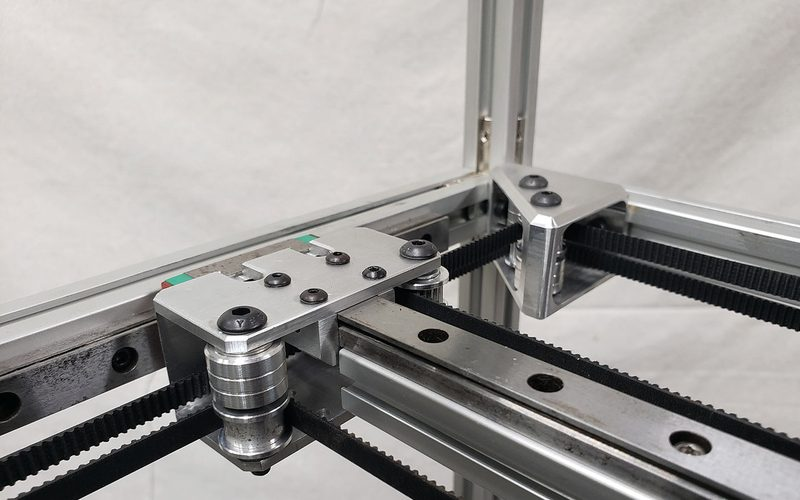
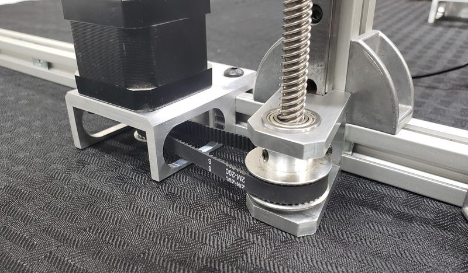
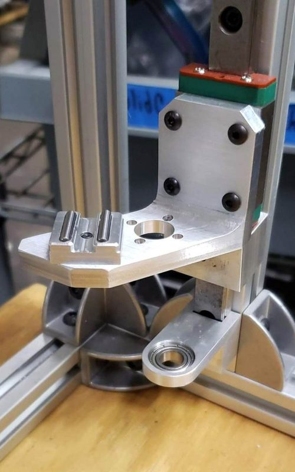

# SolidCore CoreXY

[Catalog row](../../README.md#solidcore) · [Gallery](../../GALLERY.md)

| Field | Value |
| --- | --- |
| Section | Legacy designs |
| Project page | [https://www.printables.com/model/221066-solidcore-corexy-3d-printer](https://www.printables.com/model/221066-solidcore-corexy-3d-printer) |
| Author | 3D Distributed |
| About | All-metal CoreXY with machined aluminium motion parts, linear rails on all axes, and triple Z with a kinematic bed. The frame scales to other sizes. No update since 2022-06. |
| Build volume (X×Y×Z) | 350×350×350 |
| Exterior (W×D×H) | — |
| Latest version | Files [2022-06](https://www.printables.com/model/221066-solidcore-corexy-3d-printer/files) |
| Stars Likes Views | [💙⁠258](https://www.thingiverse.com/thing:4307266) [🧡⁠54](https://www.printables.com/model/221066-solidcore-corexy-3d-printer) [⏯️⁠54K](https://www.youtube.com/watch?v=5171_TXW7M8) [❤️⁠535](https://www.youtube.com/watch?v=5171_TXW7M8) |
| Links | [STEP](https://www.printables.com/model/221066-solidcore-corexy-3d-printer/files) [Files](https://drive.google.com/drive/folders/1HQyc4OiMpGds7vOD8sf6P66I1bQqIA30) [BOM](https://docs.google.com/spreadsheets/d/1cHOBTe28XIPyURp-YsmSwgqEVQjoajGRWozn8MxH7-4/edit) |
| Groups | [Facebook](https://www.facebook.com/groups/solidcore3dprinter/) EN [Discord](https://discord.gg/jF6c6GG4qz) EN 99 |

## Pictures (10)

<table>
<tr><td align="center" width="33%"> Photo: <a href="https://hackaday.io/hacker/159019-shane-hooper">Shane Hooper</a></td><td align="center" width="33%"> Photo: <a href="https://hackaday.io/hacker/159019-shane-hooper">Shane Hooper</a></td><td align="center" width="33%"> Photo: <a href="https://hackaday.io/hacker/159019-shane-hooper">Shane Hooper</a></td></tr>
<tr><td align="center" width="33%"> Photo: <a href="https://hackaday.io/hacker/159019-shane-hooper">Shane Hooper</a></td><td align="center" width="33%"> Photo: <a href="https://hackaday.io/hacker/159019-shane-hooper">Shane Hooper</a></td><td align="center" width="33%"> Photo: <a href="https://www.printables.com/@ShaneHooper_124474">Shane Hooper</a></td></tr>
<tr><td align="center" width="33%"> Photo: <a href="https://hackaday.io/hacker/159019-shane-hooper">Shane Hooper</a></td><td align="center" width="33%"> Photo: <a href="https://hackaday.io/hacker/159019-shane-hooper">Shane Hooper</a></td><td align="center" width="33%"> Photo: <a href="https://www.printables.com/@ShaneHooper_124474">Shane Hooper</a></td></tr>
<tr><td align="center" width="33%"> Photo: <a href="https://hackaday.io/hacker/159019-shane-hooper">Shane Hooper</a></td></tr>
</table>
