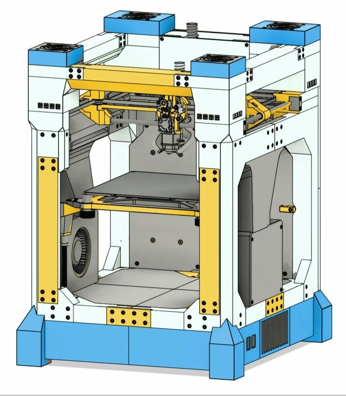
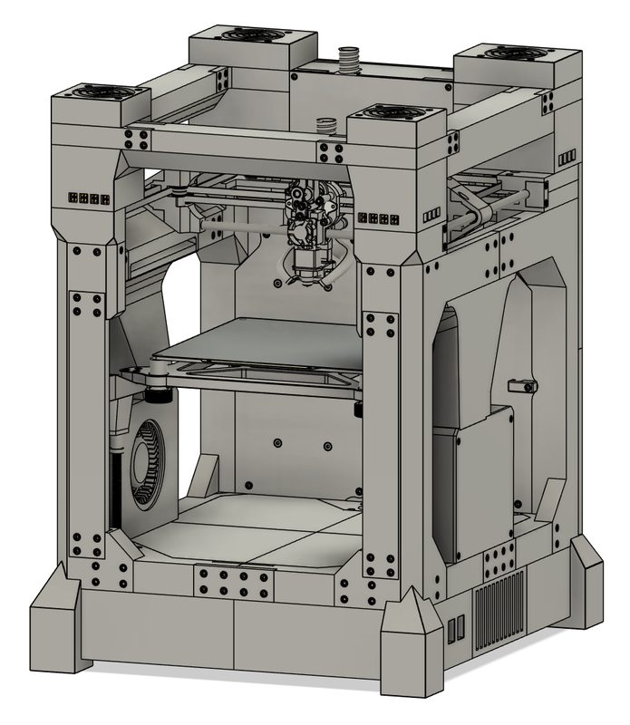
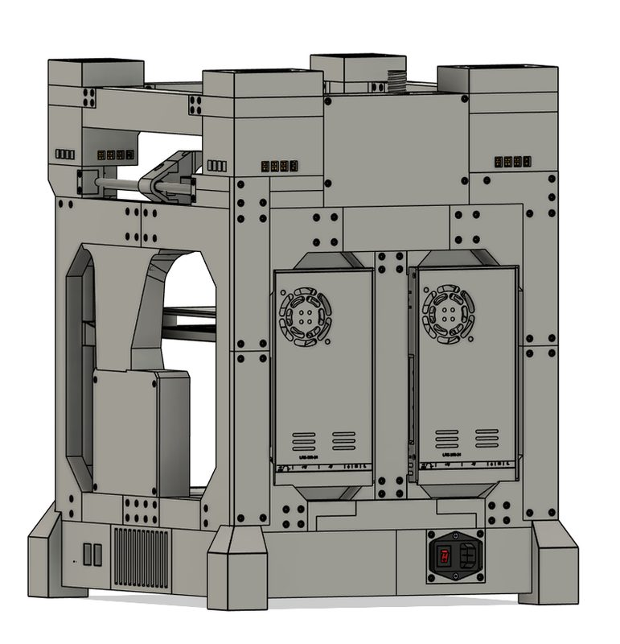
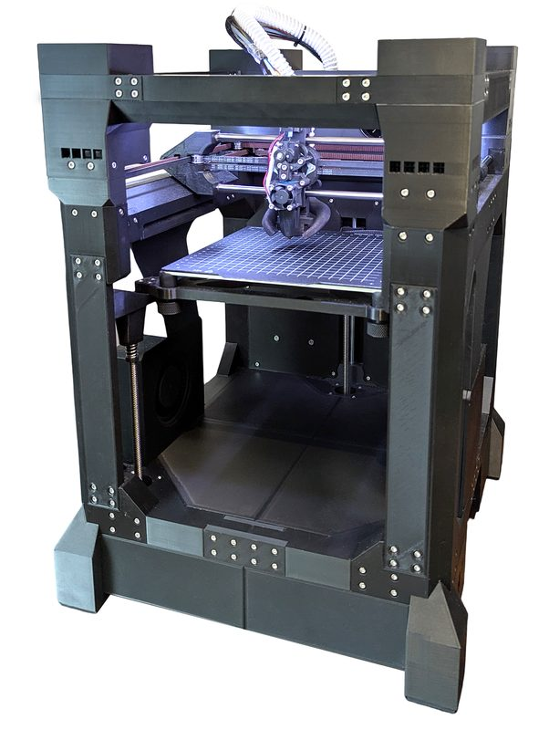
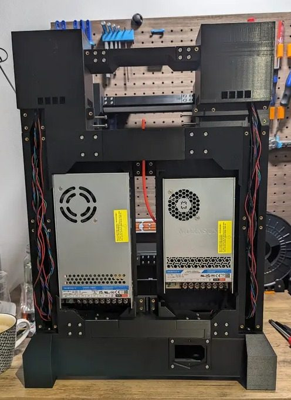
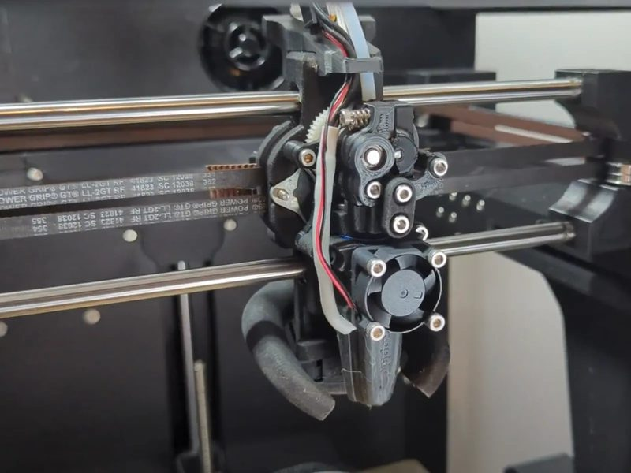

# T250

[Catalog row](../../README.md#t250) · [Gallery](../../GALLERY.md)

| Field | Value |
| --- | --- |
| Section | CoreXY · Medium (181–299 mm representative X/Y size) |
| Project page | [https://github.com/mszturc/T250](https://github.com/mszturc/T250) |
| Author | Matt the Printing Nerd |
| About | Larger high-speed successor to THE100. |
| Build volume (X×Y×Z) | 192×212×175 |
| Exterior (W×D×H) | — |
| Latest version | v1.0 [2025-06](https://github.com/mszturc/T250/commit/a4122fcc8357f2c880618e81e76a03eee02da1f5) |
| Stars Likes Views |  [🧡⁠851](https://www.printables.com/model/1341051-t250-the-worlds-fastest-3d-printer) [⏯️⁠169K](https://www.youtube.com/watch?v=qVF_iwO3d04) [❤️⁠6K](https://www.youtube.com/watch?v=qVF_iwO3d04) |
| Links | [STEP](https://github.com/mszturc/T250/blob/HEAD/CAD/T250-v1.0-final.step) [Manual](https://github.com/mszturc/T250/tree/HEAD/Docs) |
| Groups | [Discord](https://discord.gg/fW7BcUErgZ) EN 4.4K [Facebook](https://www.facebook.com/groups/181335024786568) EN 456 |

## Pictures (6)

<table>
<tr><td align="center" width="33%"></td><td align="center" width="33%"></td><td align="center" width="33%"></td></tr>
<tr><td align="center" width="33%"></td><td align="center" width="33%"></td><td align="center" width="33%"></td></tr>
</table>
