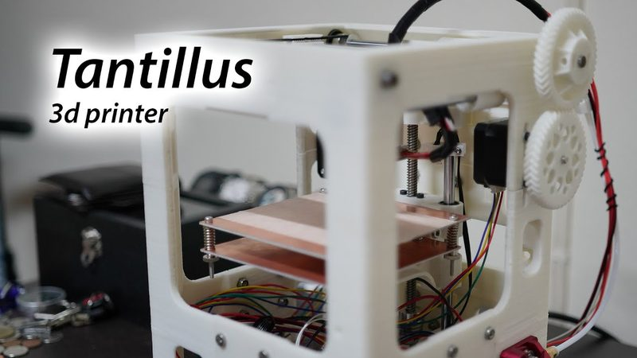
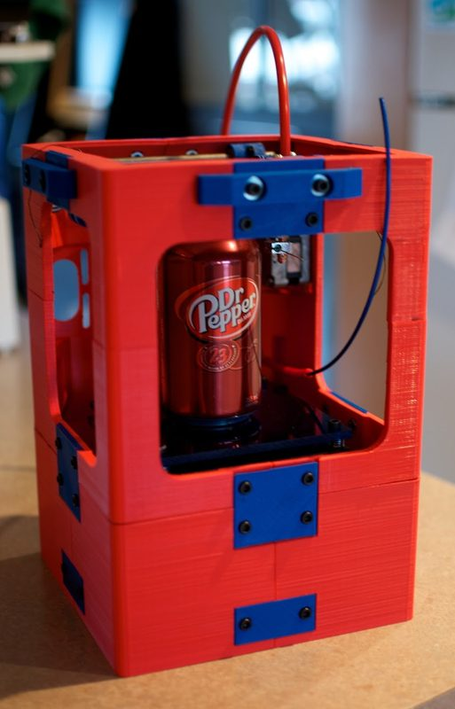
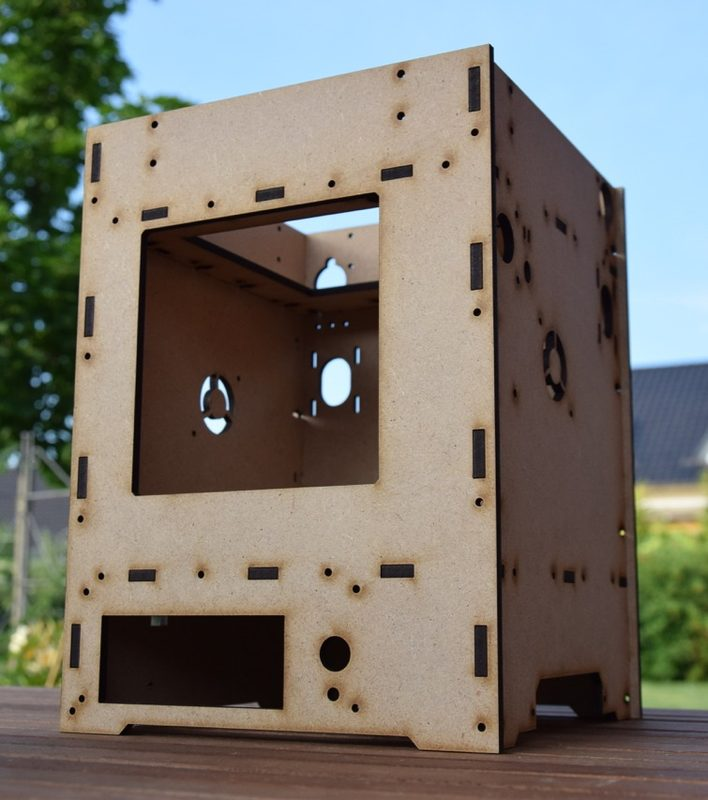

# Tantillus R

[Catalog row](../../README.md#tantillus-r) · [Gallery](../../GALLERY.md)

| Field | Value |
| --- | --- |
| Section | Legacy designs |
| Project page | [https://github.com/toolson/Tantillus_R](https://github.com/toolson/Tantillus_R) |
| Author | Toolson and Protoprinter |
| About | A 2018 rebuild of the Tantillus with a heated bed and fishing-line drives. No update since 2019. |
| Build volume (X×Y×Z) | 100×100×100 |
| Exterior (W×D×H) | 220×220×300 |
| Latest version | CAD [2019-01](https://github.com/toolson/Tantillus_R/commit/66ac49aca91cd4d73db92f3ad83a7b9df1d87bf3) |
| Stars Likes Views |  |
| Links | [Files](https://github.com/toolson/Tantillus_R) [Wiki](https://reprap.org/wiki/Tantillus_R) |
| Groups | — |

## Pictures (4)

<table>
<tr><td align="center" width="33%"></td><td align="center" width="33%"></td><td align="center" width="33%"></td></tr>
<tr><td align="center" width="33%"></td></tr>
</table>
