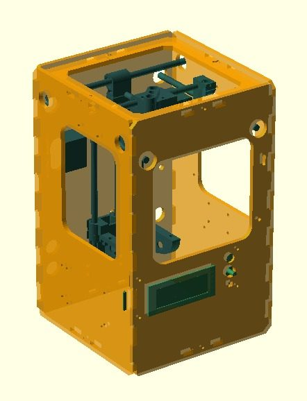
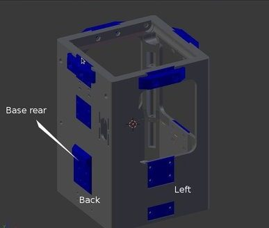
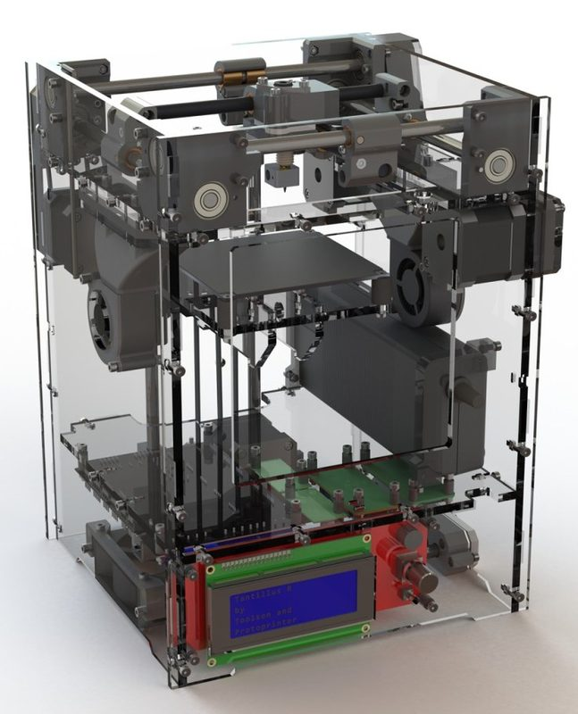
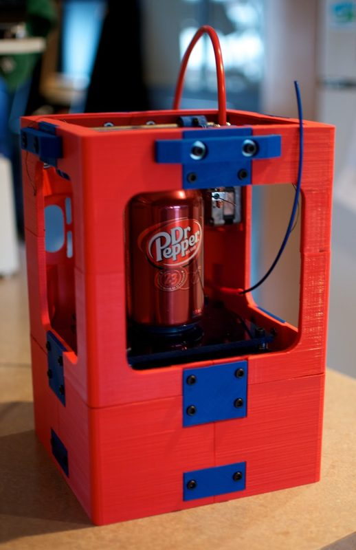
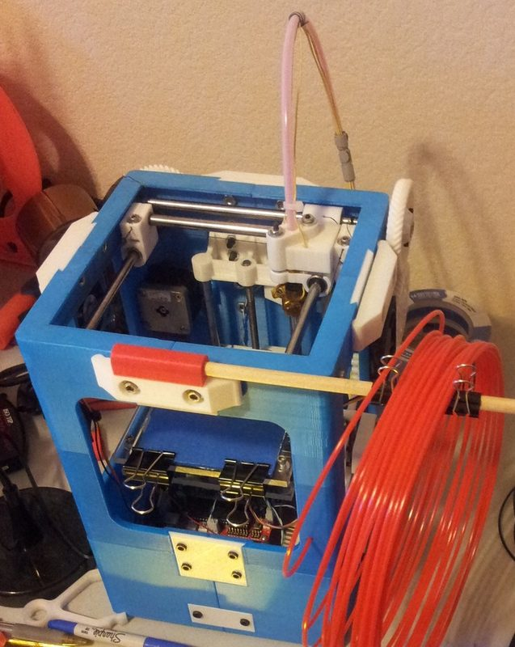

# Tantillus

[Catalog row](../../README.md#tantillus) · [Gallery](../../GALLERY.md)

| Field | Value |
| --- | --- |
| Section | Historical designs |
| Project page | [https://github.com/Intrinsically-Sublime/Tantillus](https://github.com/Intrinsically-Sublime/Tantillus) |
| Author | Sublime |
| About | Small, portable printer with fishing-line drives and printed or laser-cut enclosure options. It inspired the Tantillus R. |
| Build volume (X×Y×Z) | 100×100×100 |
| Exterior (W×D×H) | printed: 225×225×300 laser-cut: 240×240×300 |
| Latest version | CAD [2013-07](https://github.com/Intrinsically-Sublime/Tantillus/commit/64c1c6ecd790764a1e828ce54a4ee6f9e18b8753) |
| Stars Likes Views |  [⏯️⁠6.2K](https://www.youtube.com/watch?v=F6E36g0zuRg) |
| Links | [Files](https://github.com/Intrinsically-Sublime/Tantillus) [Wiki](https://reprap.org/wiki/Tantillus) |
| Groups | [Forum](https://reprap.org/forum/list.php?279) EN inactive |
| License | [GPL-3.0](https://github.com/Intrinsically-Sublime/Tantillus/blob/master/GPLv3.txt) |

## Pictures (6)

<table>
<tr><td align="center" width="33%"> Photo: <a href="https://reprap.org/wiki/User:Leonal">Leonal</a></td><td align="center" width="33%"> Photo: <a href="https://reprap.org/forum/profile.php?1,9813">Sublime</a></td><td align="center" width="33%"> Photo: <a href="http://scheuten.me/">toolson</a></td></tr>
<tr><td align="center" width="33%"> Photo: <a href="https://geometricobjectdepositiontool.blogspot.com/">Sublime</a></td><td align="center" width="33%"> Photo: <a href="https://www.printables.com/@al177">al177</a></td><td align="center" width="33%"> Photo: <a href="https://www.youtube.com/@aidilj">aidil jazmi</a></td></tr>
</table>
