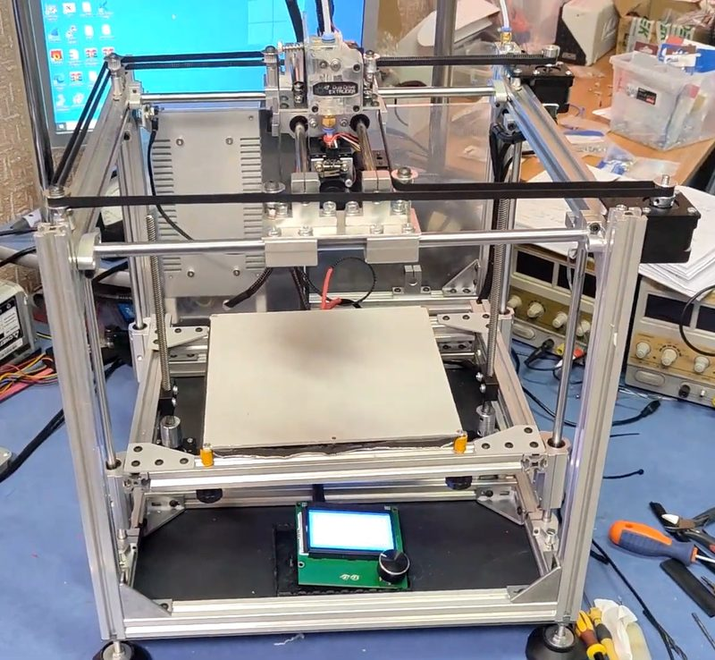
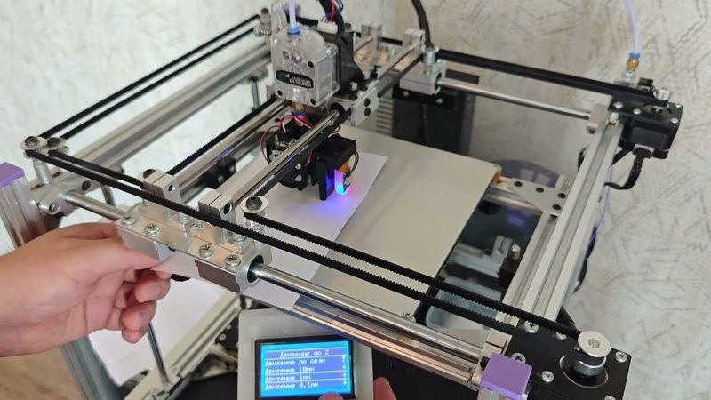

# TeLa

[Catalog row](../../README.md#tela-corexy) · [Gallery](../../GALLERY.md)

| Field | Value |
| --- | --- |
| Section | CoreXY · Medium (181–299 mm representative X/Y size) |
| Project page | [https://www.youtube.com/playlist?list=PLRrkC8b4XLig8odCiBDuxA58ZgszBqeMb](https://www.youtube.com/playlist?list=PLRrkC8b4XLig8odCiBDuxA58ZgszBqeMb) |
| Author | Техно Лаборатория |
| About | "3D printer without a 3D printer": a Russian-language CoreXY tutorial series with an English audio track available; assembled from stock parts and metal blanks with simple tools, without preprinted parts. |
| Build volume (X×Y×Z) | — |
| Exterior (W×D×H) | — |
| Latest version | Part 3.2 [2025-08](https://www.youtube.com/watch?v=yq7GaFnIq_o) |
| Stars Likes Views | [⏯️⁠53.5K](https://www.youtube.com/watch?v=g6D4_WkEhJ4) [❤️⁠1.8K](https://www.youtube.com/watch?v=g6D4_WkEhJ4) |
| Links | [CAD](https://www.tinkercad.com/things/5MnFstEdMgc-3d-printer-corexy-tela-part-two) [BOM](https://docs.google.com/spreadsheets/d/10DQ8teJVQdOapGwjsQAr7z3AT7WktHvg3ojpcD-1PAI/edit) [Video](https://www.youtube.com/playlist?list=PLRrkC8b4XLig8odCiBDuxA58ZgszBqeMb) |
| Groups | — |
| License | [CC BY-NC 3.0](https://www.tinkercad.com/things/5MnFstEdMgc-3d-printer-corexy-tela-part-two) |

## Pictures (3)

<table>
<tr><td align="center" width="33%"> Photo: <a href="https://www.youtube.com/@AliakseiSolovyov">Техно Лаборатория (Aliaksei Solovyov)</a></td><td align="center" width="33%"> Photo: <a href="https://www.youtube.com/@AliakseiSolovyov">Техно Лаборатория (Aliaksei Solovyov)</a></td><td align="center" width="33%"> Photo: <a href="https://www.youtube.com/@AliakseiSolovyov">Техно Лаборатория (Aliaksei Solovyov)</a></td></tr>
</table>

## Other homes of the files

- Wayback Machine: [latest snapshot](https://web.archive.org/web/20260226064004/https://www.youtube.com/playlist?list=PLRrkC8b4XLig8odCiBDuxA58ZgszBqeMb), 2026-02-26.
