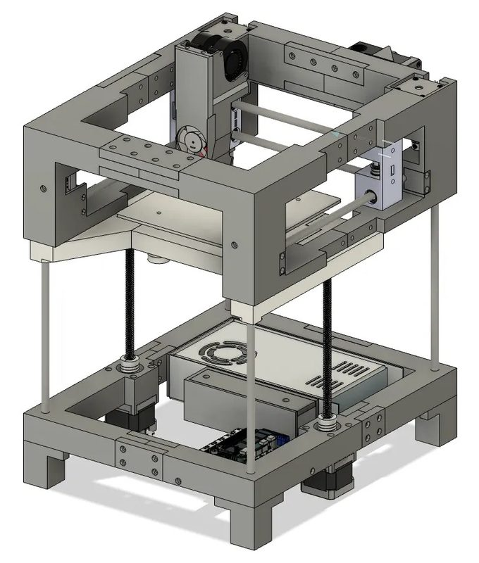
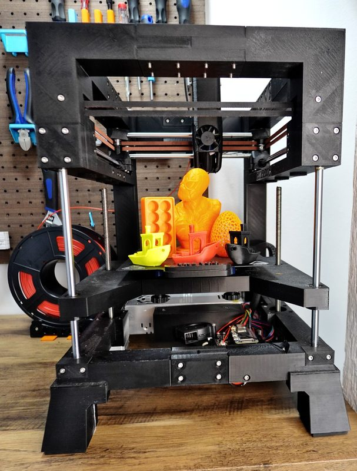
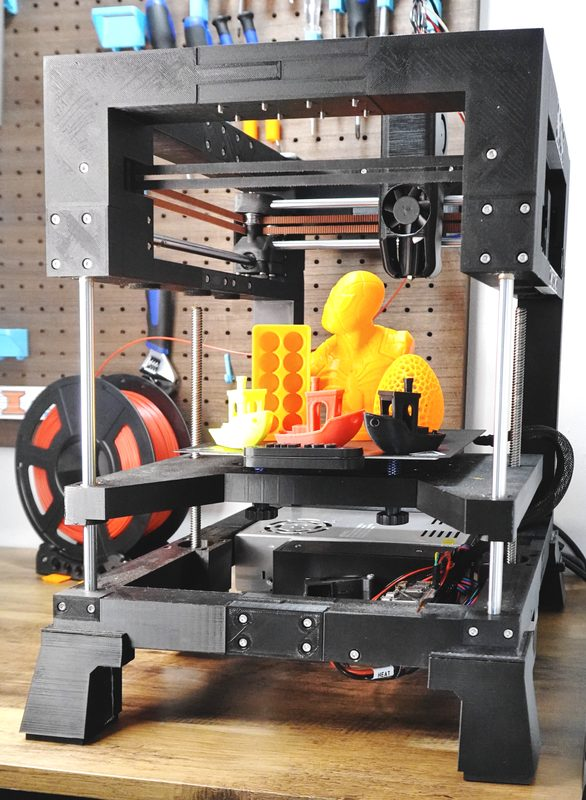
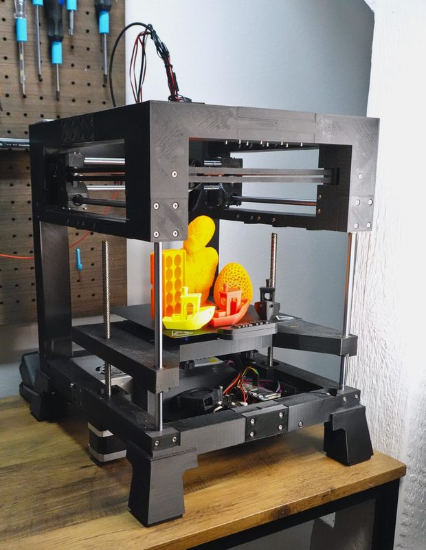
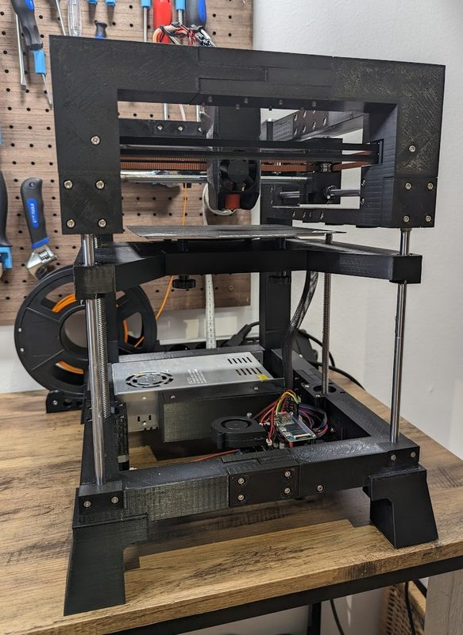
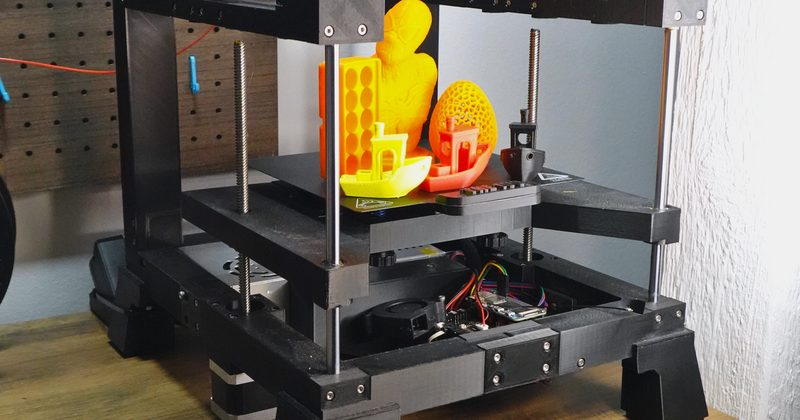

# THE100

[Catalog row](../../README.md#the100) · [Gallery](../../GALLERY.md)

| Field | Value |
| --- | --- |
| Section | CoreXY · Small (≤180 mm representative X/Y size) |
| Project page | [https://github.com/mszturc/THE100](https://github.com/mszturc/THE100) |
| Author | Matt the Printing Nerd |
| About | Fast design with a printed frame. |
| Build volume (X×Y×Z) | 165×165×165 |
| Exterior (W×D×H) | — |
| Latest version | v1.1 [2023-09](https://github.com/mszturc/THE100/commit/b0c2179cfe90322dce2d3ecbb7fae008f41882d8) |
| Stars Likes Views |  [🧡⁠2.1K](https://www.printables.com/model/572689-the-100-the-fastest-3d-printer-based-on-a-printed-) [⏯️⁠255K](https://www.youtube.com/watch?v=0K9NM08S0IA) [❤️⁠6.7K](https://www.youtube.com/watch?v=0K9NM08S0IA) |
| Links | [STEP](https://github.com/mszturc/THE100/blob/HEAD/STEP/The%20100%20v1.1.step) [Manual](https://github.com/mszturc/THE100/tree/HEAD/Docs) |
| Groups | [Discord](https://discord.gg/fW7BcUErgZ) EN 4.4K [Facebook](https://www.facebook.com/groups/181335024786568) EN 456 |

## Pictures (6)

<table>
<tr><td align="center" width="33%"> Photo: <a href="https://www.printables.com/@MattThePrintingNerd">Matt the Printing Nerd</a></td><td align="center" width="33%"> Photo: <a href="https://www.printables.com/@MattThePrintingNerd">Matt the Printing Nerd</a></td><td align="center" width="33%"> Photo: <a href="https://www.printables.com/@MattThePrintingNerd">Matt the Printing Nerd</a></td></tr>
<tr><td align="center" width="33%"> Photo: <a href="https://www.printables.com/@MattThePrintingNerd">Matt the Printing Nerd</a></td><td align="center" width="33%"> Photo: <a href="https://hackaday.io/hacker/1321136">Matt the Printing Nerd</a></td><td align="center" width="33%"> Photo: <a href="https://www.printables.com/@MattThePrintingNerd">Matt the Printing Nerd</a></td></tr>
</table>
