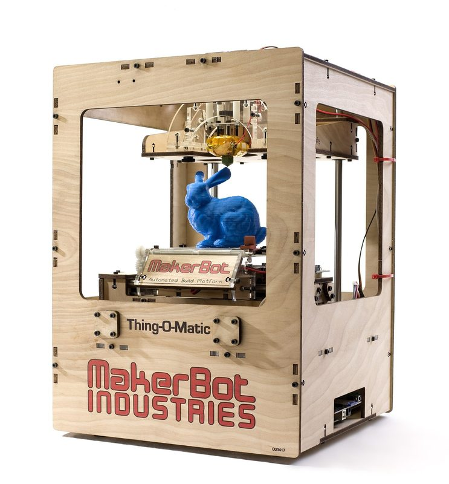
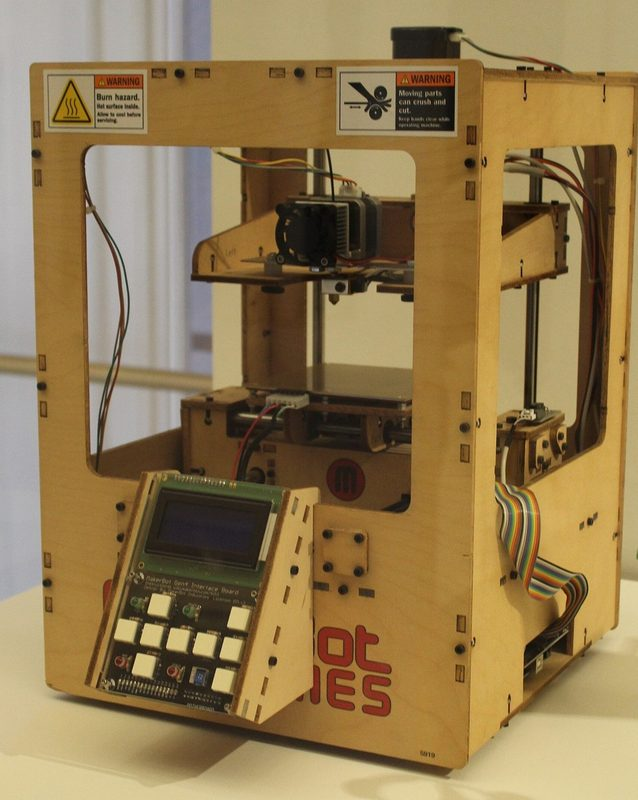
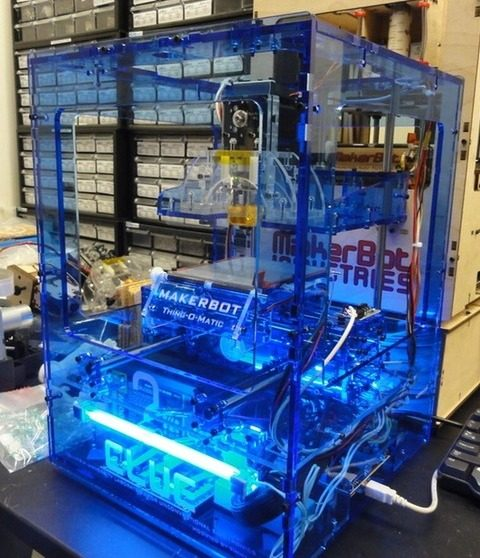
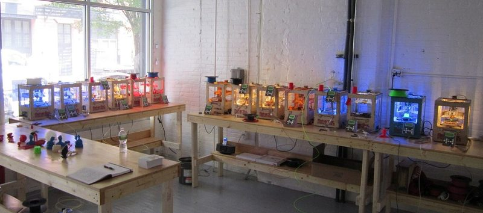
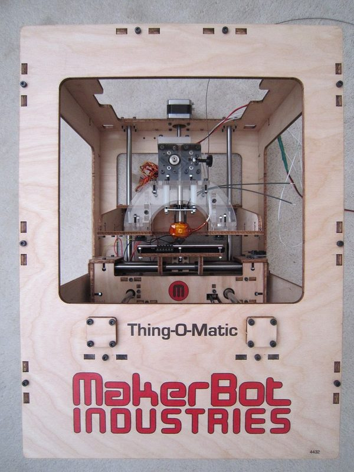
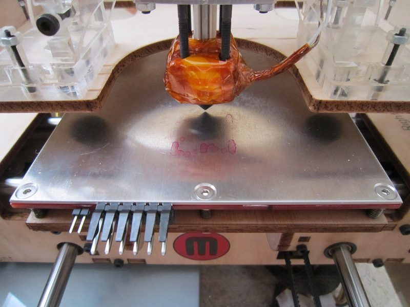
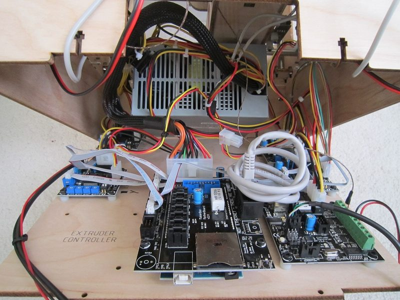
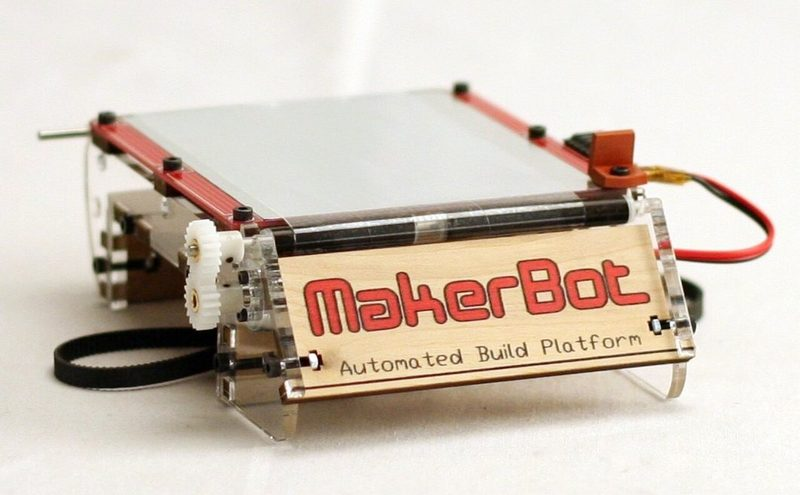

# Thing-O-Matic

[Catalog row](../../README.md#thing-o-matic) · [Gallery](../../GALLERY.md)

| Field | Value |
| --- | --- |
| Section | Historical designs |
| Project page | [https://www.thingiverse.com/thing:4973](https://www.thingiverse.com/thing:4973) |
| Author | MakerBot |
| About | CupCake successor with a new plywood body, 3/8-inch shafts, a stepper-driven cantilever Z stage, Gen4 electronics with USB and endstops, and the Automated Build Platform, a conveyor belt that clears each finished print. |
| Build volume (X×Y×Z) | ABP: 100×100×100 Acrylic platform: 110×110×120 |
| Exterior (W×D×H) | 300×300×400 |
| Latest version | Rev I [2011-05](https://www.thingiverse.com/thing:4973/files) |
| Stars Likes Views | [💙⁠1.1K](https://www.thingiverse.com/thing:4973) [⏯️⁠878](https://www.youtube.com/watch?v=lQ7oprADaY4) [❤️⁠2](https://www.youtube.com/watch?v=lQ7oprADaY4) |
| Links | [Files](https://www.thingiverse.com/thing:4973/files) [BOM](https://web.archive.org/web/20111215111456/http://www.thingiverse.com/thing:4973/partlist) [Manual](https://web.archive.org/web/20121126083014/http://wiki.makerbot.com/thingomatic-doc:thingomatic-assembly-instructions) [Firmware](https://github.com/makerbot/G3Firmware) |
| Groups | [Google Groups](https://groups.google.com/g/makerbot) EN inactive [Reddit](https://www.reddit.com/r/makerbot/) EN 5.2K |
| License | [GPL-2.0 (Thingiverse), GPL-3.0 (Google Code project), GFDL (wiki docs)](https://www.thingiverse.com/thing:4973) |

## Pictures (8)

<table>
<tr><td align="center" width="33%"> Version: with Automated Build Platform Photo: <a href="https://www.flickr.com/people/makerbot/">MakerBot</a></td><td align="center" width="33%"> Version: with Gen4 Interface Board (LCD panel) Photo: <a href="https://commons.wikimedia.org/wiki/User:14GTR">14GTR</a></td><td align="center" width="33%"> Version: transparent blue acrylic body (custom) Photo: amabhy</td></tr>
<tr><td align="center" width="33%"> Photo: <a href="https://www.flickr.com/people/27164521@N00">syvwlch</a></td><td align="center" width="33%"> Photo: <a href="https://www.flickr.com/people/27164521@N00">syvwlch</a></td><td align="center" width="33%"> Photo: <a href="https://www.flickr.com/people/27164521@N00">syvwlch</a></td></tr>
<tr><td align="center" width="33%"> Version: Gen4 electronics Photo: <a href="https://www.flickr.com/people/27164521@N00">syvwlch</a></td><td align="center" width="33%"> Version: Automated Build Platform (part) Photo: <a href="https://www.flickr.com/people/makerbot/">MakerBot</a></td></tr>
</table>

## Other homes of the files

- [Google Code archive, makerbot-thingomatic.zip](https://storage.googleapis.com/google-code-archive-downloads/v2/code.google.com/makerbot/makerbot-thingomatic.zip): body, stage and test-jig DXFs with the Rev C plywood and acrylic layouts, 2010-11-30. Project license GPL-3.0.
- [Google Code archive, Gen4 electronics](https://code.google.com/archive/p/makerbot/downloads): Motherboard v2.4, Extruder Controller v3.6, Stepper Driver v3.3, Mechanical Endstop v1.2 and Heater Board v1.1 sources.
- [MakerBot Subversion tag, Wayback copy](https://web.archive.org/web/20110115081627/http://svn.makerbot.com/tags/thingomatic/): the same DXF set. The live server is gone.
- [makerbot/Makerbot on GitHub](https://github.com/makerbot/Makerbot/tree/master/Thing-O-Matic%20Hacks): mount DXFs for the Thing-O-Matic. No license file.
- [makerbot/Stepstruder-MK7 on GitHub](https://github.com/makerbot/Stepstruder-MK7): SolidWorks parts of the MK7 extruder and a thingomatic-assembly.SLDASM. No license file.
- [MakerBot wiki, Thing-O-Matic, Wayback copy](https://web.archive.org/web/20121126091310/http://wiki.makerbot.com/thingomatic): specifications and links to all docs. GFDL.
- Wayback Machine: [latest snapshot](https://web.archive.org/web/20250518170359/https://www.thingiverse.com/thing:4973), 2025-05-18.
