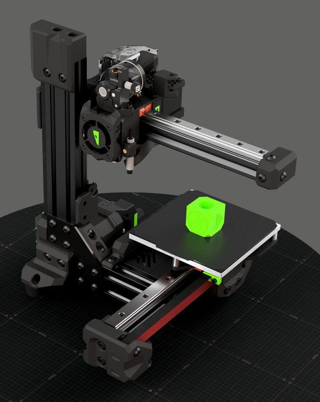
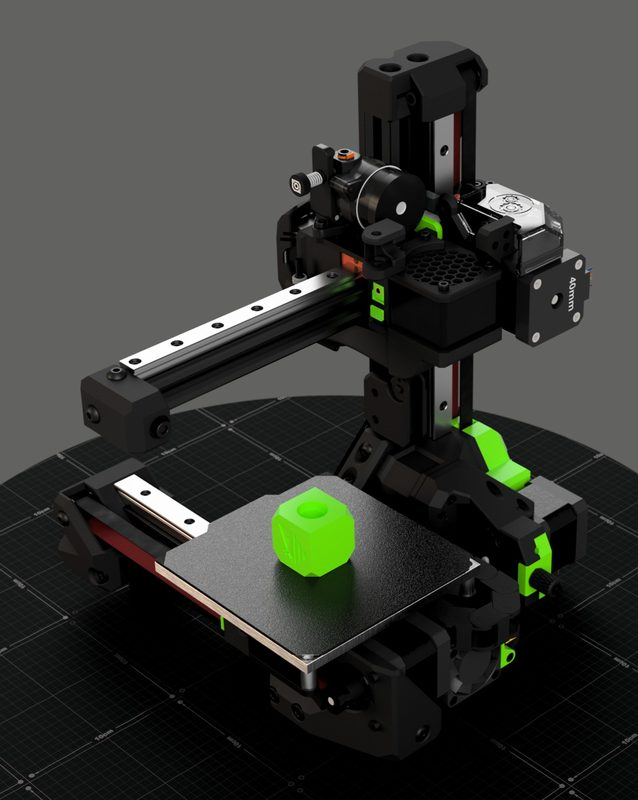
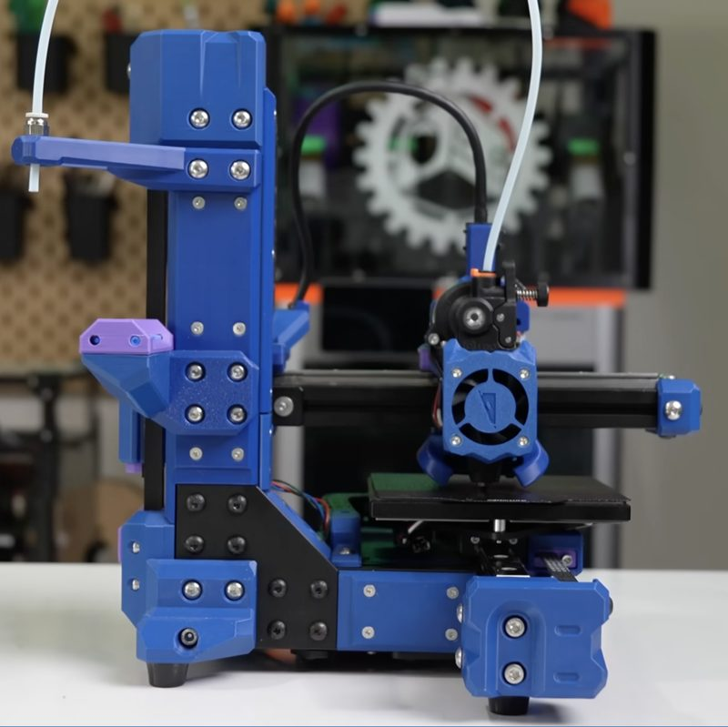
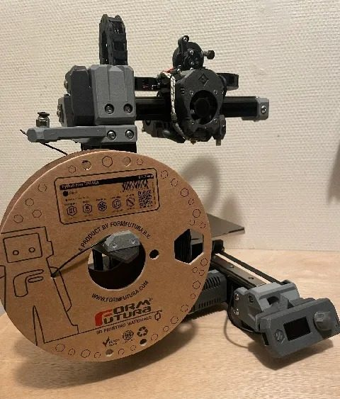

# TicTac 2.1

[Catalog row](../../README.md#tictac-2-1) · [Gallery](../../GALLERY.md)

| Field | Value |
| --- | --- |
| Section | Cartesian · Small (≤180 mm on both X/Y axes) |
| Project page | [https://www.printables.com/model/416884-tictac-21](https://www.printables.com/model/416884-tictac-21) |
| Author | Squirrelbrain |
| About | A miniaturized V-Minion-derived Cartesian printer. |
| Build volume (X×Y×Z) | 120×120×120 |
| Exterior (W×D×H) | — |
| Latest version | 2.1 [2024-01](https://www.printables.com/model/416884-tictac-21/files) |
| Stars Likes Views | [🧡⁠465](https://www.printables.com/model/416884-tictac-21) [💚⁠35](https://makerworld.com/en/models/144161-tic-tac-miniaturised-v-minion) |
| Links | [Files](https://www.printables.com/model/416884-tictac-21/files) |
| Groups | [Facebook](https://www.facebook.com/groups/ratrig3dprintercommunity) EN 19.9K [Discord](https://discord.gg/ratrig) EN 13.8K |

## Pictures (5)

<table>
<tr><td align="center" width="33%"></td><td align="center" width="33%"></td><td align="center" width="33%"></td></tr>
<tr><td align="center" width="33%"></td><td align="center" width="33%"></td></tr>
</table>
