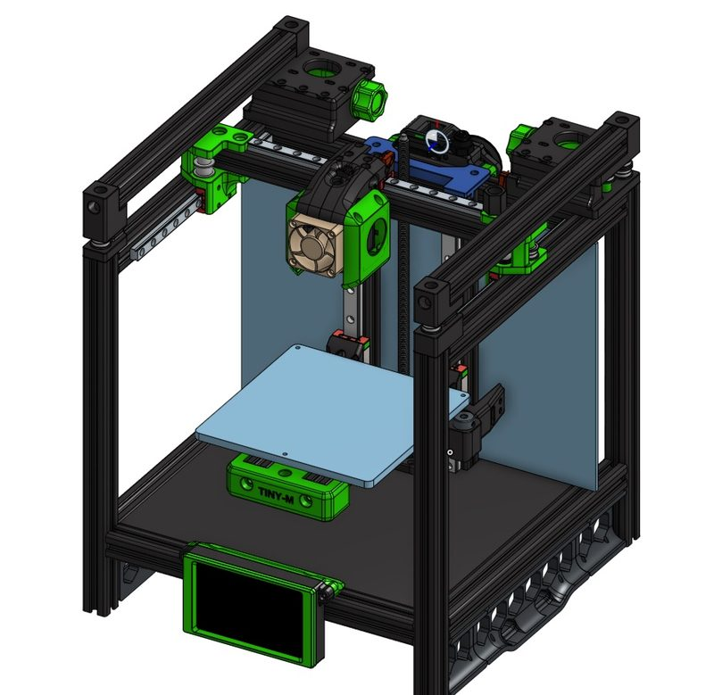
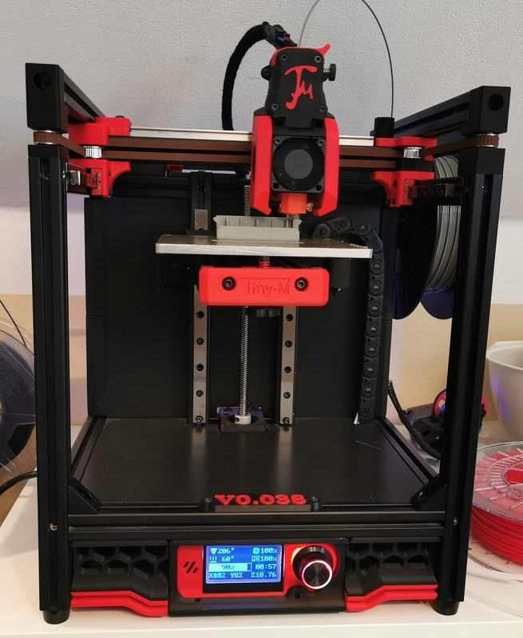
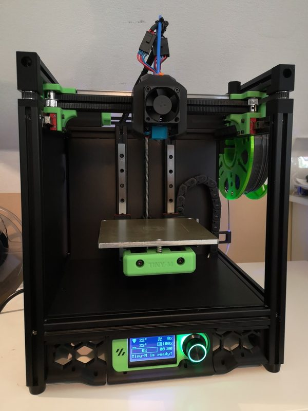
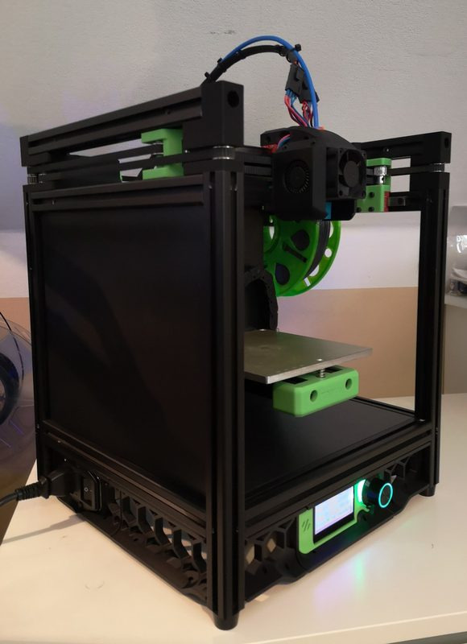
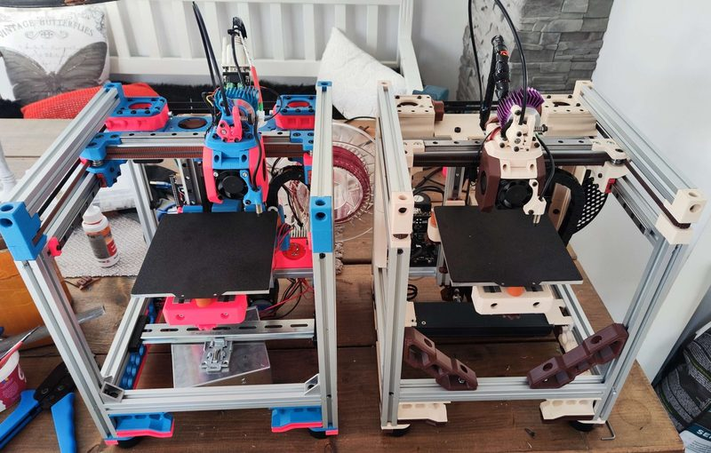

# Tiny-M

[Catalog row](../../README.md#tiny-m) · [Gallery](../../GALLERY.md)

| Field | Value |
| --- | --- |
| Section | Legacy designs |
| Project page | [https://github.com/gsl12/Tiny-M](https://github.com/gsl12/Tiny-M) |
| Author | gsl12 |
| About | Archived 150 mm Voron V0-inspired CoreXY; creator lists V4 as current and V5 as beta. |
| Build volume (X×Y×Z) | 150×150×150 |
| Exterior (W×D×H) | — |
| Latest version | V4 [2021-12](https://github.com/gsl12/Tiny-M/commit/8a72279f867deccffb45758eab8780779cddbe2a) |
| Stars Likes Views |  |
| Links | [CAD](https://cad.onshape.com/documents/f842588d372acab22a4ce687/w/3332acdd7c7bf7fc53ddefb6/e/ce1bfb58b96a9bb3b38b0502) [BOM](https://github.com/gsl12/Tiny-M/tree/master/BOM) |
| Groups | [Discord](https://discord.gg/tmZkjWs) EN 2.8K |
| License | [GPL-3.0](https://github.com/gsl12/Tiny-M/blob/master/LICENSE) |

## Pictures (6)

<table>
<tr><td align="center" width="33%"> Photo: <a href="https://github.com/gsl12">gsl12</a></td><td align="center" width="33%"> Photo: <a href="https://github.com/gsl12">gsl12</a></td><td align="center" width="33%"> Photo: <a href="https://github.com/gsl12">gsl12</a></td></tr>
<tr><td align="center" width="33%"> Photo: <a href="https://github.com/gsl12">gsl12</a></td><td align="center" width="33%"> Photo: <a href="https://github.com/gsl12">gsl12</a></td><td align="center" width="33%"> Photo: <a href="https://www.printables.com/@Etretti_376690">Etretti</a></td></tr>
</table>
