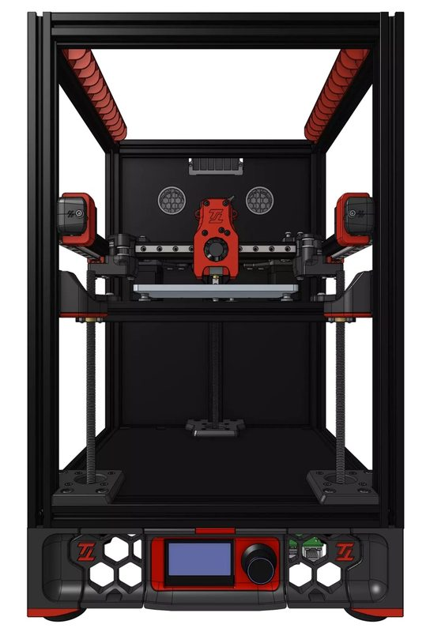
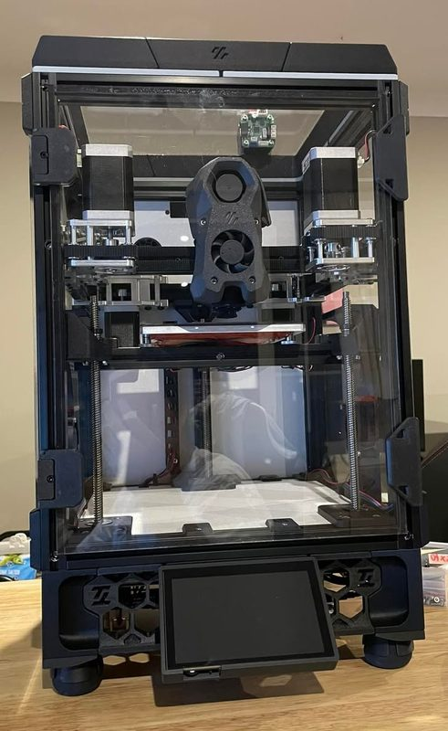

# Tiny-T

[Catalog row](../../README.md#tiny-t) · [Gallery](../../GALLERY.md)

| Field | Value |
| --- | --- |
| Section | CoreXY · Small (≤180 mm representative X/Y size) |
| Project page | [https://github.com/PrintersForAnts/Tiny-T](https://github.com/PrintersForAnts/Tiny-T) |
| Author | Printers for Ants |
| About | Revision 2.0 scales the Voron Trident layout down to a 150 mm cube. |
| Build volume (X×Y×Z) | 150×150×150 |
| Exterior (W×D×H) | — |
| Latest version | R2 [2023-01](https://github.com/PrintersForAnts/Tiny-T/releases/tag/TinyT-r2) |
| Stars Likes Views |  |
| Links | [CAD](https://github.com/PrintersForAnts/Tiny-T/tree/main/CAD) [STL](https://github.com/PrintersForAnts/Tiny-T/tree/main/STLs) [BOM](https://github.com/PrintersForAnts/Tiny-T#components) |
| Groups | [Discord](https://discord.gg/doomcube) EN 6.9K |
| License | [GPL-3.0](https://github.com/PrintersForAnts/Tiny-T/blob/main/LICENSE.txt) |

## Pictures (3)

<table>
<tr><td align="center" width="33%"> Photo: <a href="https://github.com/PrintersForAnts">Printers for Ants</a></td><td align="center" width="33%"> Photo: <a href="https://github.com/PrintersForAnts">Printers for Ants</a></td><td align="center" width="33%"></td></tr>
</table>
