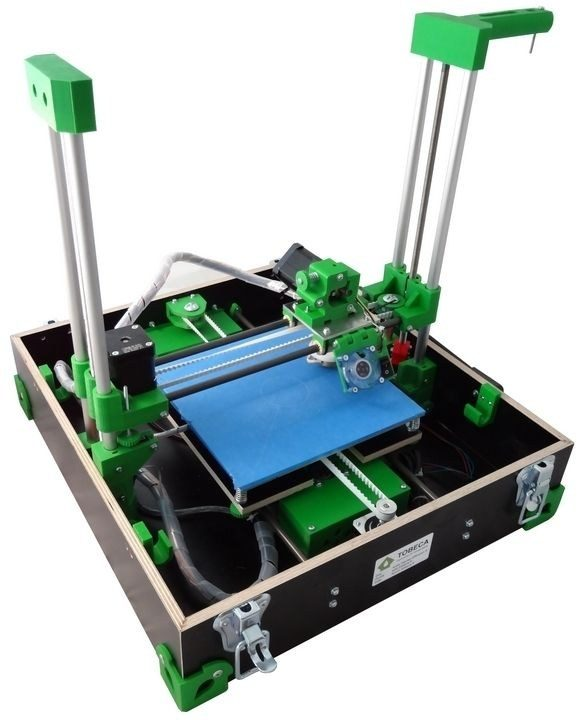
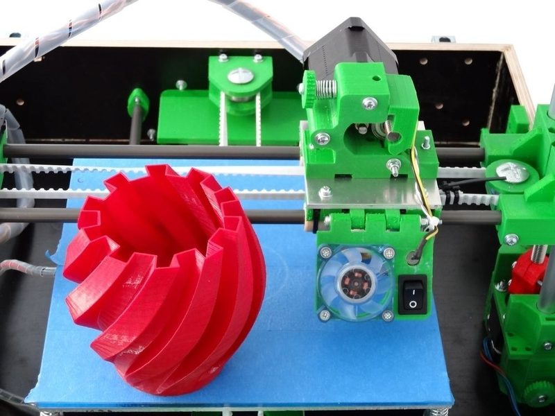
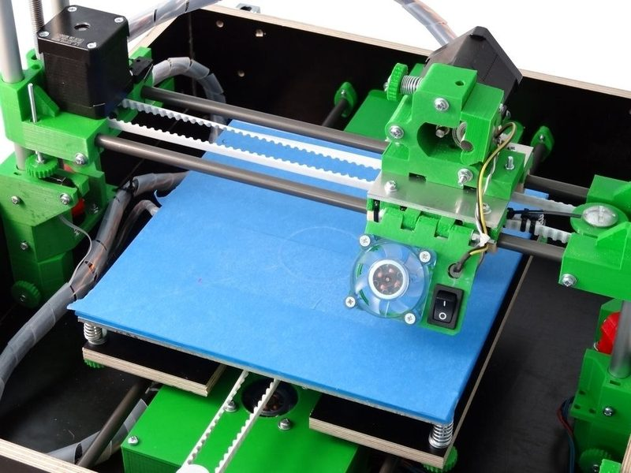
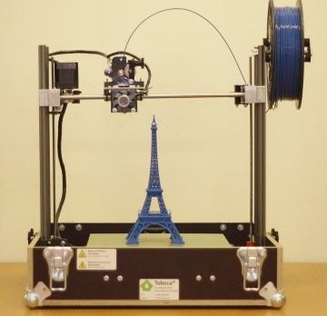
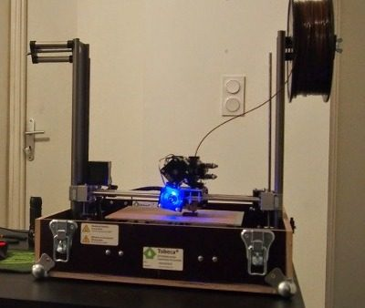

# Tobeca 2

[Catalog row](../../README.md#tobeca) · [Gallery](../../GALLERY.md)

| Field | Value |
| --- | --- |
| Section | Legacy designs |
| Project page | [https://github.com/tobeca/Tobeca2](https://github.com/tobeca/Tobeca2) |
| Author | Adrien Grelet / Tobeca |
| About | French Cartesian printer that folds into its own wooden carrying case, sold as a kit with open files. Versions are the Tobeca of 2013 and the Tobeca 2 of 2014 to 2017. No update since 2017-01. |
| Build volume (X×Y×Z) | Tobeca 2: 200×200×250 Tobeca: 200×200×220 |
| Exterior (W×D×H) | open: 440×414×430 closed: 440×414×175 |
| Latest version | CAD [2017-01](https://github.com/tobeca/Tobeca2/commit/f4495f5a51f7b09e82490aa3095d12cbda40ffb6) |
| Stars Likes Views |  [💙⁠131](https://www.thingiverse.com/thing:147011) |
| Links | [CAD](https://github.com/tobeca/Tobeca2/tree/master/SKP) Tobeca 2 [STL](https://github.com/tobeca/Tobeca2/tree/master/STL) Tobeca 2 [BOM](https://github.com/tobeca/Tobeca2/blob/master/PARTS%20LIST%203.3.ods) Tobeca 2 [Firmware](https://github.com/tobeca/Tobeca2/tree/master/FW) Tobeca 2 [Files](https://github.com/pyroboynroses/Tobeca) old Tobeca [BOM](https://github.com/pyroboynroses/Tobeca/blob/master/BOM.ods) old Tobeca [Wiki](https://reprap.org/wiki/Tobeca) old Tobeca |
| Groups | — |
| License | [CC BY-NC-SA 3.0 FR (Tobeca 2, GitHub), GPL-3.0 (Tobeca, GitHub and RepRap wiki), GPL-2.0 (Tobeca, Thingiverse)](https://github.com/tobeca/Tobeca2/blob/master/CC%20BY-NC-SA.txt) |

## Pictures (6)

<table>
<tr><td align="center" width="33%"> Version: Tobeca (first version, grey parts) Photo: <a href="https://www.thingiverse.com/Tobeca">Tobeca</a></td><td align="center" width="33%"> Version: Tobeca (2013, green parts) Photo: <a href="https://www.thingiverse.com/Tobeca">Tobeca</a></td><td align="center" width="33%"> Version: Tobeca (2013, green parts) Photo: <a href="https://www.thingiverse.com/Tobeca">Tobeca</a></td></tr>
<tr><td align="center" width="33%"> Version: Tobeca (2013, green parts) Photo: <a href="https://www.thingiverse.com/Tobeca">Tobeca</a></td><td align="center" width="33%"> Version: Tobeca 2 Photo: <a href="https://www.thingiverse.com/Tobeca">Tobeca</a></td><td align="center" width="33%"> Version: Tobeca 2</td></tr>
</table>
