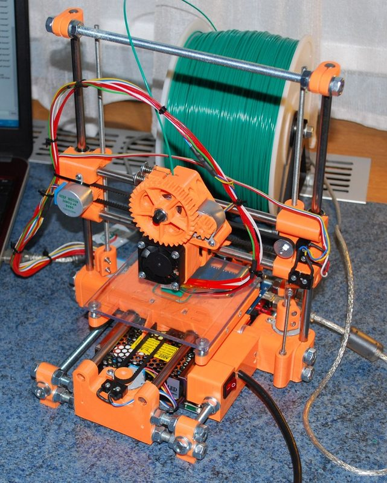
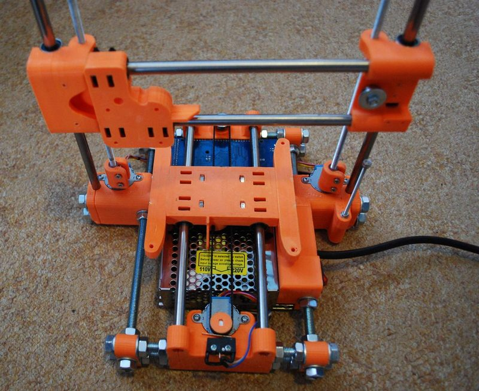
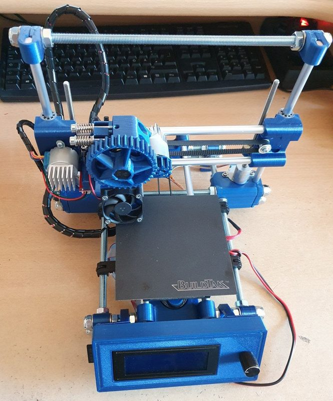

# ToyREP

[Catalog row](../../README.md#toyrep) · [Gallery](../../GALLERY.md)

| Field | Value |
| --- | --- |
| Section | Legacy designs |
| Project page | [https://reprap.org/wiki/ToyREP](https://reprap.org/wiki/ToyREP) |
| Author | Thorgal |
| About | Tiny threaded-rod Cartesian printer driven by cheap 28BYJ-48 geared steppers with a bipolar hack. The author calls it a technology demonstrator or toy, with 10 to 12.5 mm/s on X and Y. No update since 2015-07. |
| Build volume (X×Y×Z) | 100: 100×100×100 125: 125×125×100 |
| Exterior (W×D×H) | 100: 255×245×295 125: 265×265×295 |
| Latest version | First release [2015-07](https://reprap.org/wiki/ToyREP) |
| Stars Likes Views | [💙⁠3.7K](https://www.thingiverse.com/thing:945156) |
| Links | [STL](https://www.thingiverse.com/thing:945156/files) [Manual](https://reprap.org/wiki/ToyREP_Build_Manual) [BOM](https://reprap.org/wiki/ToyREP_Buyers_Guide) [Wiki](https://reprap.org/wiki/ToyREP) |
| Groups | — |
| License | [CC BY-SA 4.0 (Thingiverse, RepRap wiki)](https://www.thingiverse.com/thing:945156) |

## Pictures (4)

<table>
<tr><td align="center" width="33%"> Photo: <a href="https://reprap.org/wiki/User:Thorgal">Thorgal</a></td><td align="center" width="33%"> Photo: <a href="https://reprap.org/wiki/User:Thorgal">Thorgal</a></td><td align="center" width="33%"> Photo: <a href="https://reprap.org/wiki/User:Thorgal">Thorgal</a></td></tr>
<tr><td align="center" width="33%"> Version: ToyRep RX (remix by peter47_a) Photo: <a href="https://www.thingiverse.com/peter47_a/designs">peter47_a</a></td></tr>
</table>

## Mods and variants

- [ToyRep RX](https://www.thingiverse.com/thing:4654626) by peter47_a: a reworked ToyRep. CC BY-SA.
