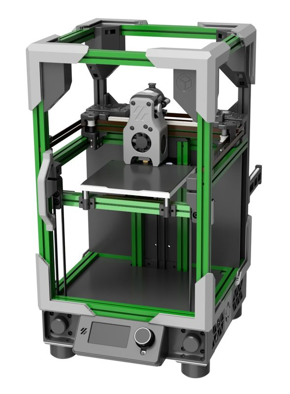
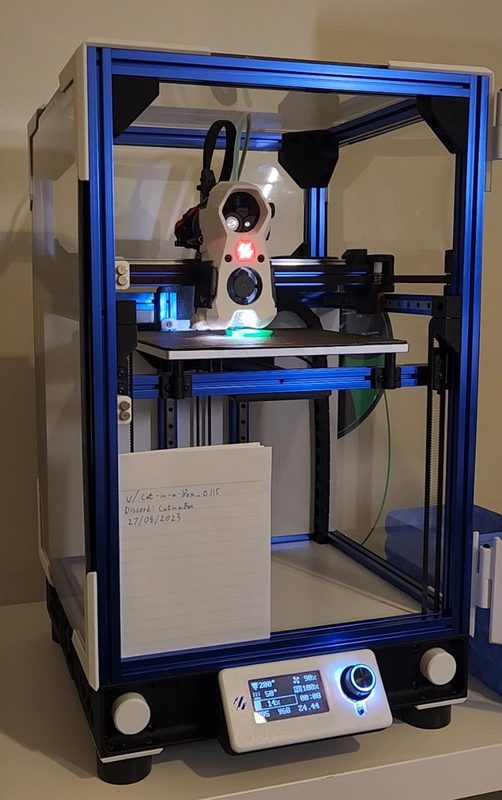
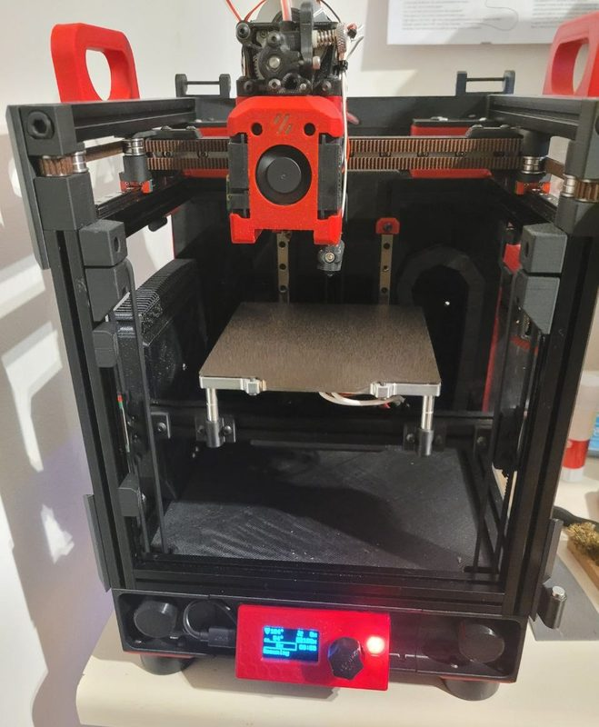
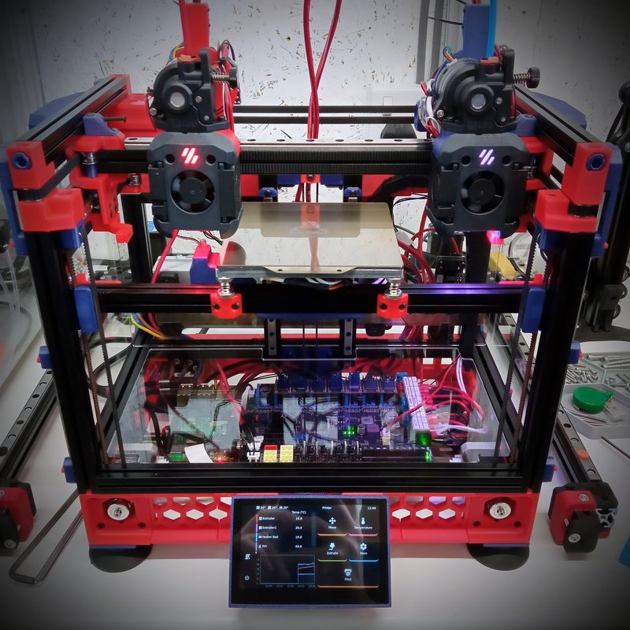

# Tri-Zero

[Catalog row](../../README.md#tri-zero) · [Gallery](../../GALLERY.md)

| Field | Value |
| --- | --- |
| Section | Conversions |
| Project page | [https://github.com/zruncho3d/tri-zero](https://github.com/zruncho3d/tri-zero) |
| Author | zruncho3d |
| About | Voron V0-derived CoreXY mod adding triple belted Z and automatic bed leveling; also supports a fresh build. Its latest documented release is Alpha 6. |
| Build volume (X×Y×Z) | standard: 120×120×120 Plus50: 170×170×170 |
| Exterior (W×D×H) | — |
| Latest version | alpha 6 [2022-10](https://github.com/zruncho3d/tri-zero/blob/main/CHANGES.md#2022-10-16-update) |
| Stars Likes Views |  [⏯️⁠17.6K](https://www.youtube.com/watch?v=XPtowYdHhJ8) [❤️⁠129](https://www.youtube.com/watch?v=XPtowYdHhJ8) |
| Links | [CAD](https://github.com/zruncho3d/tri-zero/tree/main/CAD) [Manual](https://github.com/zruncho3d/tri-zero/blob/main/INSTRUCTIONS.md) [Plus50](https://github.com/zruncho3d/tri-zero/blob/main/PLUS50.md) |
| Groups | [Discord](https://discord.gg/voron) EN 40.8K [Discord](https://discord.gg/doomcube) EN 6.9K [Reddit](https://www.reddit.com/r/voroncorexy/) EN 30.3K |

## Pictures (5)

<table>
<tr><td align="center" width="33%"> Photo: <a href="https://github.com/zruncho3d">Zruncho 3D</a></td><td align="center" width="33%"> Photo: <a href="https://github.com/zruncho3d">Zruncho 3D</a></td><td align="center" width="33%"> Photo: <a href="https://www.reddit.com/user/Cat-in-a-Box_0115">u/Cat-in-a-Box_0115</a></td></tr>
<tr><td align="center" width="33%"> Photo: <a href="https://www.printables.com/@HitLuca">HitLuca</a></td><td align="center" width="33%"> Photo: <a href="https://www.printables.com/@Rushmere3D">Rushmere3D</a></td></tr>
</table>
