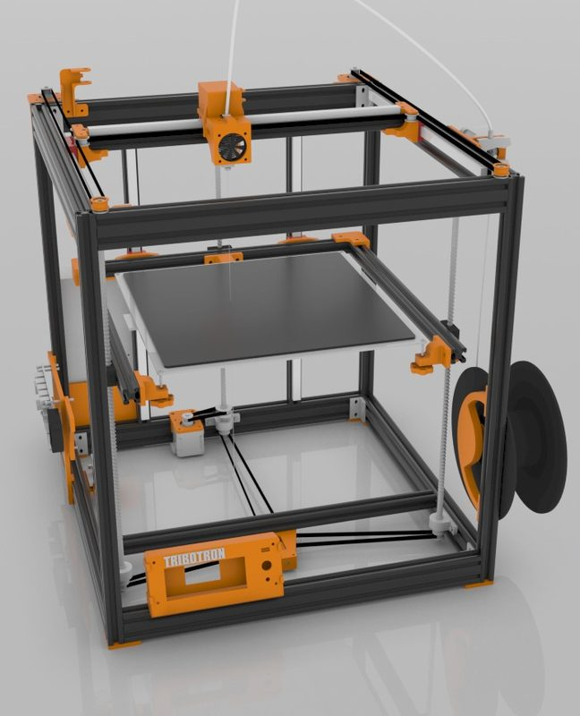
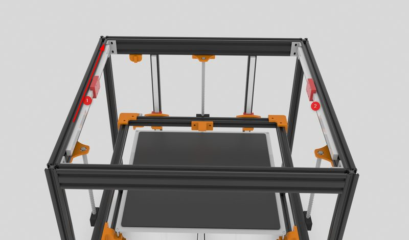
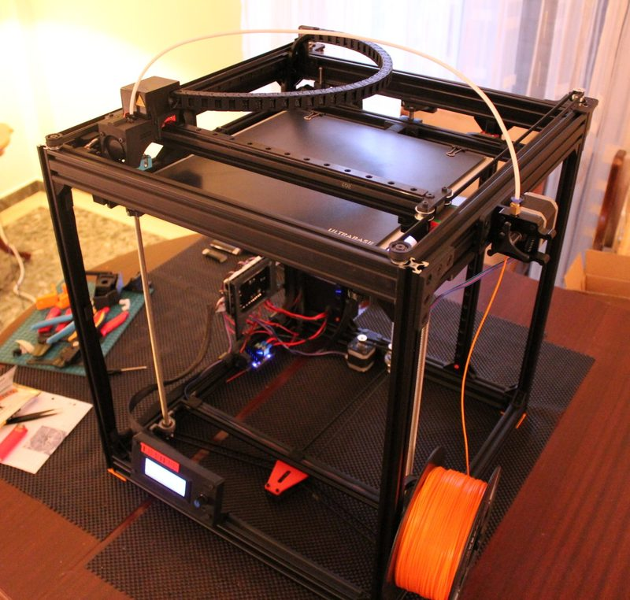
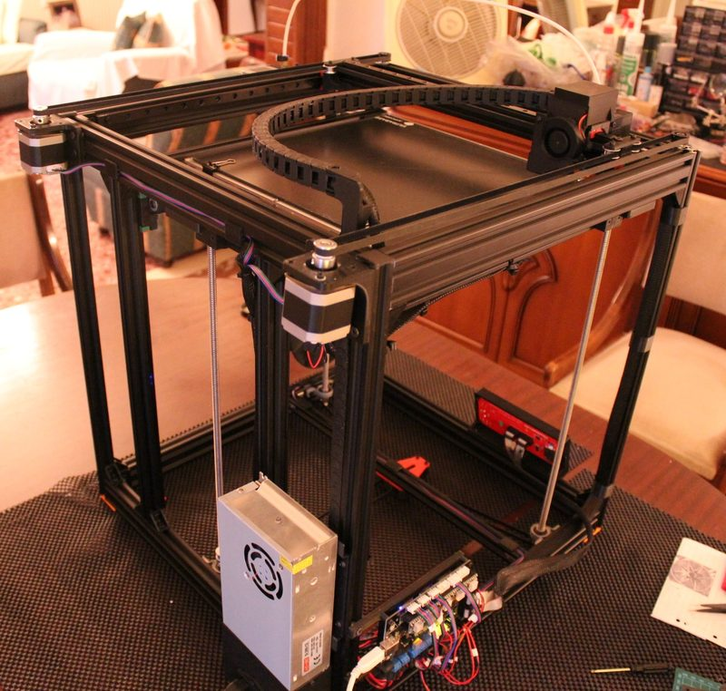

# Tribotron

[Catalog row](../../README.md#tribotron) · [Gallery](../../GALLERY.md)

| Field | Value |
| --- | --- |
| Section | Historical designs |
| Project page | [https://www.thingiverse.com/thing:3013586](https://www.thingiverse.com/thing:3013586) |
| Author | VaggelisG2 |
| About | Single-belt H-bot with a 2020/2040 extrusion frame and MGN12 rails on all axes; its successor KEEVO is CoreXY. One of the few H-bots with full files. |
| Build volume (X×Y×Z) | 300×300×380 |
| Exterior (W×D×H) | 460×460×540 |
| Latest version | Files [2019-01](https://www.thingiverse.com/thing:3013586/files) |
| Stars Likes Views | [💙⁠247](https://www.thingiverse.com/thing:3013586) [⏯️⁠19.7K](https://www.youtube.com/watch?v=K0pcGKAQ4eA) [❤️⁠141](https://www.youtube.com/watch?v=K0pcGKAQ4eA) |
| Links | [Files](https://www.thingiverse.com/thing:3013586/files) [Manual](https://www.instructables.com/Tribotron-3D-Printer/) [Video](https://youtu.be/K0pcGKAQ4eA) |
| Groups | — |
| License | [CC BY-NC 4.0](https://www.thingiverse.com/thing:3013586) |

## Pictures (5)

<table>
<tr><td align="center" width="33%"> Photo: <a href="https://www.instructables.com/member/VaggelisG2/">VaggelisG2</a></td><td align="center" width="33%"> Photo: <a href="https://www.thingiverse.com/VaggelisG2">VaggelisG2</a></td><td align="center" width="33%"> Photo: <a href="https://www.instructables.com/member/VaggelisG2/">VaggelisG2</a></td></tr>
<tr><td align="center" width="33%"> Photo: <a href="https://www.thingiverse.com/VaggelisG2">VaggelisG2</a></td><td align="center" width="33%"> Photo: <a href="https://www.thingiverse.com/VaggelisG2">VaggelisG2</a></td></tr>
</table>
