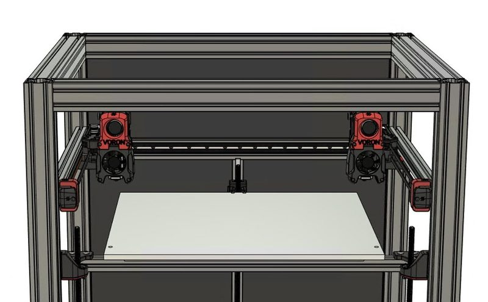
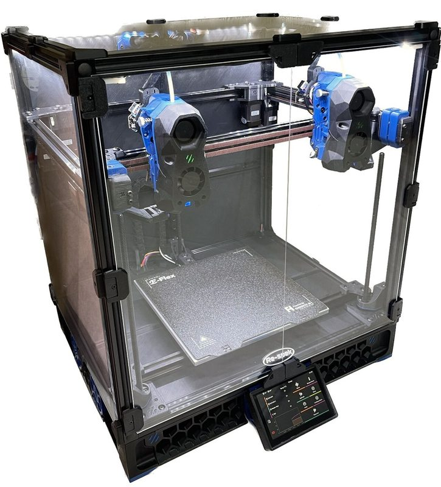
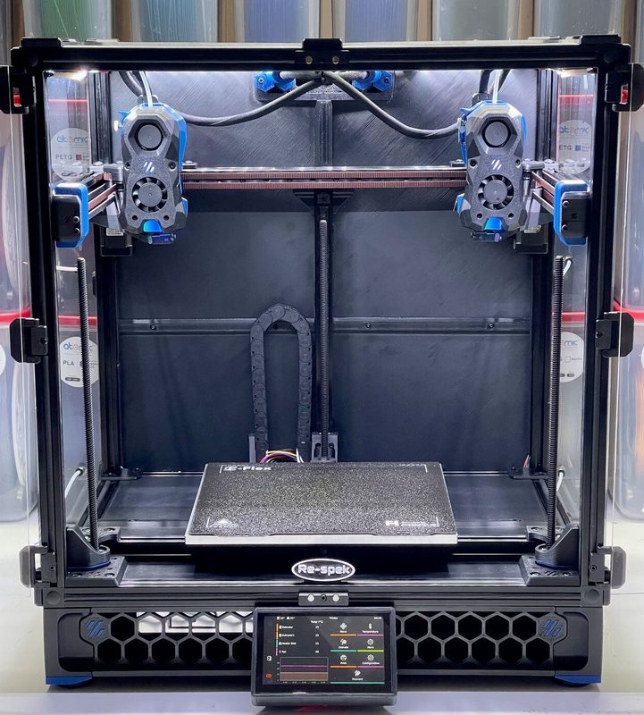
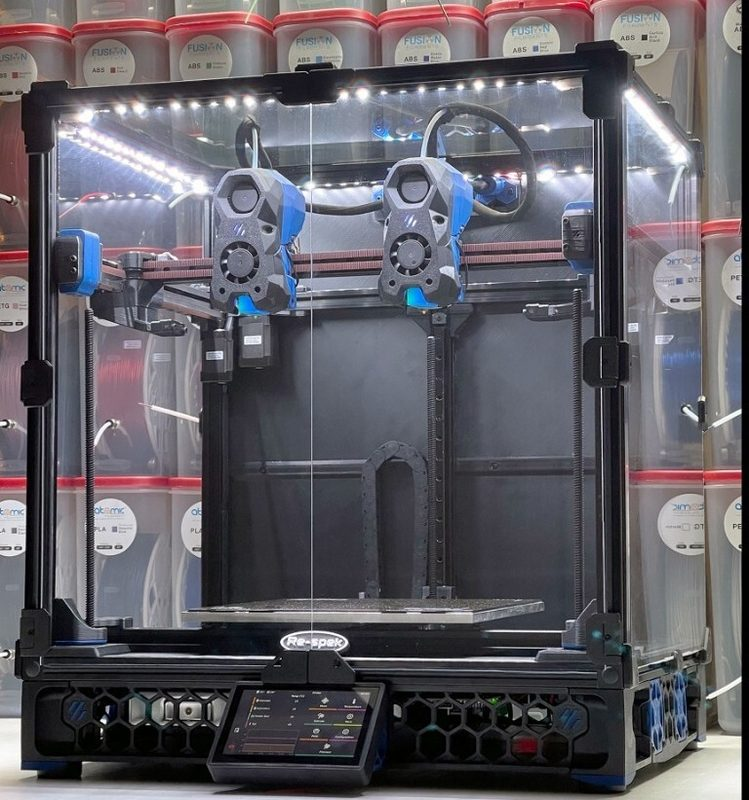
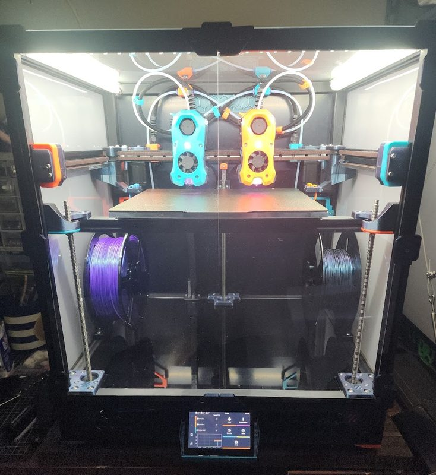
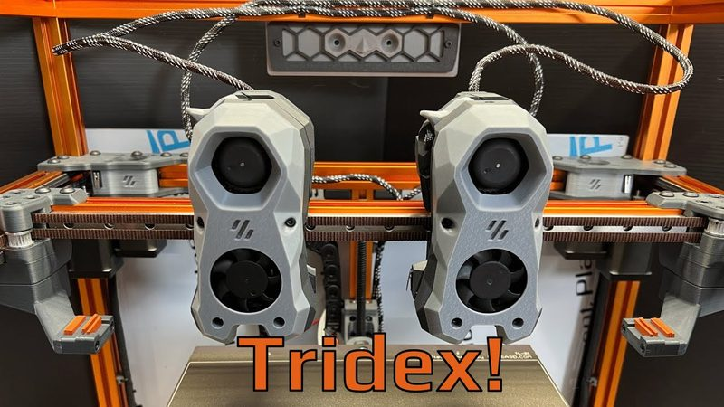

# Tridex

[Catalog row](../../README.md#tridex) · [Gallery](../../GALLERY.md)

| Field | Value |
| --- | --- |
| Section | Conversions |
| Project page | [https://github.com/FrankenVoron/Tridex](https://github.com/FrankenVoron/Tridex) |
| Author | FrankenVoron |
| About | Advanced Trident-derived IDEX for dual-material printing; the creator says it may eventually become release-worthy, and documentation is still in progress. |
| Build volume (X×Y×Z) | single toolhead: 225×250×250 dual toolhead: 205×250×250 |
| Exterior (W×D×H) | — |
| Latest version | CAD [2022-10](https://github.com/FrankenVoron/Tridex/commit/573d3ced37) |
| Stars Likes Views |  [⏯️⁠62.6K](https://www.youtube.com/watch?v=31fqpKYj7v4) [❤️⁠1.1K](https://www.youtube.com/watch?v=31fqpKYj7v4) |
| Links | [CAD](https://github.com/FrankenVoron/Tridex/tree/main/CAD) [BOM](https://github.com/FrankenVoron/Tridex/blob/main/Documentation/0_bill_of_materials.md) [Manual](https://github.com/FrankenVoron/Tridex/blob/main/Documentation/1_assembly_instructions.md) [STL](https://github.com/FrankenVoron/Tridex/tree/main/STLs) |
| Groups | [Discord](https://discord.gg/voron) EN 40.8K [Discord](https://discord.gg/doomcube) EN 6.9K [Reddit](https://www.reddit.com/r/voroncorexy/) EN 30.3K |

## Pictures (7)

<table>
<tr><td align="center" width="33%"> Photo: <a href="https://github.com/eddietheengineer">eddietheengineer</a></td><td align="center" width="33%"> Photo: <a href="https://www.youtube.com/@eddietheengineer">eddietheengineer</a></td><td align="center" width="33%"> Photo: <a href="https://www.ebay.com/itm/404626174240">Re-spek</a></td></tr>
<tr><td align="center" width="33%"> Photo: <a href="https://www.ebay.com/itm/404626174240">Re-spek</a></td><td align="center" width="33%"> Photo: <a href="https://www.ebay.com/itm/404626174240">Re-spek</a></td><td align="center" width="33%"> Photo: <a href="https://www.printables.com/@GalvanicGlaze_170963">Galvanic</a></td></tr>
<tr><td align="center" width="33%"> Photo: <a href="https://www.youtube.com/@SteveBuilds">Steve Builds</a></td></tr>
</table>
