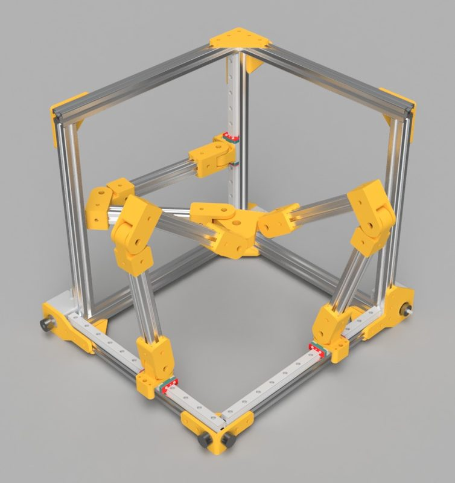
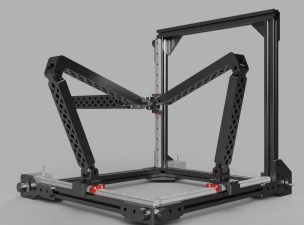
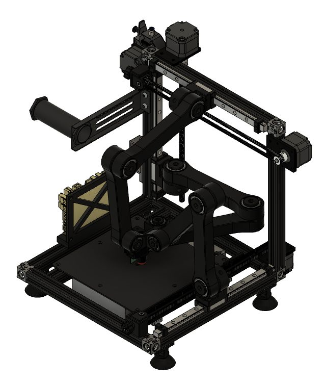
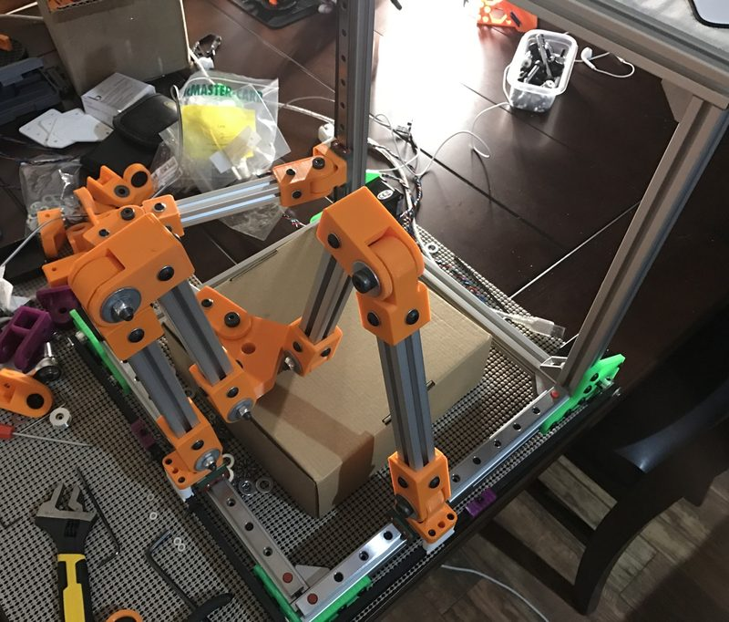
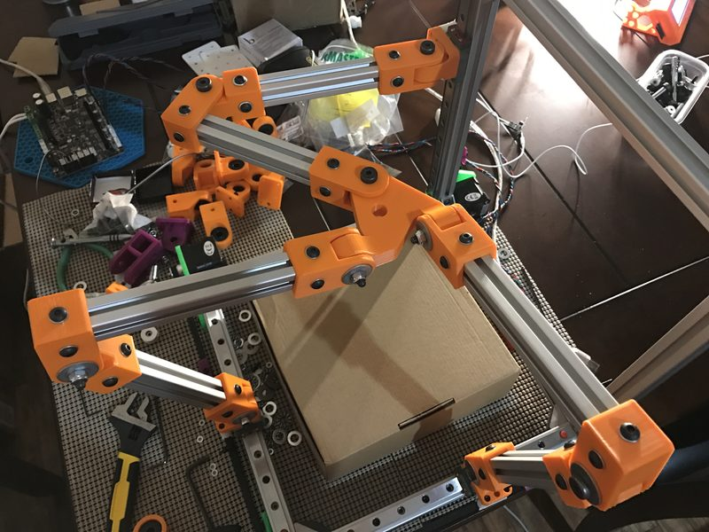
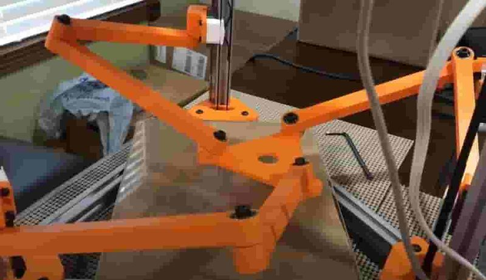
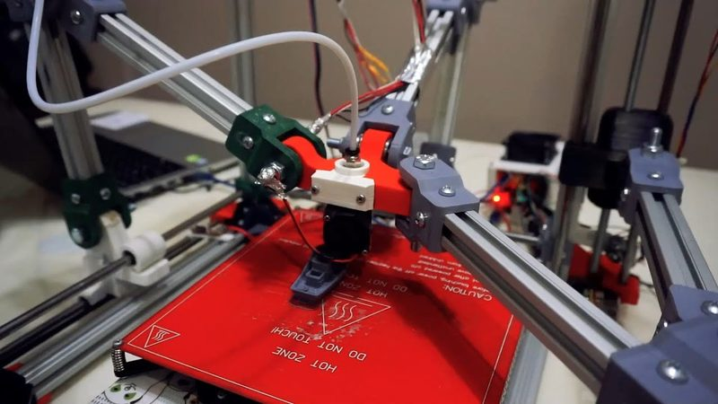
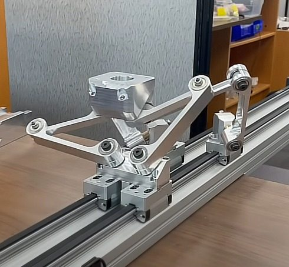

# Tripteron

[Catalog row](../../README.md#tripteron) · [Gallery](../../GALLERY.md)

| Field | Value |
| --- | --- |
| Section | Historical designs |
| Project page | [https://reprap.org/wiki/Tripteron](https://reprap.org/wiki/Tripteron) |
| Author | RepRap |
| About | A rare working printer with three orthogonal parallel arms. |
| Build volume (X×Y×Z) | — |
| Exterior (W×D×H) | — |
| Latest version | First release [2016-11](https://www.thingiverse.com/thing:1903757) |
| Stars Likes Views | [💙⁠353](https://www.thingiverse.com/thing:1903757) [🧡⁠29](https://www.printables.com/model/157727) [⏯️⁠58.4K](https://www.youtube.com/watch?v=aRaI0pesDN0) [❤️⁠708](https://www.youtube.com/watch?v=aRaI0pesDN0) |
| Links | — |
| Groups | [Forum](https://reprap.org/forum/read.php?166,719575) EN inactive |

## Pictures (9)

<table>
<tr><td align="center" width="33%"> Photo: <a href="https://www.thingiverse.com/Apsu">Apsu</a></td><td align="center" width="33%"> Photo: <a href="https://www.thingiverse.com/Apsu">Apsu</a></td><td align="center" width="33%"> Photo: <a href="https://www.thingiverse.com/Apsu">Apsu</a></td></tr>
<tr><td align="center" width="33%"> Photo: <a href="https://www.printables.com/@apsu_209940">Apsu</a></td><td align="center" width="33%"> Photo: <a href="https://www.thingiverse.com/Apsu">Apsu</a></td><td align="center" width="33%"> Photo: <a href="https://www.thingiverse.com/Apsu">Apsu</a></td></tr>
<tr><td align="center" width="33%"> Photo: <a href="https://www.thingiverse.com/Apsu">Apsu</a></td><td align="center" width="33%"> Photo: <a href="https://www.youtube.com/@SelcukMakina">Konya Teknik Üniversitesi Makina Mühendisliği</a></td><td align="center" width="33%"></td></tr>
</table>
