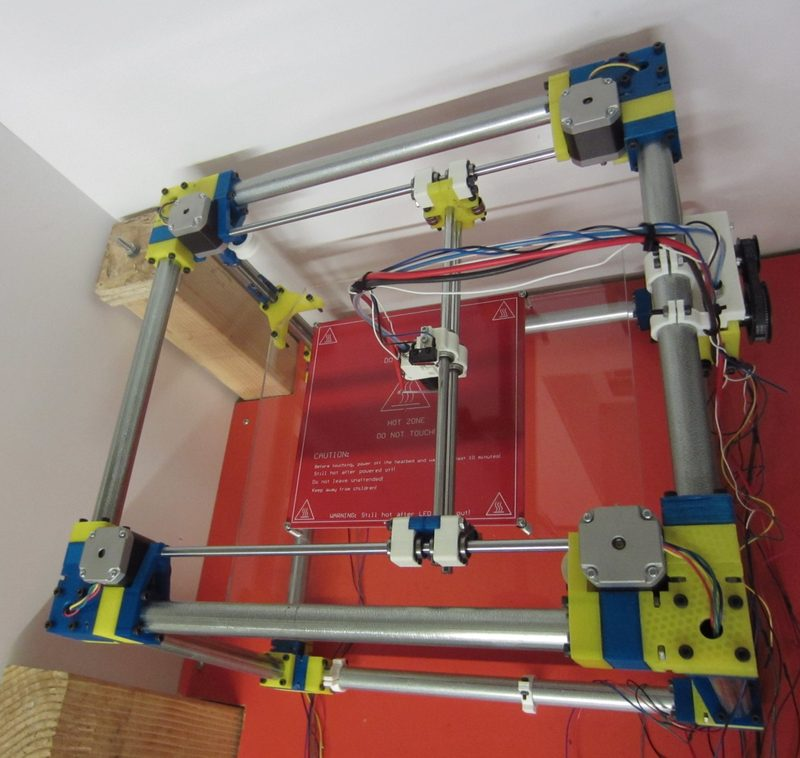
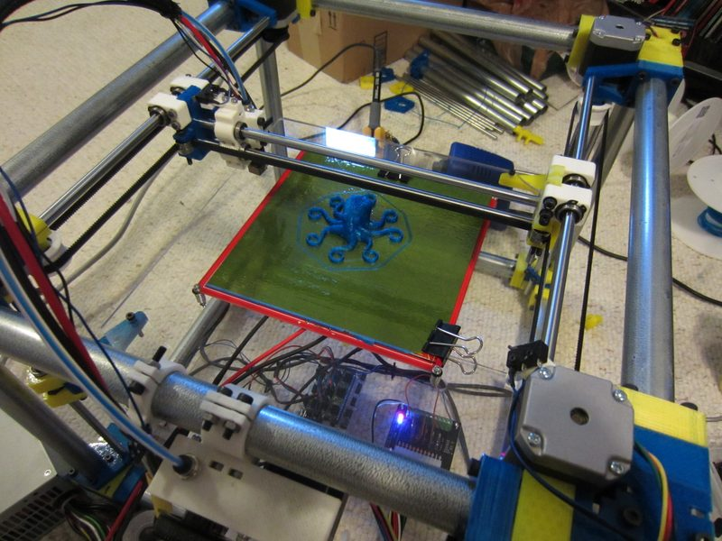
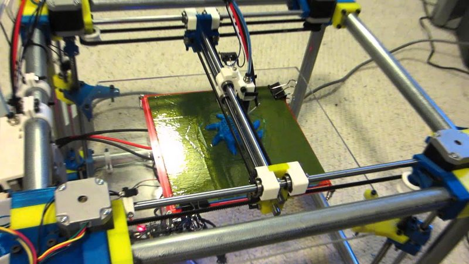
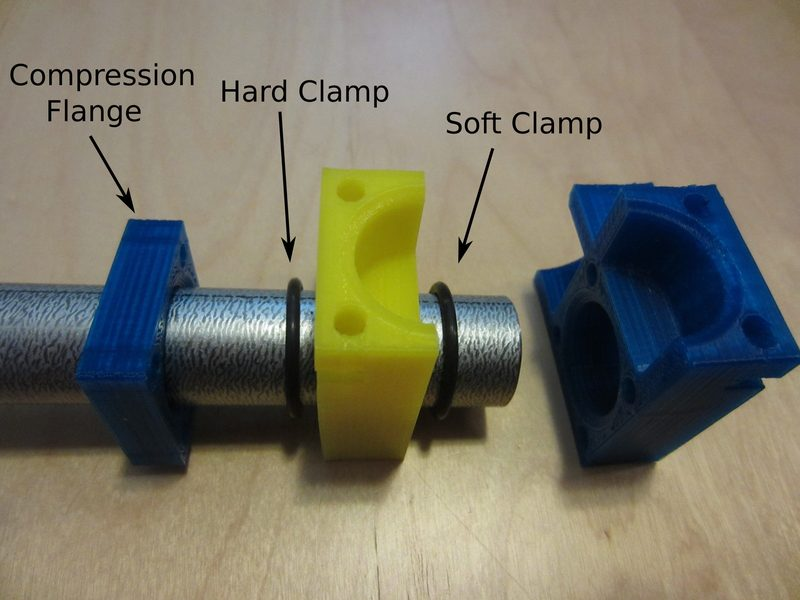
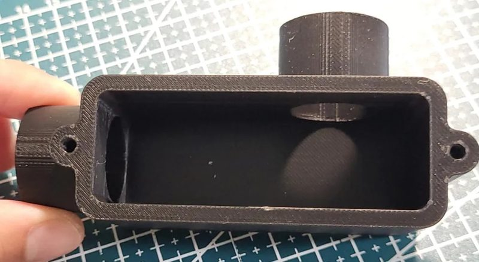

# UConduit

[Catalog row](../../README.md#uconduit) · [Gallery](../../GALLERY.md)

| Field | Value |
| --- | --- |
| Section | Historical designs |
| Project page | [https://github.com/iquizzle/uconduit](https://github.com/iquizzle/uconduit) |
| Author | Lee Miller |
| About | Early single-belt H-bot with a frame of hardware-store steel conduit and parametric OpenSCAD source. |
| Build volume (X×Y×Z) | 265×250×240 |
| Exterior (W×D×H) | 485×445×380 |
| Latest version | CAD [2013-12](https://github.com/iquizzle/uconduit/commit/3d66a1659d0b6aba79ace77930395a757839446d) |
| Stars Likes Views |  [💙⁠367](https://www.thingiverse.com/thing:102972) [⏯️⁠22K](https://www.youtube.com/watch?v=73MlaBWCTPU) [❤️⁠50](https://www.youtube.com/watch?v=73MlaBWCTPU) |
| Links | [Files](https://github.com/iquizzle/uconduit) [Manual](https://hackaday.com/2013/06/12/using-electrical-conduit-for-a-3d-printer-frame/) [BOM](https://github.com/iquizzle/uconduit/blob/HEAD/UCON_BOM.pdf) [Wiki](https://reprap.org/wiki/Uconduit) |
| Groups | — |

## Pictures (6)

<table>
<tr><td align="center" width="33%"></td><td align="center" width="33%"></td><td align="center" width="33%"></td></tr>
<tr><td align="center" width="33%"></td><td align="center" width="33%"></td><td align="center" width="33%"></td></tr>
</table>
