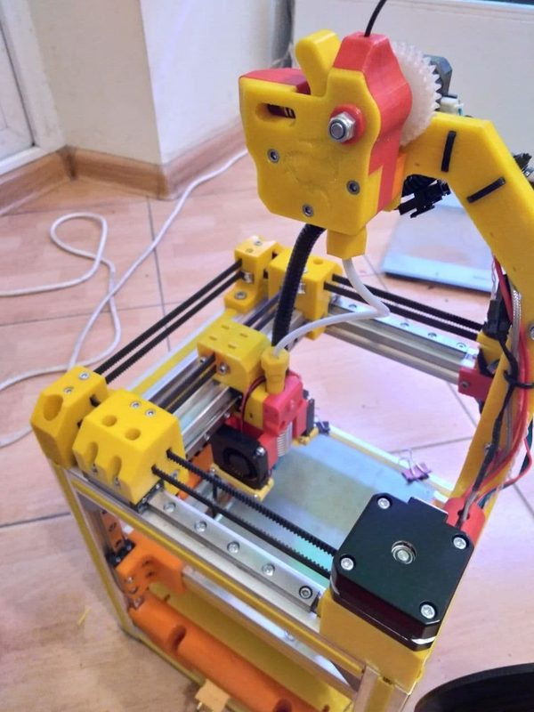
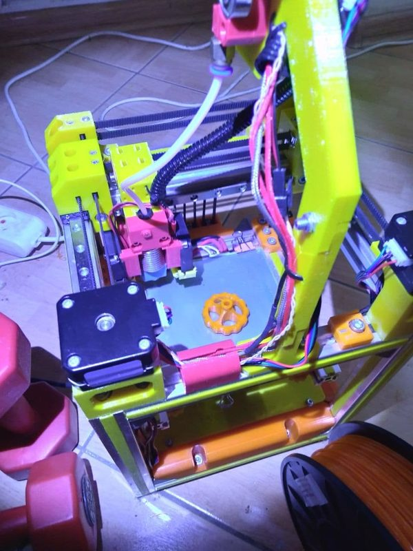

# ucorexy

[Catalog row](../../README.md#ucorexy) · [Gallery](../../GALLERY.md)

| Field | Value |
| --- | --- |
| Section | Legacy designs |
| Project page | [https://github.com/aleknest/ucorexy](https://github.com/aleknest/ucorexy) |
| Author | aleknest |
| About | Small parametric OpenSCAD CoreXY on 2020 extrusion and MGN9 rails, with Klipper config and two bed sizes (120 and 220 mm). No update since 2022-03. |
| Build volume (X×Y×Z) | 120 bed: 105×105×80 220 bed: — |
| Exterior (W×D×H) | — |
| Latest version | CAD [2022-03](https://github.com/aleknest/ucorexy/commit/63121a71f5a127e5f168eab8a1f0a8e498ca1458) |
| Stars Likes Views |  |
| Links | [CAD](https://github.com/aleknest/ucorexy/blob/main/ucorexy.scad) [STL](https://github.com/aleknest/ucorexy/tree/main/produce/ucorexy_bed120mm) 120 bed [STL](https://github.com/aleknest/ucorexy/tree/main/produce/ucorexy_bed220mm) 220 bed [BOM](https://github.com/aleknest/ucorexy/blob/main/bom.txt) [Config](https://github.com/aleknest/ucorexy/blob/main/printer.cfg) |
| Groups | — |
| License | [GPL-3.0](https://github.com/aleknest/ucorexy/blob/main/LICENSE) |

## Pictures (3)

<table>
<tr><td align="center" width="33%"> Photo: <a href="https://github.com/aleknest">aleknest</a></td><td align="center" width="33%"> Photo: <a href="https://github.com/aleknest">aleknest</a></td><td align="center" width="33%"> Photo: <a href="https://github.com/aleknest">aleknest</a></td></tr>
</table>
