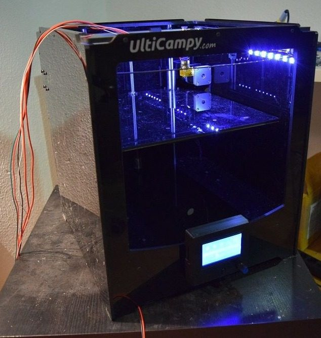
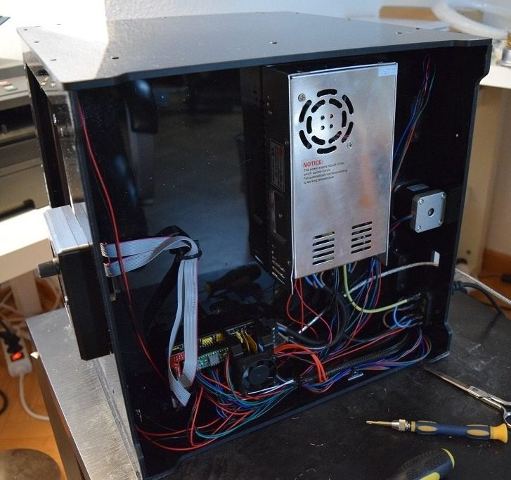
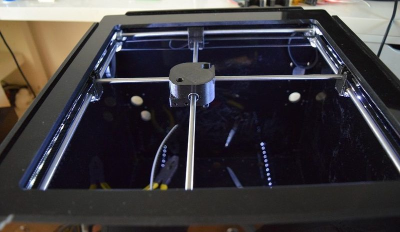
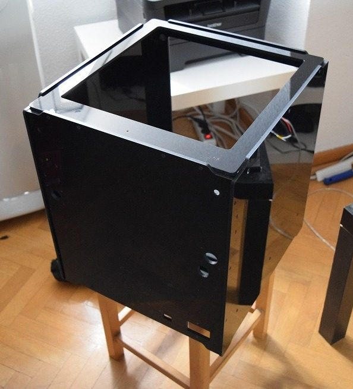
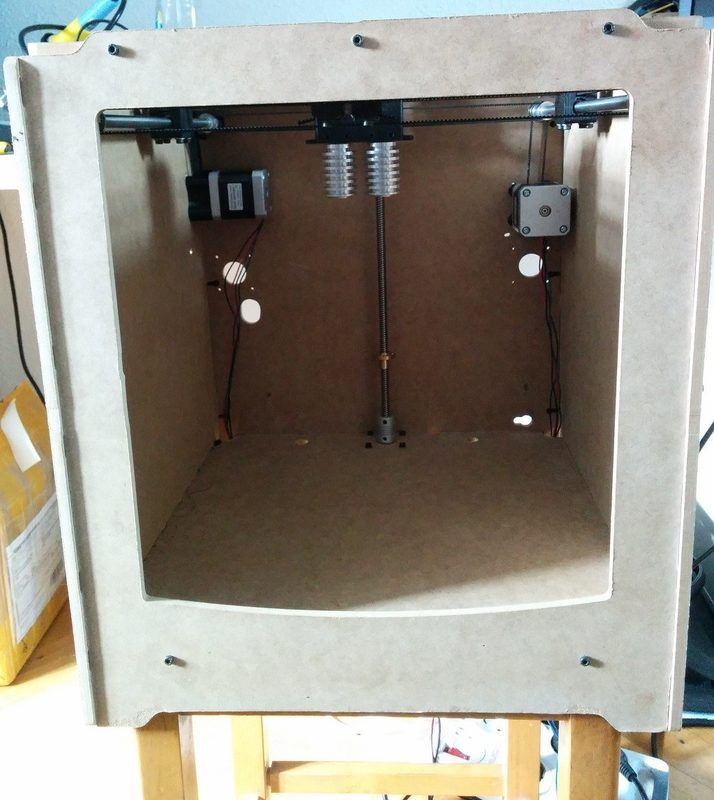
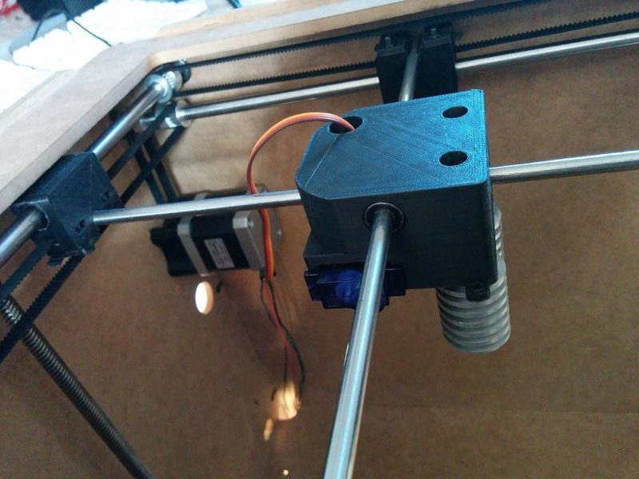

# Ulticampy

[Catalog row](../../README.md#ulticampy) · [Gallery](../../GALLERY.md)

| Field | Value |
| --- | --- |
| Section | Legacy designs |
| Project page | [https://github.com/campy/UlticampyV3](https://github.com/campy/UlticampyV3) |
| Author | Juan Campillos / 3DCampy |
| About | Ultimaker-style cross-gantry printer in a closed box of CNC-cut panels, built from RepRap parts with a Bowden feed and bronze bushings. V1 has an MDF frame, V2 has black panels, and V3 adds SolidWorks sources and CAM files. No update since 2015-10. |
| Build volume (X×Y×Z) | 225×235×200 |
| Exterior (W×D×H) | — |
| Latest version | CAD [2015-10](https://github.com/campy/UlticampyV3/commit/ebac48152278c8273b3421cc69940f300ca900f8) |
| Stars Likes Views |  [💙⁠196](https://www.thingiverse.com/thing:640166) [⏯️⁠12.7K](https://www.youtube.com/watch?v=YYdzM99KZmc) [❤️⁠15](https://www.youtube.com/watch?v=YYdzM99KZmc) |
| Links | [Files](https://github.com/campy/UlticampyV3) [STL](https://github.com/campy/UlticampyV3/tree/master/STL%20Printer%20parts) [Firmware](https://github.com/campy/UlticampyV3/tree/master/Frimware%20Ulticampy%20V3) [V2](https://github.com/campy/Ulticampy-V2) [V1](https://github.com/campy/Ulticampy-V1) |
| Groups | — |
| License | [CC BY-SA 4.0 (Thingiverse), CC BY-NC-SA (RepRap wiki)](https://www.thingiverse.com/thing:640166) |

## Pictures (7)

<table>
<tr><td align="center" width="33%"> Version: V2/V3 black acrylic box Photo: <a href="https://www.thingiverse.com/Campy/designs">Campy</a></td><td align="center" width="33%"> Version: V2/V3 black acrylic box Photo: <a href="https://www.thingiverse.com/Campy/designs">Campy</a></td><td align="center" width="33%"> Version: V2/V3 black acrylic box Photo: <a href="https://www.thingiverse.com/Campy/designs">Campy</a></td></tr>
<tr><td align="center" width="33%"> Version: V2/V3 black acrylic box Photo: <a href="https://www.thingiverse.com/Campy/designs">Campy</a></td><td align="center" width="33%"> Version: V2 Photo: <a href="https://github.com/campy">Campy</a></td><td align="center" width="33%"> Version: V1 (MDF box) Photo: <a href="https://github.com/campy">Campy</a></td></tr>
<tr><td align="center" width="33%"> Version: V1 Photo: <a href="https://github.com/campy">Campy</a></td></tr>
</table>
