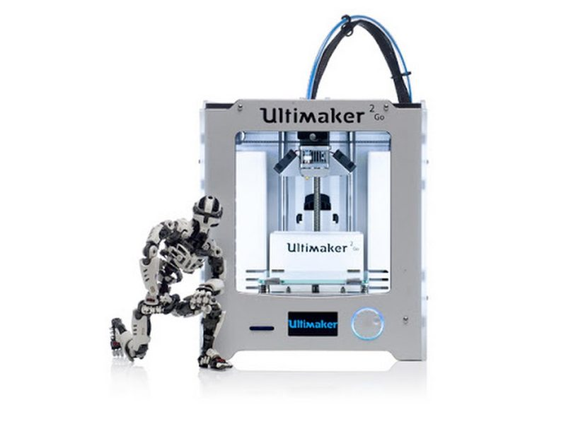
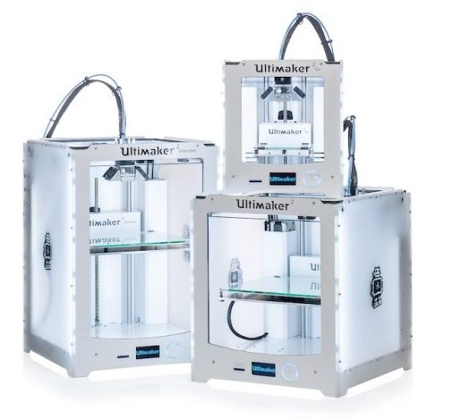
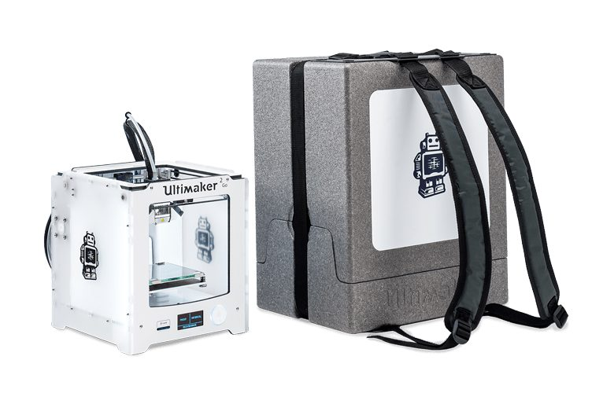

# Ultimaker 2 Go

[Catalog row](../../README.md#ultimaker-2-go) · [Gallery](../../GALLERY.md)

| Field | Value |
| --- | --- |
| Section | Legacy designs |
| Project page | [https://github.com/Ultimaker/Ultimaker2Go](https://github.com/Ultimaker/Ultimaker2Go) |
| Author | Ultimaker |
| About | Compact, self-contained Cartesian member of the Ultimaker 2 family with published part sources and BOM. No update since 2016. |
| Build volume (X×Y×Z) | 120×120×115 |
| Exterior (W×D×H) | 258×250×288 |
| Latest version | STEP [2016-01](https://github.com/Ultimaker/Ultimaker2Go/commit/28b7e8238e56cc885ed334ac8c9dafcdb14ff8fb) |
| Stars Likes Views |  [⏯️⁠84.8K](https://www.youtube.com/watch?v=C0PyS0v-ssc) [❤️⁠230](https://www.youtube.com/watch?v=C0PyS0v-ssc) |
| Links | [Files](https://github.com/Ultimaker/Ultimaker2Go) [Manual](https://um-support-files.ultimaker.com/manuals/user-manual/UM2GO/Ultimaker%202%20Go%20-%20User%20manual%20EN%20v2.1.pdf) |
| Groups | [Forum](https://community.ultimaker.com/) EN [Forum](https://community.ultimaker.com/forum/124-deutsch/) DE [Forum](https://community.ultimaker.com/forum/126-fran%C3%A7ais/) FR [Forum](https://community.ultimaker.com/forum/125-espa%C3%B1ol/) ES [Forum](https://community.ultimaker.com/forum/123-nederlands/) NL [Reddit](https://www.reddit.com/r/ultimaker/) EN 4.6K |
| License | [CC BY-NC 3.0](https://github.com/Ultimaker/Ultimaker2Go/blob/master/LICENSE) |

## Pictures (4)

<table>
<tr><td align="center" width="33%"> Photo: <a href="https://github.com/Ultimaker">Ultimaker</a></td><td align="center" width="33%"> Photo: <a href="https://github.com/Ultimaker">Ultimaker</a></td><td align="center" width="33%"> Photo: <a href="https://github.com/Ultimaker">Ultimaker</a></td></tr>
<tr><td align="center" width="33%"> Photo: <a href="https://github.com/Ultimaker">Ultimaker</a></td></tr>
</table>

## Other homes of the files

- Wayback Machine: [latest snapshot](https://web.archive.org/web/20251219135341/https://github.com/Ultimaker/Ultimaker2Go), 2025-12-19.
