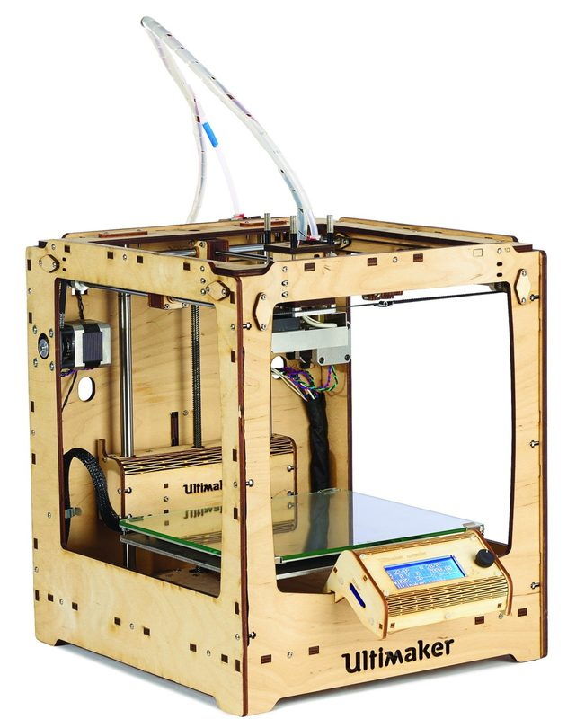
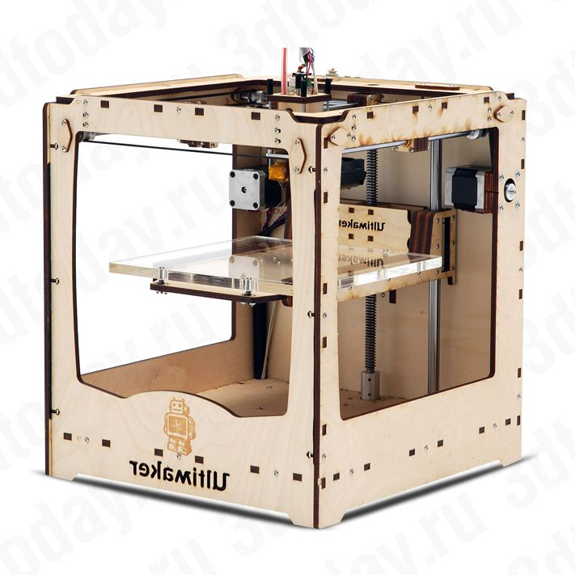
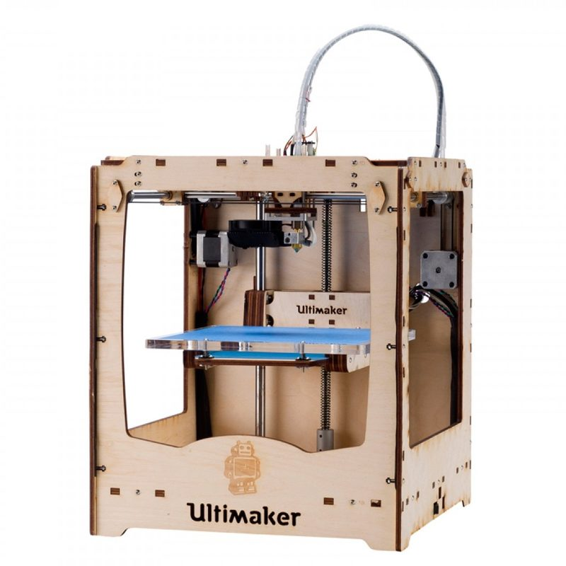
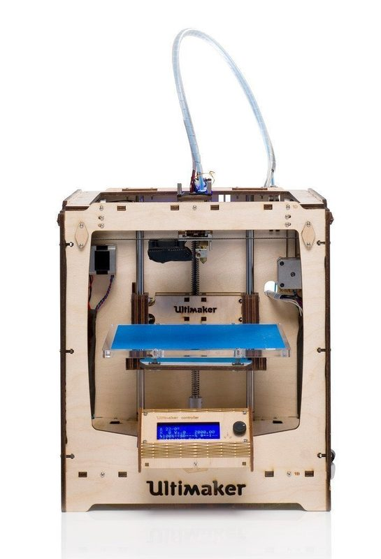
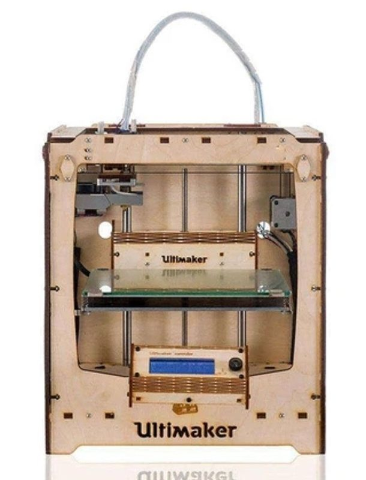
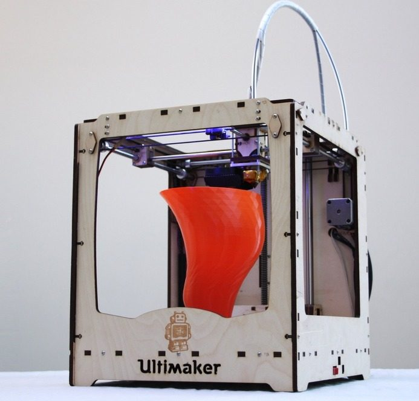
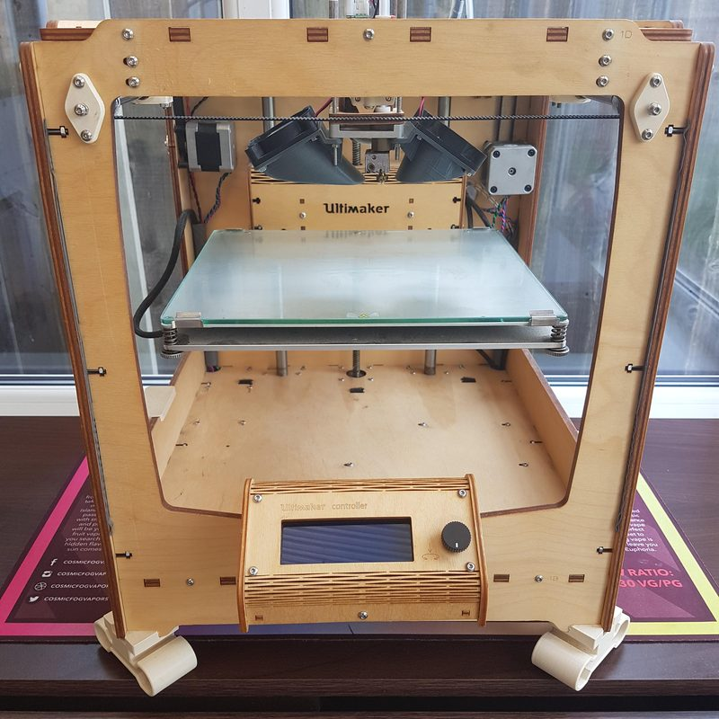
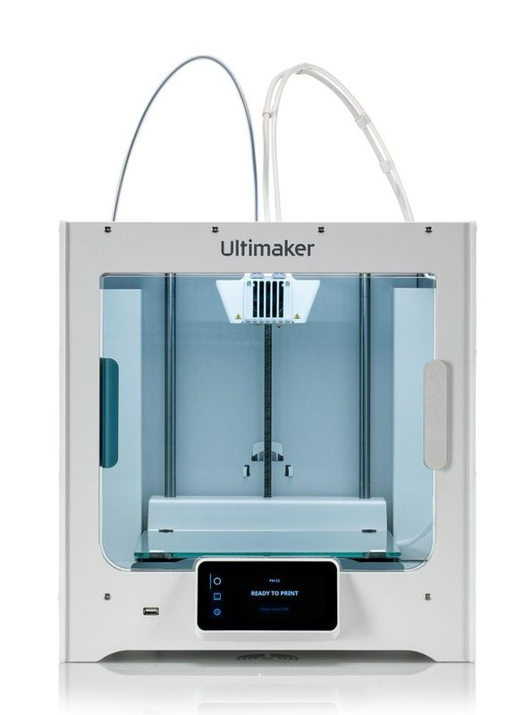
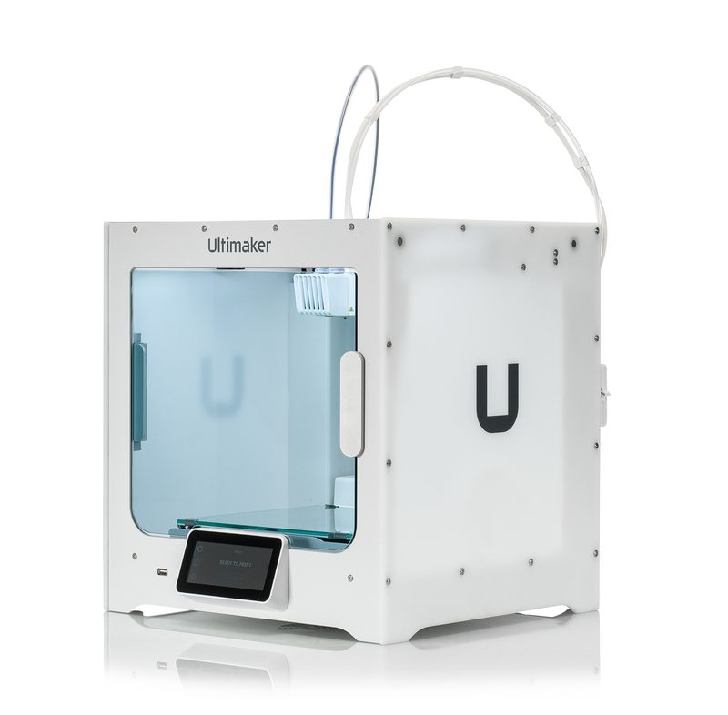

# Ultimaker Original

[Catalog row](../../README.md#ultimaker-original) · [Gallery](../../GALLERY.md)

| Field | Value |
| --- | --- |
| Section | Historical designs |
| Project page | [https://github.com/Ultimaker/UltimakerOriginal](https://github.com/Ultimaker/UltimakerOriginal) |
| Author | Ultimaker |
| About | Open-design wooden-frame printer. It made the moving-head cross gantry and the Bowden feed popular. |
| Build volume (X×Y×Z) | 205×205×200 |
| Exterior (W×D×H) | — |
| Latest version | CAD [2014-09](https://github.com/Ultimaker/UltimakerOriginal/commit/d72cd54202f0661c90d9c63fb5d4a42622985606) |
| Stars Likes Views |  [⏯️⁠40.7K](https://www.youtube.com/watch?v=OWZi_rvBJ6o) [❤️⁠48](https://www.youtube.com/watch?v=OWZi_rvBJ6o) |
| Links | [BOM](https://github.com/Ultimaker/UltimakerOriginal/tree/HEAD/BOM) |
| Groups | [Forum](https://community.ultimaker.com/) EN [Forum](https://community.ultimaker.com/forum/124-deutsch/) DE [Forum](https://community.ultimaker.com/forum/126-fran%C3%A7ais/) FR [Forum](https://community.ultimaker.com/forum/125-espa%C3%B1ol/) ES [Reddit](https://www.reddit.com/r/ultimaker/) EN 4.6K |

## Pictures (9)

<table>
<tr><td align="center" width="33%"> Photo: Brian Kaldorf</td><td align="center" width="33%"> Photo: <a href="https://ultimaker.com">Ultimaker</a></td><td align="center" width="33%"> Photo: <a href="https://ultimaker.com">Ultimaker</a></td></tr>
<tr><td align="center" width="33%"> Photo: <a href="https://ultimaker.com">Ultimaker</a></td><td align="center" width="33%"> Photo: <a href="https://ultimaker.com">Ultimaker</a></td><td align="center" width="33%"> Photo: <a href="https://reprap.org/wiki/User:ErikDeBruijn">Erik de Bruijn</a></td></tr>
<tr><td align="center" width="33%"> Photo: <a href="https://community.ultimaker.com/profile/313886-cor3ys/">cor3ys</a></td><td align="center" width="33%"> Photo: <a href="https://ultimaker.com">Ultimaker</a></td><td align="center" width="33%"> Photo: <a href="https://ultimaker.com">Ultimaker</a></td></tr>
</table>
