# Ultimaker (Original to 3)

[Catalog row](../../README.md#ultimaker) · [Gallery](../../GALLERY.md)

| Field | Value |
| --- | --- |
| Section | Historical designs |
| Project page | [https://github.com/Ultimaker/Ultimaker2](https://github.com/Ultimaker/Ultimaker2) |
| Author | Ultimaker |
| About | Open-hardware line that made the moving-head cross gantry and the Bowden feed popular. It grew from the wooden Original and Original+ through the UM2, UM2 Extended, compact UM2 Go, UM2+ and UM2 Extended+ to the dual-extrusion UM3 and UM3 Extended with swappable print cores. |
| Build volume (X×Y×Z) | UM3: 215×215×200 UM3 Extended: 215×215×300 UM2, UM2+: 223×223×205 UM2 Extended, Extended+: 223×223×305 UM2 Go: 120×120×115 Original+: 210×210×205 Original: 205×205×200 |
| Exterior (W×D×H) | UM3: 342×380×389 UM3 Extended: 342×380×489 UM2, UM2+: 342×357×388 UM2 Extended, Extended+: 342×357×488 UM2 Go: 258×250×288 Original+: 357×342×388 |
| Latest version | UM2+ [2018-07](https://github.com/Ultimaker/Ultimaker2Plus/commit/830bcb6203b9c5c9794401b153fd75a019132bd2) |
| Stars Likes Views |  [⏯️⁠379K](https://www.youtube.com/watch?v=ScfMl3u-uT8) [❤️⁠1.2K](https://www.youtube.com/watch?v=ScfMl3u-uT8) |
| Links | [STEP](https://github.com/Ultimaker/Ultimaker3/blob/master/3D%20model%20Ultimaker%203/9066.STEP.zip) UM3 [BOM](https://github.com/Ultimaker/Ultimaker3/tree/master/BOM) UM3 [Manual](https://um-support-files.ultimaker.com/manuals/user-manual/UM3/Ultimaker%203%20-%20User%20manual%20EN%20v1.4.pdf) UM3 [STEP](https://github.com/Ultimaker/Ultimaker3Extended/blob/master/3D%20model%20Ultimaker%203%20extended/9511.STEP.zip) UM3 Extended [STEP](https://github.com/Ultimaker/Ultimaker2Plus/blob/master/3D%20model%20Ultimaker%202%2B/Main%20assembly%20Ultimaker%202%2B.zip) UM2+ [BOM](https://github.com/Ultimaker/Ultimaker2Plus/tree/master/BOM) UM2+ [STEP](https://github.com/Ultimaker/Ultimaker2ExtendedPlus/blob/master/3D%20model%20Ultimaker2extended%2B/Main%20assembly%20Ultimaker2extended%2B.STEP.zip) UM2 Extended+ [STEP](https://github.com/Ultimaker/Ultimaker2Go/blob/master/3D%20model/UM%202%20GO.STEP) UM2 Go [Manual](https://um-support-files.ultimaker.com/manuals/user-manual/UM2GO/Ultimaker%202%20Go%20-%20User%20manual%20EN%20v2.1.pdf) UM2 Go [STEP](https://github.com/Ultimaker/Ultimaker2/blob/master/Assembly%20UM2%20stepfile.STEP) UM2 [BOM](https://github.com/Ultimaker/Ultimaker2/tree/master/_BOM) UM2 [Manual](https://github.com/Ultimaker/Ultimaker2/blob/master/um2%20assembly%20manual%20V1.1%20_english.pdf) UM2 [STEP](https://github.com/Ultimaker/Ultimaker2Extended/blob/master/3D%20model/UM%20Extended.STEP) UM2 Extended [Files](https://github.com/Ultimaker/Ultimaker-Original-Plus) Original+ [Manual](https://github.com/Ultimaker/Ultimaker-Original-Plus/blob/master/Buildmanual%20UM%20Original%20%2B%20v2.pdf) Original+ [BOM](https://github.com/Ultimaker/UltimakerOriginal/tree/HEAD/BOM) Original |
| Groups | [Forum](https://community.ultimaker.com/) EN [Forum](https://community.ultimaker.com/forum/124-deutsch/) DE [Forum](https://community.ultimaker.com/forum/126-fran%C3%A7ais/) FR [Forum](https://community.ultimaker.com/forum/125-espa%C3%B1ol/) ES [Forum](https://community.ultimaker.com/forum/123-nederlands/) NL [Reddit](https://www.reddit.com/r/ultimaker/) EN 4.6K |
| License | [CC BY-NC 3.0 (GitHub, Thingiverse)](https://github.com/Ultimaker/Ultimaker2/blob/master/LICENSE) |

## Pictures (34)

<table>
<tr><td align="center" width="33%"> Version: UM3 Photo: <a href="https://commons.wikimedia.org/wiki/User:DirkvdM">DirkvdM</a></td><td align="center" width="33%"><a href="1-ultimaker.jpg">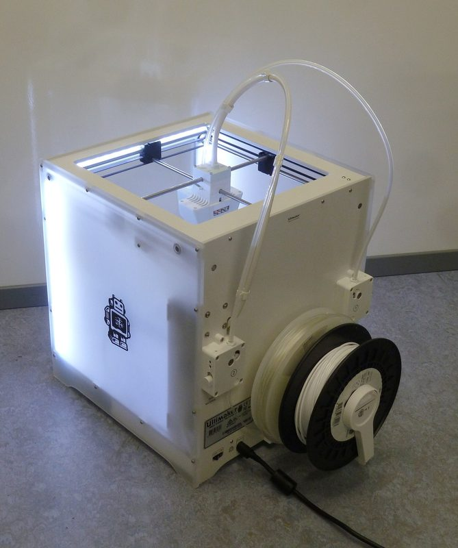</a> Version: UM3 Photo: <a href="https://commons.wikimedia.org/wiki/User:DirkvdM">DirkvdM</a></td><td align="center" width="33%"><a href="2-ultimaker.jpg">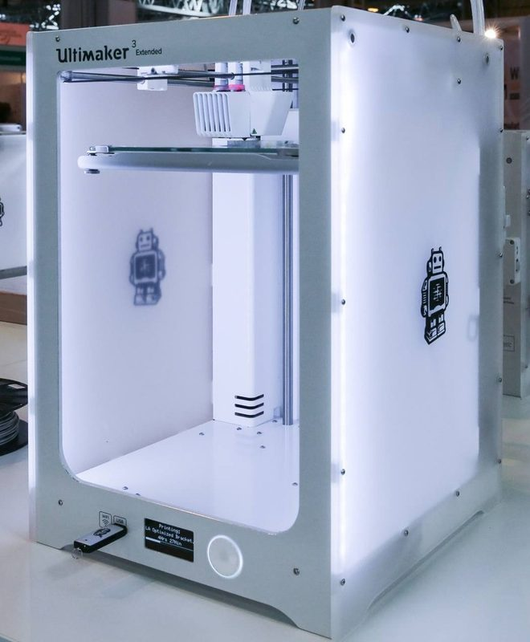</a> Version: UM3 Extended Photo: <a href="https://ultimaker.com">Ultimaker</a></td></tr>
<tr><td align="center" width="33%"><a href="3-ultimaker.jpg">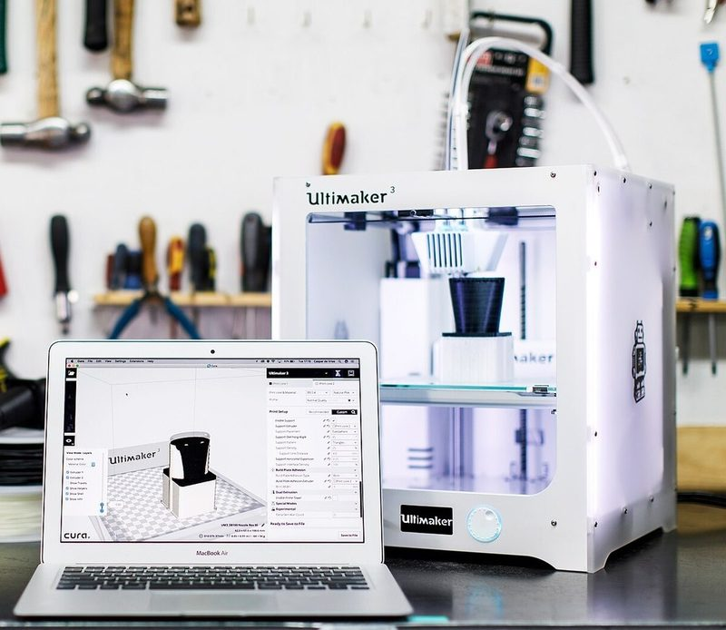</a> Version: UM3 Photo: <a href="https://ultimaker.com">Ultimaker</a></td><td align="center" width="33%"><a href="4-ultimaker.jpg">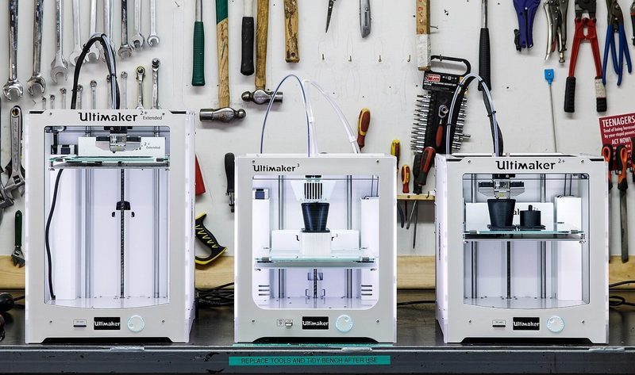</a> Version: UM2 Extended+, UM3, UM2+ Photo: <a href="https://ultimaker.com">Ultimaker</a></td><td align="center" width="33%"><a href="5-ultimaker.jpg">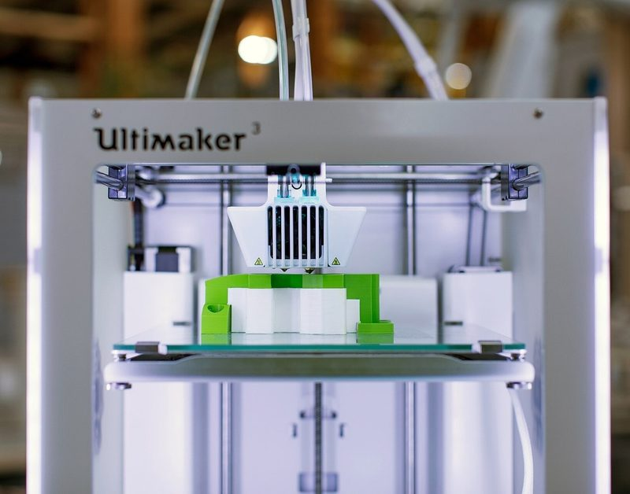</a> Version: UM3 Photo: <a href="https://ultimaker.com">Ultimaker</a></td></tr>
<tr><td align="center" width="33%"><a href="6-ultimaker.jpg">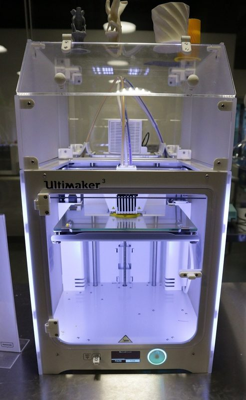</a> Version: UM3 Photo: <a href="https://www.flickr.com/photos/155936862@N04/">Kalle</a></td><td align="center" width="33%"><a href="7-ultimaker.jpg">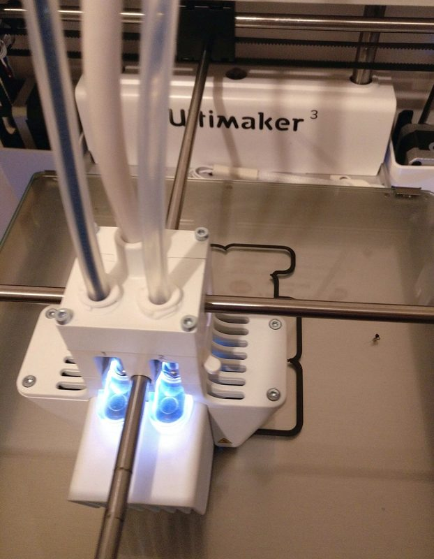</a> Version: UM3 Photo: <a href="https://commons.wikimedia.org/wiki/User:MakerTobey">MakerTobey</a></td><td align="center" width="33%"><a href="8-ultimaker.jpg">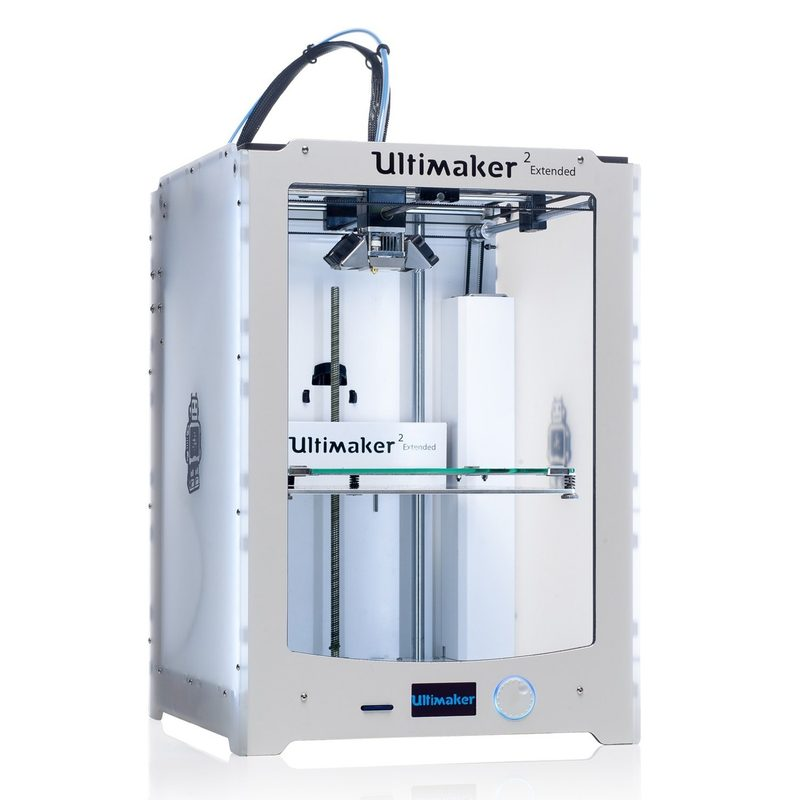</a> Version: UM2 Extended Photo: <a href="https://www.flickr.com/photos/33907867@N02/">Creative Tools/Ultimaker</a></td></tr>
<tr><td align="center" width="33%"><a href="9-ultimaker.jpg">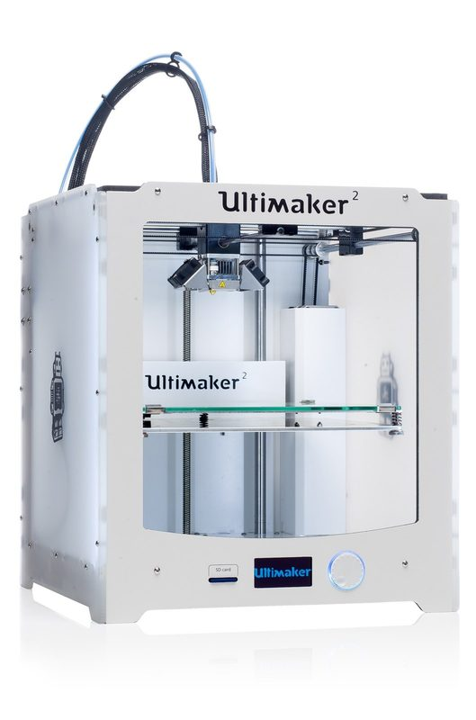</a> Version: UM2 Photo: <a href="https://ultimaker.com">Ultimaker</a></td><td align="center" width="33%"><a href="10-ultimaker.jpg">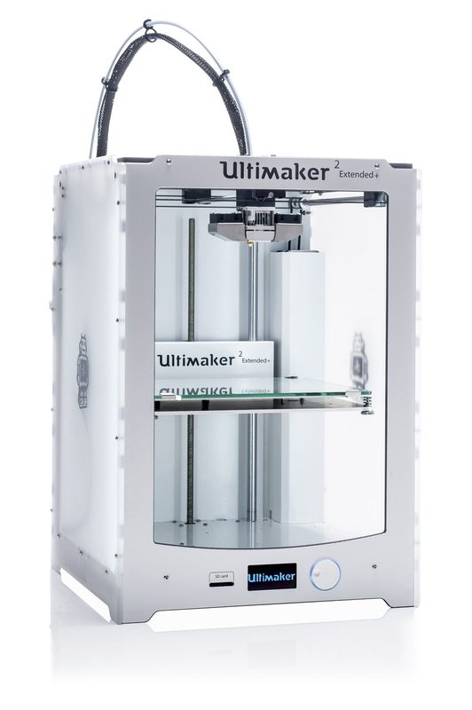</a> Version: UM2 Extended+ Photo: <a href="https://ultimaker.com">Ultimaker</a></td><td align="center" width="33%"><a href="11-ultimaker.jpg">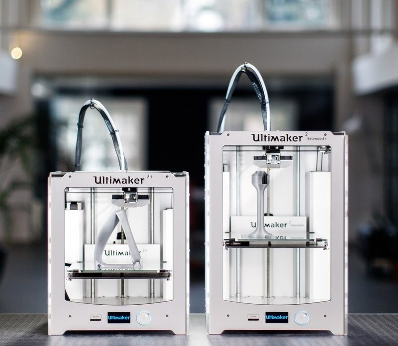</a> Version: UM2+ and UM2 Extended+ Photo: <a href="https://ultimaker.com">Ultimaker</a></td></tr>
<tr><td align="center" width="33%"><a href="12-ultimaker.jpg">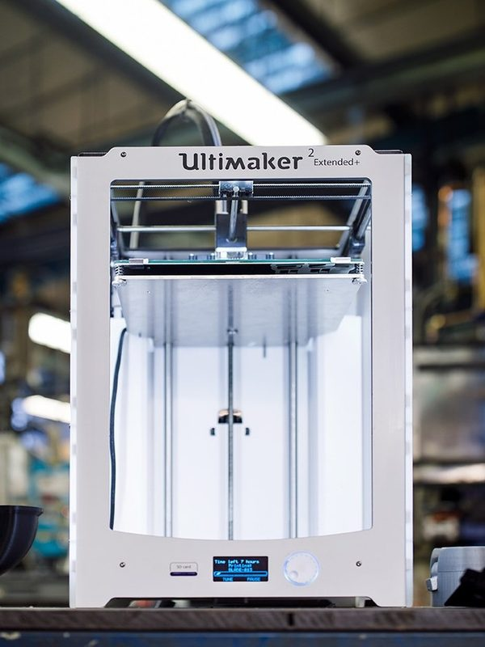</a> Version: UM2 Extended+ Photo: <a href="https://commons.wikimedia.org/wiki/User:Slozova">Svitlana Lozova</a></td><td align="center" width="33%"><a href="13-ultimaker.jpg">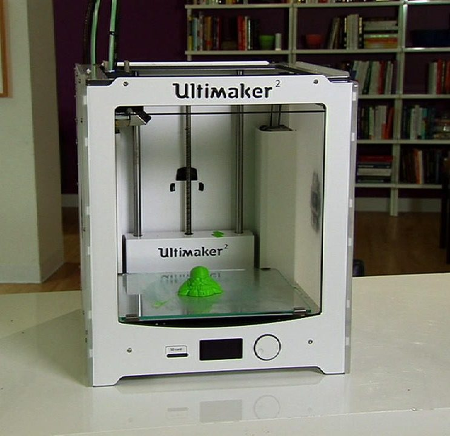</a> Version: UM2 Photo: <a href="https://commons.wikimedia.org/wiki/User:Kadel3003">Kadel3003</a></td><td align="center" width="33%"><a href="14-ultimaker.jpg">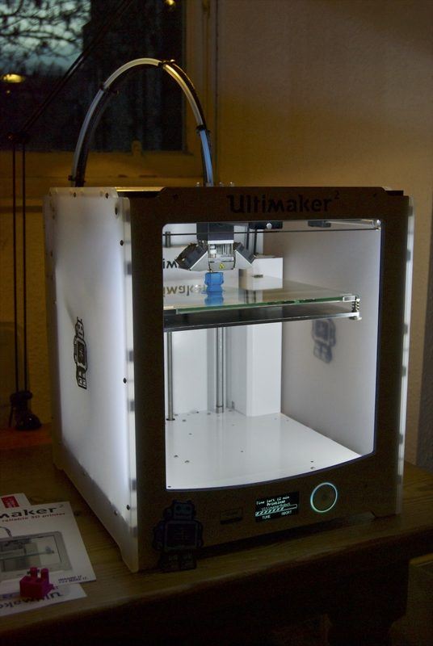</a> Version: UM2 Photo: <a href="https://www.flickr.com/photos/50394334@N00/">Gary C Martin</a></td></tr>
<tr><td align="center" width="33%"><a href="15-ultimaker.jpg">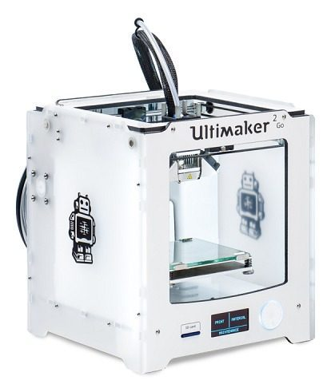</a> Version: UM2 Go Photo: <a href="https://github.com/Ultimaker">Ultimaker</a></td><td align="center" width="33%"><a href="16-ultimaker.jpg">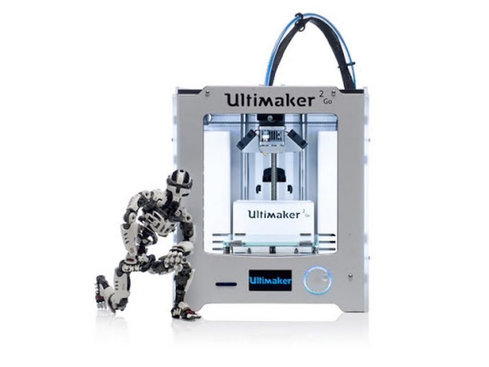</a> Version: UM2 Go Photo: <a href="https://github.com/Ultimaker">Ultimaker</a></td><td align="center" width="33%"><a href="17-ultimaker.jpg">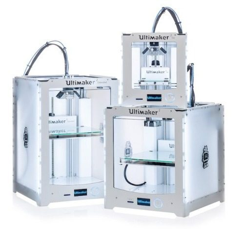</a> Version: UM2 Extended, UM2 Go, UM2 Photo: <a href="https://github.com/Ultimaker">Ultimaker</a></td></tr>
<tr><td align="center" width="33%"><a href="18-ultimaker.jpg">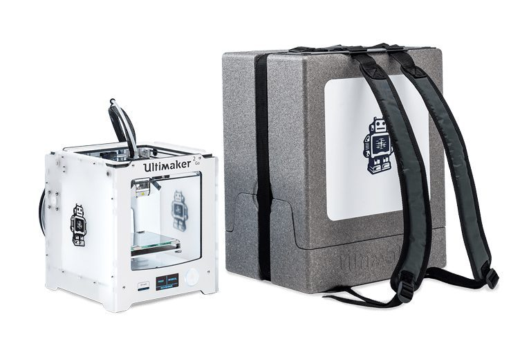</a> Version: UM2 Go with its carry backpack Photo: <a href="https://github.com/Ultimaker">Ultimaker</a></td><td align="center" width="33%"><a href="19-ultimaker.jpg">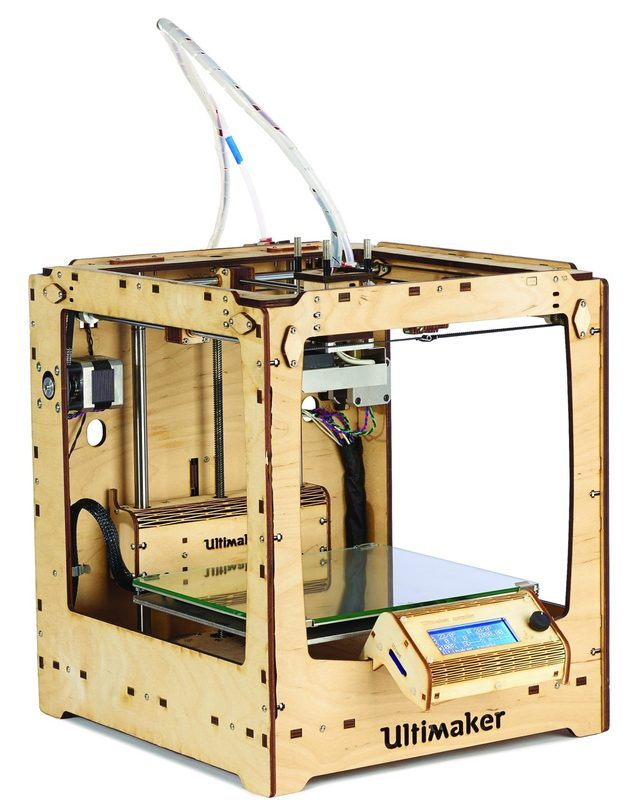</a> Version: Original+ Photo: Brian Kaldorf</td><td align="center" width="33%"><a href="20-ultimaker.jpg">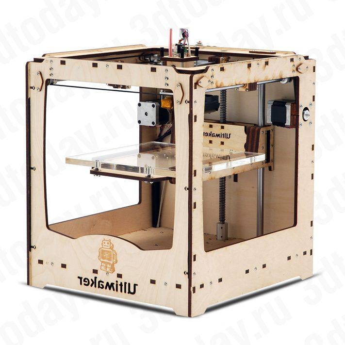</a> Version: Original Photo: <a href="https://ultimaker.com">Ultimaker</a></td></tr>
<tr><td align="center" width="33%"><a href="21-ultimaker.jpg">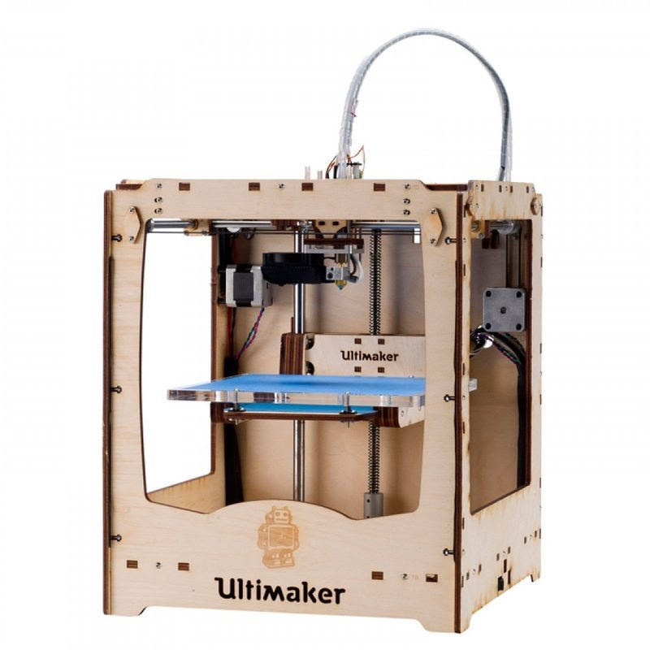</a> Version: Original Photo: <a href="https://ultimaker.com">Ultimaker</a></td><td align="center" width="33%"><a href="22-ultimaker.jpg">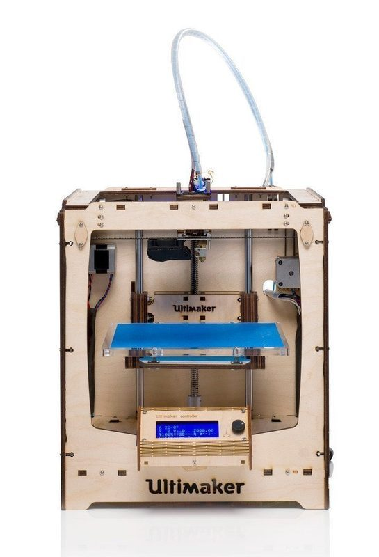</a> Version: Original Photo: <a href="https://ultimaker.com">Ultimaker</a></td><td align="center" width="33%"><a href="23-ultimaker.jpg">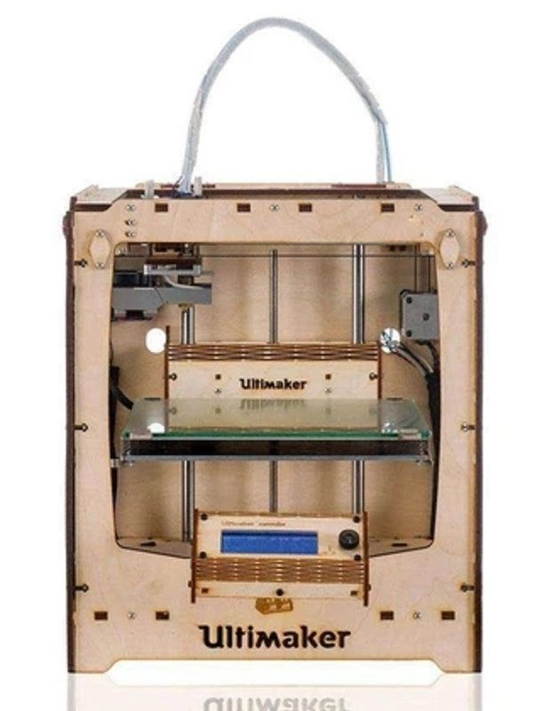</a> Version: Original+ Photo: <a href="https://ultimaker.com">Ultimaker</a></td></tr>
<tr><td align="center" width="33%"><a href="24-ultimaker.jpg">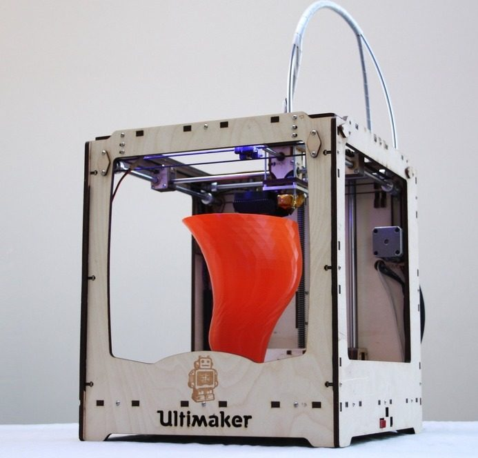</a> Version: Original Photo: <a href="https://reprap.org/wiki/User:ErikDeBruijn">Erik de Bruijn</a></td><td align="center" width="33%"><a href="25-ultimaker.jpg">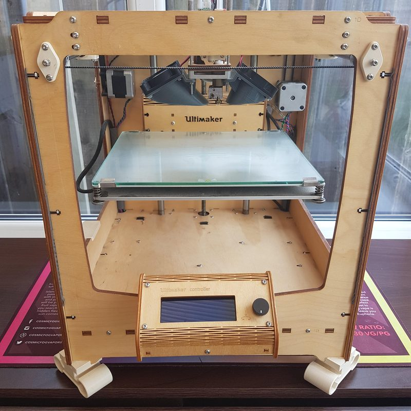</a> Version: Original+ Photo: <a href="https://community.ultimaker.com/profile/313886-cor3ys/">cor3ys</a></td><td align="center" width="33%"><a href="26-ultimaker.jpg">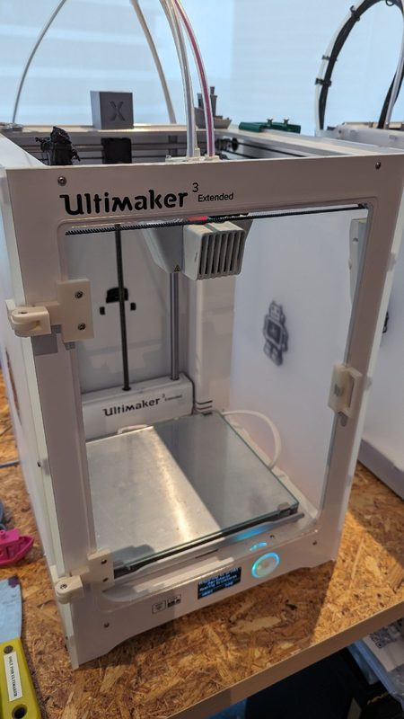</a> Version: UM3 Extended Photo: <a href="https://www.printables.com/@cyberal_">cyberal</a></td></tr>
<tr><td align="center" width="33%"><a href="27-ultimaker.jpg">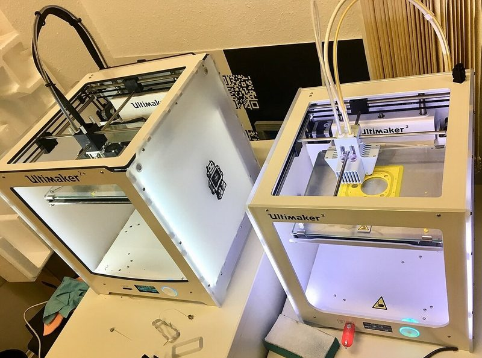</a> Version: UM2+ and UM3 Photo: <a href="https://commons.wikimedia.org/wiki/User:-stk">-stk</a></td><td align="center" width="33%"><a href="28-ultimaker.jpg">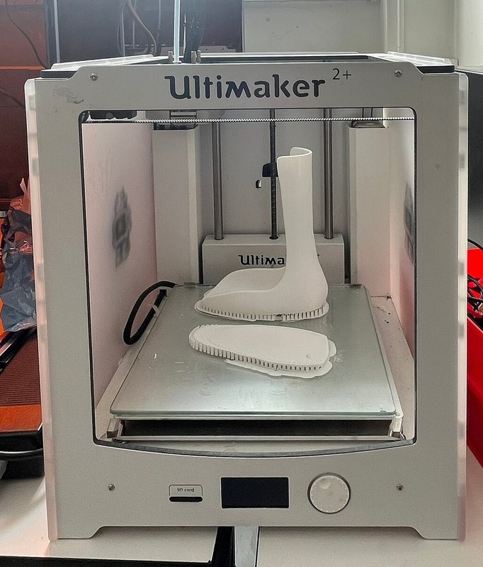</a> Version: UM2+ Photo: <a href="https://commons.wikimedia.org/wiki/User:Beno%C3%AEt_Prieur">Benoît Prieur</a></td><td align="center" width="33%"><a href="29-ultimaker.jpg">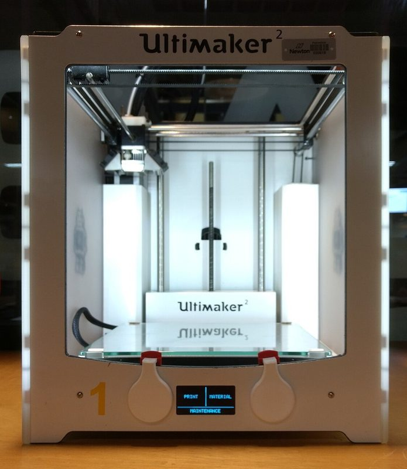</a> Version: UM2 Photo: <a href="https://commons.wikimedia.org/wiki/User:FabLab_Newton">FabLab Newton</a></td></tr>
<tr><td align="center" width="33%"><a href="30-ultimaker.jpg">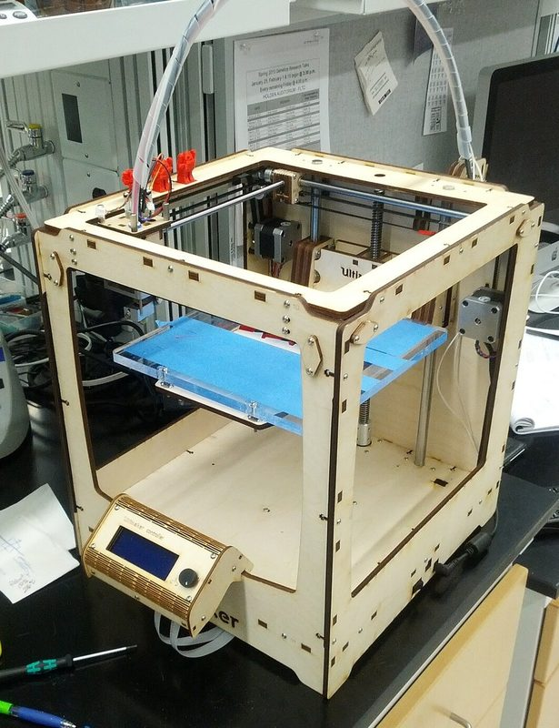</a> Version: Original Photo: <a href="https://commons.wikimedia.org/wiki/User:Semenko">Semenko</a></td><td align="center" width="33%"><a href="31-ultimaker.jpg">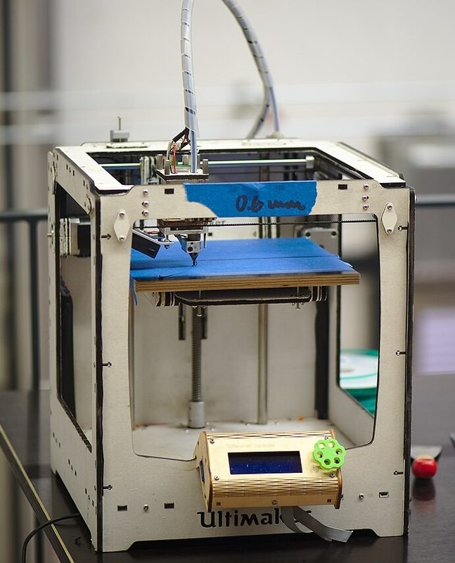</a> Version: Original Photo: <a href="https://www.flickr.com/photos/91843684@N02/">tonnerrelombard</a></td><td align="center" width="33%"><a href="32-ultimaker.jpg">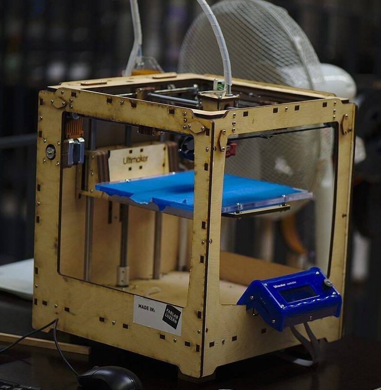</a> Version: Original Photo: <a href="https://www.flickr.com/photos/91843684@N02/">tonnerrelombard</a></td></tr>
<tr><td align="center" width="33%"><a href="33-ultimaker.jpg">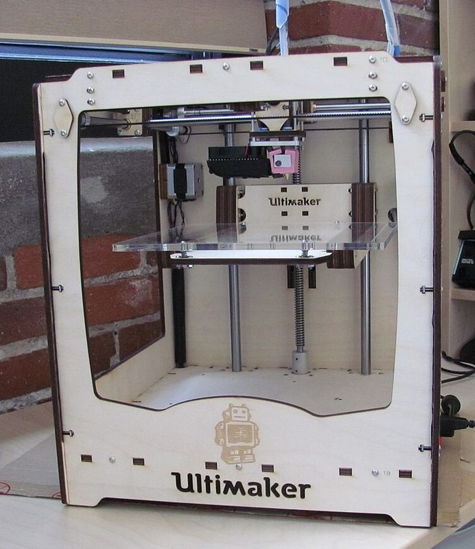</a> Version: Original Photo: <a href="https://www.flickr.com/photos/52118225@N08/">ddurant123</a></td></tr>
</table>

## Other homes of the files

- [Thingiverse](https://www.thingiverse.com/thing:8563): Original laser-cut frame drawings by Ultimaker co-founder Martijn Elserman, 2011-05. CC BY-NC.
- Wayback Machine, latest snapshot of each repository:
  - [Ultimaker3](https://web.archive.org/web/20260107220814/https://github.com/Ultimaker/Ultimaker3) 2026-01-07
  - [Ultimaker3Extended](https://web.archive.org/web/20250822083041/https://github.com/Ultimaker/Ultimaker3Extended) 2025-08-22
  - [Ultimaker2Plus](https://web.archive.org/web/20250729192854/https://github.com/Ultimaker/Ultimaker2Plus) 2025-07-29
  - [Ultimaker2ExtendedPlus](https://web.archive.org/web/20250730000910/https://github.com/Ultimaker/Ultimaker2ExtendedPlus) 2025-07-30
  - [Ultimaker2Go](https://web.archive.org/web/20251219135341/https://github.com/Ultimaker/Ultimaker2Go) 2025-12-19
  - [Ultimaker2](https://web.archive.org/web/20250804015520/https://github.com/Ultimaker/Ultimaker2) 2025-08-04
  - [Ultimaker2Extended](https://web.archive.org/web/20250730000914/https://github.com/Ultimaker/Ultimaker2Extended) 2025-07-30
  - [Ultimaker-Original-Plus](https://web.archive.org/web/20250903005301/https://github.com/Ultimaker/Ultimaker-Original-Plus) 2025-09-03
  - [UltimakerOriginal](https://web.archive.org/web/20250729192126/https://github.com/Ultimaker/UltimakerOriginal) 2025-07-29

## Mods and variants

- [UM2-structure DIY printer](https://github.com/lucerna-gelu/UM2-Ultimaker-3Dprinter-DIY) by *lucerna-gelu*. A self-built printer on the UM2 layout, with its own frame. The repo has a STEP and STL model, drawings of the custom machined parts, Marlin firmware for an SKR 1.3 board, PrusaSlicer settings and a troubleshooting PDF. The firmware sets a 140×140×392 build volume. License: MIT. Last update 2021-07.
