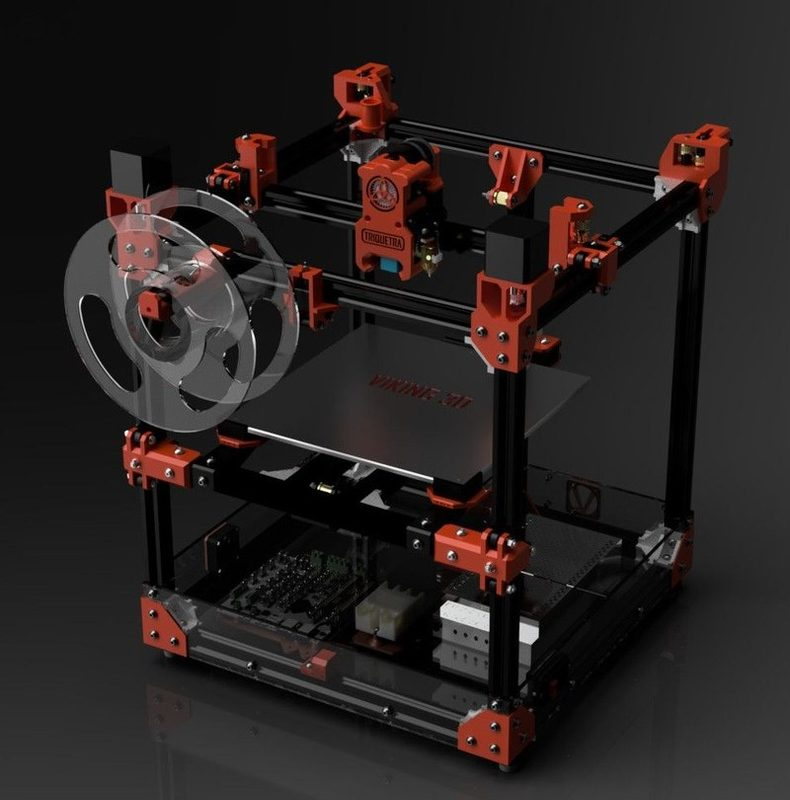
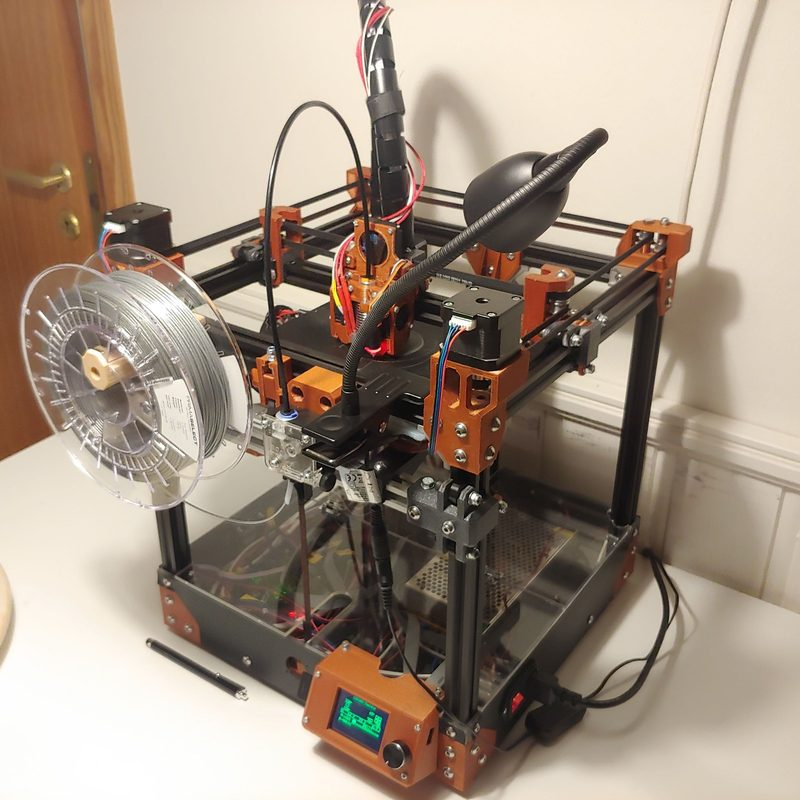
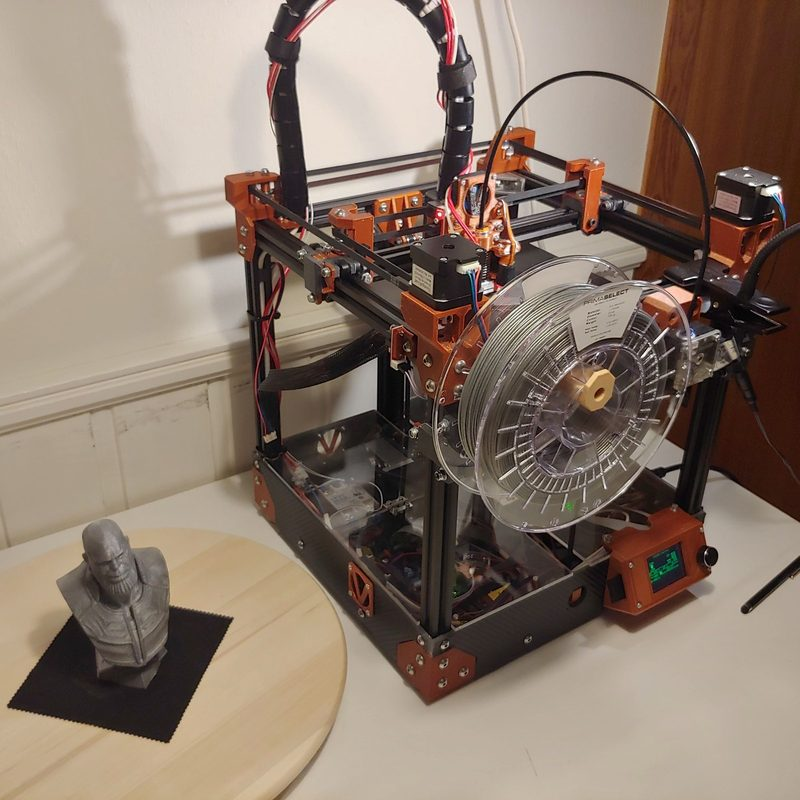
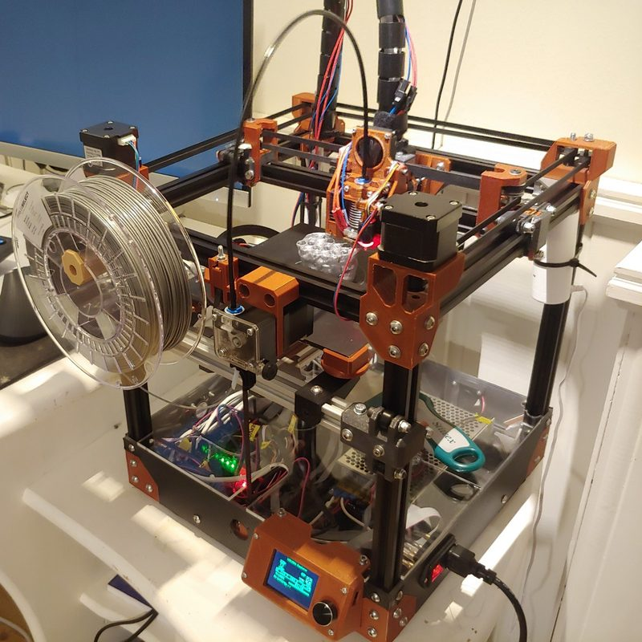
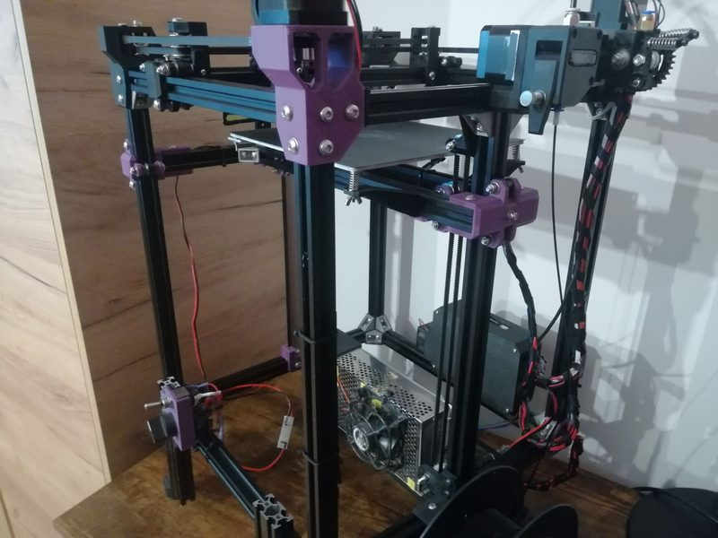
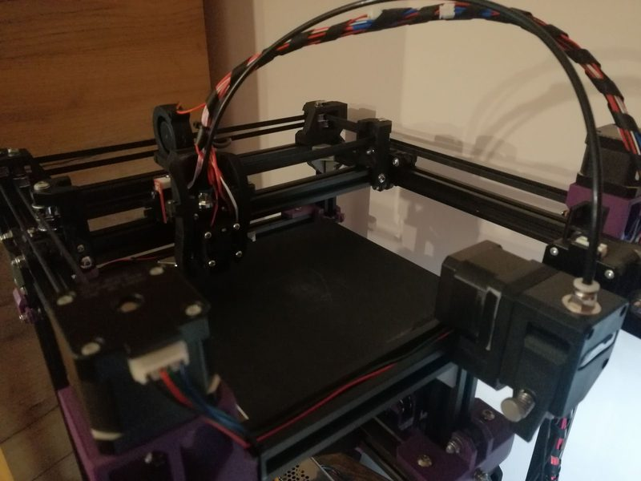

# V-Baby CoreXY

[Catalog row](../../README.md#v-baby-corexy) · [Gallery](../../GALLERY.md)

| Field | Value |
| --- | --- |
| Section | Legacy designs |
| Project page | [https://github.com/RoyBerntsenDesign/V-Baby-CoreXY](https://github.com/RoyBerntsenDesign/V-Baby-CoreXY) |
| Author | Roy Berntsen / PRO 3D |
| About | Small sibling of the V-King: a desktop CoreXY where V-wheels run in V-slot extrusion and belts drive all three axes. Version 1.2 adds a belted 3:1 Z gear in place of the worm gear. No update since 2021-04. |
| Build volume (X×Y×Z) | 200×200×200 |
| Exterior (W×D×H) | — |
| Latest version | 1.2 [2021-04](https://github.com/RoyBerntsenDesign/V-Baby-CoreXY/releases/tag/1.2) |
| Stars Likes Views |  [💙⁠141](https://www.thingiverse.com/thing:3863246) [🤍⁠76](https://www.myminifactory.com/object/3d-print-101026) [⏯️⁠9.6K](https://www.youtube.com/watch?v=y4W0cese5Mc) [❤️⁠220](https://www.youtube.com/watch?v=y4W0cese5Mc) |
| Links | [STEP](https://github.com/RoyBerntsenDesign/V-Baby-CoreXY/blob/master/Source%20Files/V-Baby%20V1.2.0%20step%20simplified.step) [CAD](https://github.com/RoyBerntsenDesign/V-Baby-CoreXY/blob/master/Source%20Files/V-Baby%20V1.2.0.f3z) [STL](https://github.com/RoyBerntsenDesign/V-Baby-CoreXY/tree/master/Part%20Print%20Files) [BOM](https://github.com/RoyBerntsenDesign/V-Baby-CoreXY/blob/master/Document%20Library/Bill%20Of%20Materials/V-Baby%20BOM.xlsx) [Config](https://github.com/RoyBerntsenDesign/V-Baby-CoreXY/tree/master/Firmware) |
| Groups | [Facebook](https://www.facebook.com/groups/viking3d/) EN |
| License | [CC BY-NC-SA 4.0](https://github.com/RoyBerntsenDesign/V-Baby-CoreXY/blob/master/LICENSE) |

## Pictures (7)

<table>
<tr><td align="center" width="33%"> Photo: <a href="https://hackaday.io/hacker/408375-roy-berntsen">Roy Berntsen</a></td><td align="center" width="33%"> Version: V1.2 Photo: <a href="https://www.thingiverse.com/3D_PRO">Roy Berntsen</a></td><td align="center" width="33%"> Photo: <a href="https://www.thingiverse.com/3D_PRO">Roy Berntsen</a></td></tr>
<tr><td align="center" width="33%"> Photo: <a href="https://www.thingiverse.com/3D_PRO">Roy Berntsen</a></td><td align="center" width="33%"> Photo: <a href="https://www.myminifactory.com/users/Pro3D">Roy Berntsen</a></td><td align="center" width="33%"> Photo: <a href="https://www.thingiverse.com/BepisFan04">BepisFan04</a></td></tr>
<tr><td align="center" width="33%"> Photo: <a href="https://www.thingiverse.com/BepisFan04">BepisFan04</a></td></tr>
</table>
