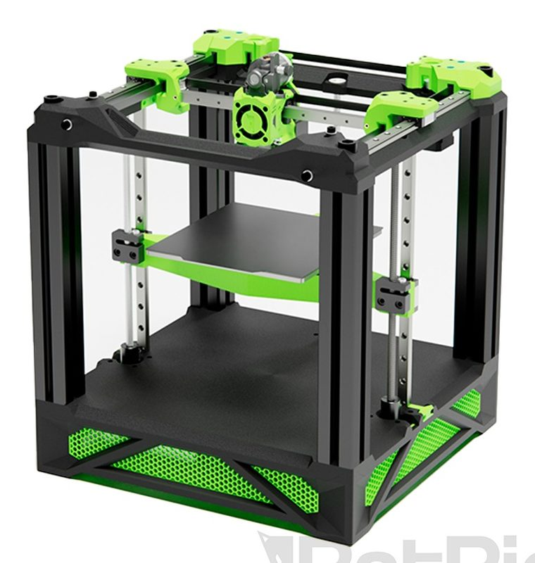
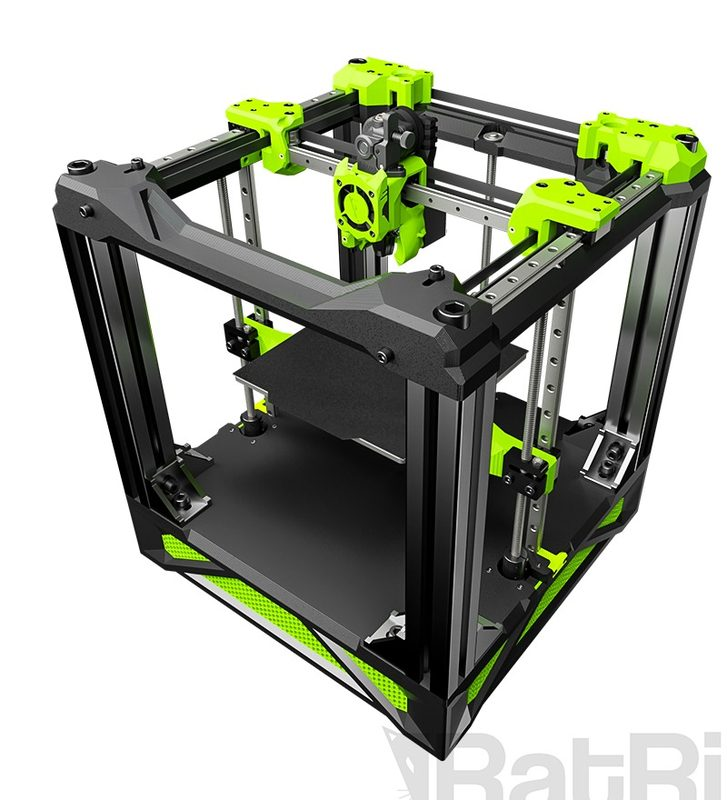
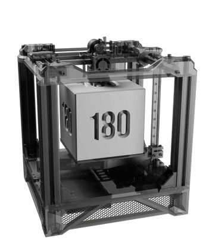
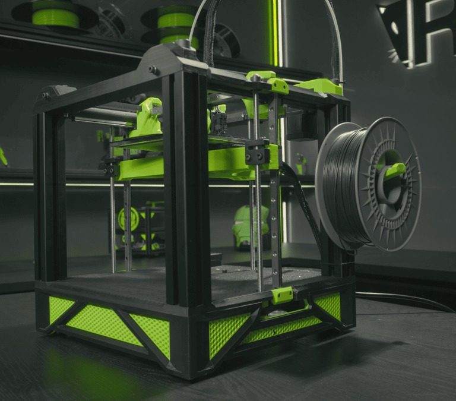
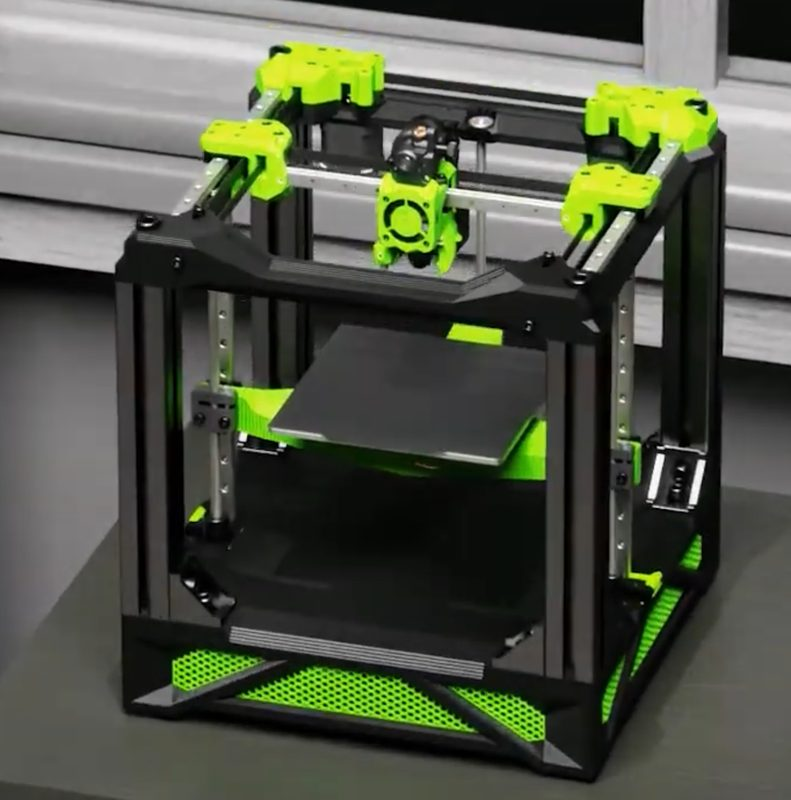
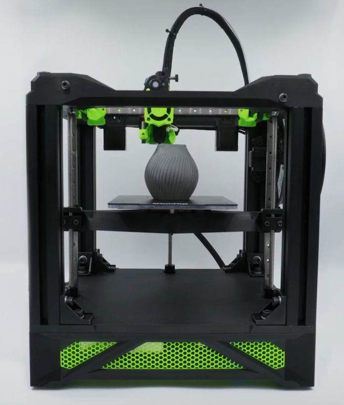
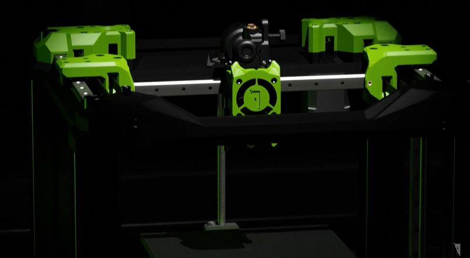

# Rat Rig V-Chonk

[Catalog row](../../README.md#v-chonk) · [Gallery](../../GALLERY.md)

| Field | Value |
| --- | --- |
| Section | CoreXY · Small (≤180 mm representative X/Y size) |
| Project page | [https://github.com/Rat-Rig/V-Chonk](https://github.com/Rat-Rig/V-Chonk) |
| Author | Rat Rig family |
| About | Beta, mostly printed 180 mm CoreXY. |
| Build volume (X×Y×Z) | 180×180×180 |
| Exterior (W×D×H) | — |
| Latest version | v0.4 [2024-07](https://github.com/Rat-Rig/V-Chonk/commit/85fa06be71054b5c0d7e513cc762dbd7d893b6a0) |
| Stars Likes Views |  [⏯️⁠18.2K](https://www.youtube.com/watch?v=TIkY9gv_bjg) [❤️⁠308](https://www.youtube.com/watch?v=TIkY9gv_bjg) |
| Links | [STEP](https://github.com/Rat-Rig/V-Chonk#step-files) [BOM](https://github.com/Rat-Rig/V-Chonk/tree/main/bom) [STL](https://github.com/Rat-Rig/V-Chonk/tree/main/stl) |
| Groups | [Facebook](https://www.facebook.com/groups/ratrig3dprintercommunity) EN 19.9K [Discord](https://discord.gg/ratrig) EN 13.8K [Reddit](https://www.reddit.com/r/RatRig/) EN 3K |
| License | [CC BY-SA 4.0](https://github.com/Rat-Rig/V-Chonk/blob/main/LICENSE) |

## Pictures (7)

<table>
<tr><td align="center" width="33%"> Photo: <a href="https://github.com/Rat-Rig">Rat Rig</a></td><td align="center" width="33%"> Photo: <a href="https://github.com/Rat-Rig">Rat Rig</a></td><td align="center" width="33%"> Photo: <a href="https://ratrig.com">Rat Rig</a></td></tr>
<tr><td align="center" width="33%"> Photo: <a href="https://github.com/Rat-Rig">Rat Rig</a></td><td align="center" width="33%"> Photo: <a href="https://ratrig.com">Rat Rig</a></td><td align="center" width="33%"> Photo: <a href="https://ratrig.com">Rat Rig</a></td></tr>
<tr><td align="center" width="33%"> Photo: <a href="https://github.com/Rat-Rig">Rat Rig</a></td></tr>
</table>

## Other homes of the files

- Wayback Machine: [latest snapshot](https://web.archive.org/web/20250730041141/https://github.com/Rat-Rig/V-Chonk), 2025-07-30.
