# V-King CoreXY

[Catalog row](../../README.md#v-king) · [Gallery](../../GALLERY.md)

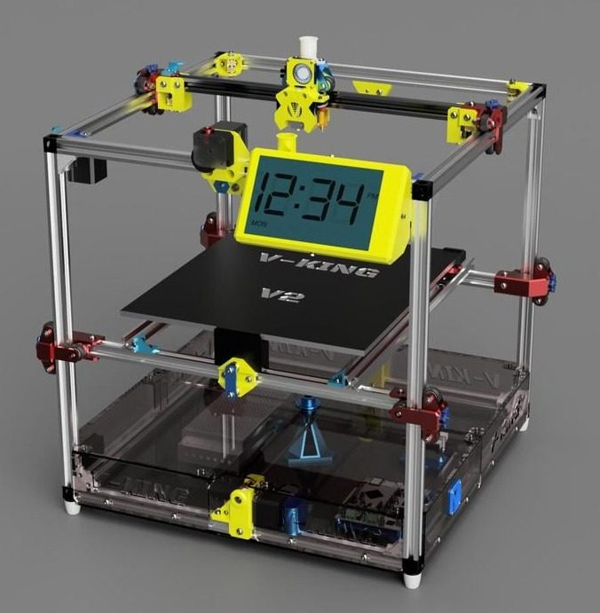

| Field | Value |
| --- | --- |
| Section | Legacy designs |
| Project page | [https://github.com/RoyBerntsenDesign/V-King-CoreXY](https://github.com/RoyBerntsenDesign/V-King-CoreXY) |
| Author | Roy Berntsen / PRO 3D |
| About | Hypercube-style CoreXY with no smooth rods: all axes run on V-wheels in V-slot extrusion, and a worm gear drives the belted Z. No update since 2022-01. |
| Build volume (X×Y×Z) | 340×390×330 |
| Exterior (W×D×H) | — |
| Latest version | Files [2022-01](https://github.com/RoyBerntsenDesign/V-King-CoreXY/commit/59a7ad08779e54fee8d0c5510eb178a15f1034da) |
| Stars Likes Views |  [💙⁠541](https://www.thingiverse.com/thing:2921021) [🤍⁠21](https://www.myminifactory.com/object/3d-print-v-king-corexy-v2-0-73409) [⏯️⁠43K](https://www.youtube.com/watch?v=wINF7qM0DQU) [❤️⁠458](https://www.youtube.com/watch?v=wINF7qM0DQU) |
| Links | [CAD](https://a360.co/3YxhjgS) [STL](https://github.com/RoyBerntsenDesign/V-King-CoreXY/tree/master/Part%20File%20Library) [BOM](https://github.com/RoyBerntsenDesign/V-King-CoreXY/blob/master/Document%20Library/Bill%20Of%20Materials/V-King%20CoreXY%20V2%20-%20Part%20Order%20List.xlsx) [Manual](https://github.com/RoyBerntsenDesign/V-King-CoreXY/blob/master/Document%20Library/V-king%20MK2%20Assembly%20Manual%20V1.0.pdf) [Config](https://github.com/RoyBerntsenDesign/V-King-CoreXY/tree/master/Firmware%20Files/RRF-Duet) |
| Groups | [Facebook](https://www.facebook.com/groups/viking3d/) EN |

## Pictures (14)

<table>
<tr><td align="center" width="33%"> Photo: <a href="https://www.thingiverse.com/3D_PRO">Roy Berntsen</a></td><td align="center" width="33%"><a href="1-v-king.jpg">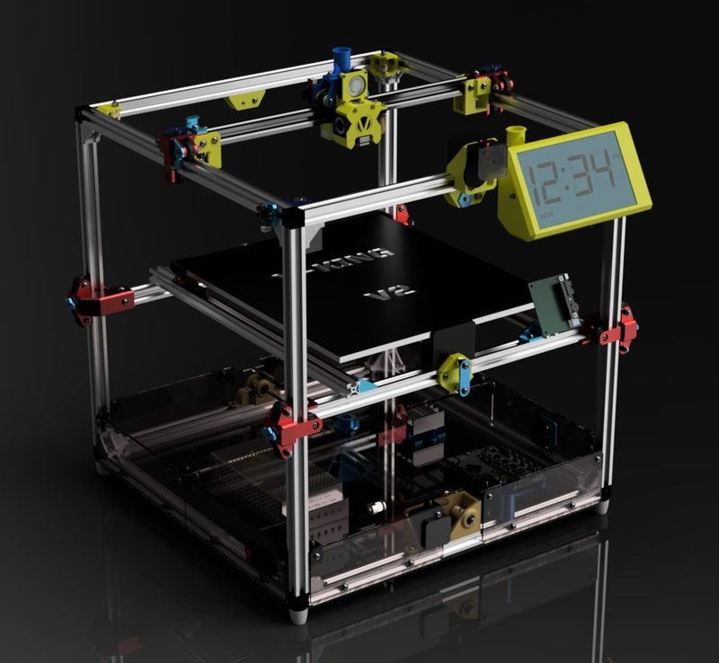</a> Photo: <a href="https://github.com/RoyBerntsenDesign">Roy Berntsen</a></td><td align="center" width="33%"><a href="2-v-king.jpg">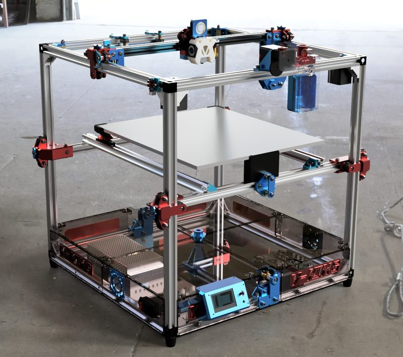</a> Photo: <a href="https://www.myminifactory.com/users/Pro3D">Roy Berntsen</a></td></tr>
<tr><td align="center" width="33%"><a href="3-v-king.jpg">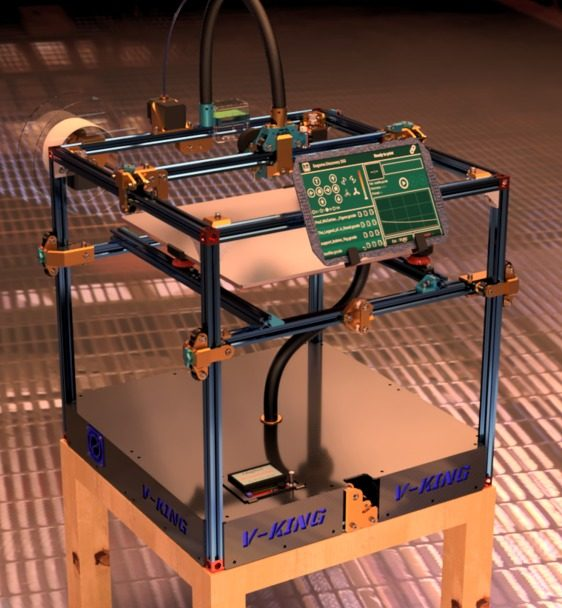</a> Photo: <a href="https://openbuilds.com/builds/v-king-corexy.7699/">Roy Berntsen</a></td><td align="center" width="33%"><a href="4-v-king.jpg">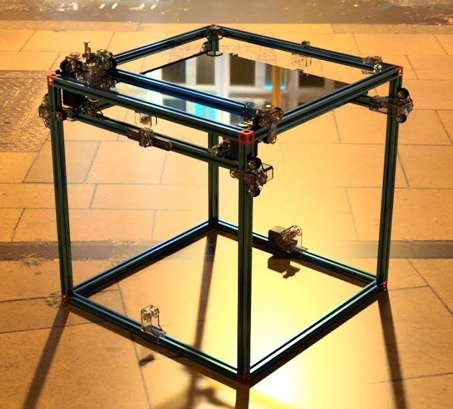</a> Photo: <a href="https://www.youtube.com/@PRO3DESIGN">Roy Berntsen</a></td><td align="center" width="33%"><a href="5-v-king.jpg">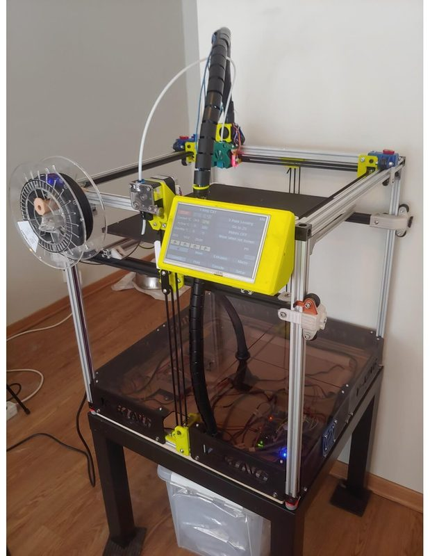</a> Photo: <a href="https://makersupplies.dk/">makersupplies</a></td></tr>
<tr><td align="center" width="33%"><a href="6-v-king.jpg">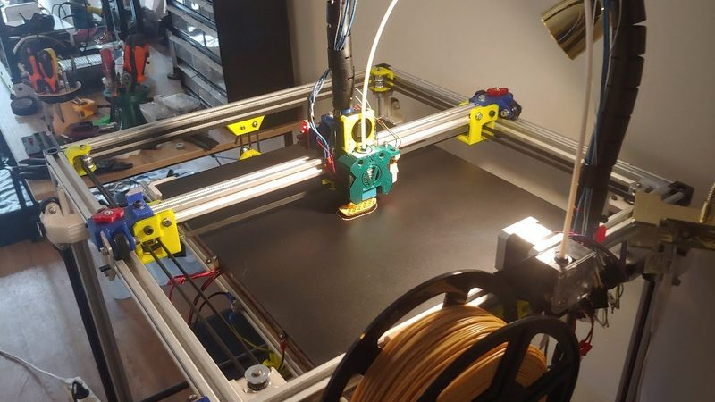</a> Photo: <a href="https://www.youtube.com/@PRO3DESIGN">Roy Berntsen</a></td><td align="center" width="33%"><a href="7-v-king.jpg">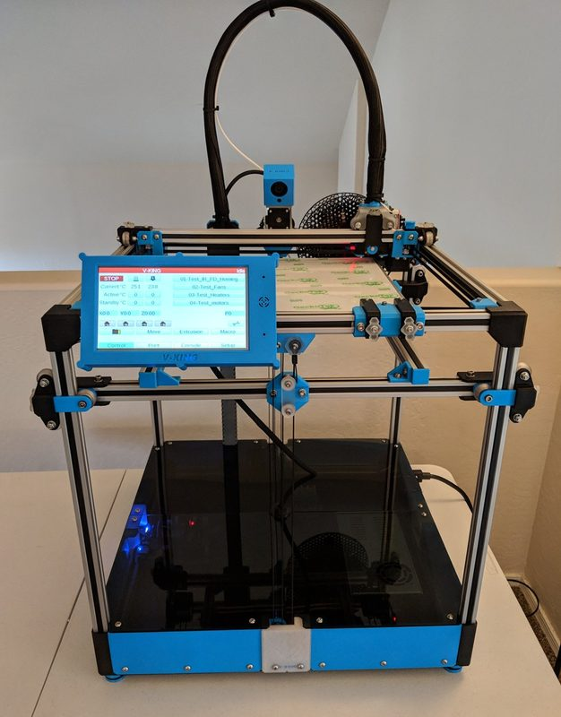</a> Photo: Kelly Stephenson</td><td align="center" width="33%"><a href="8-v-king.jpg">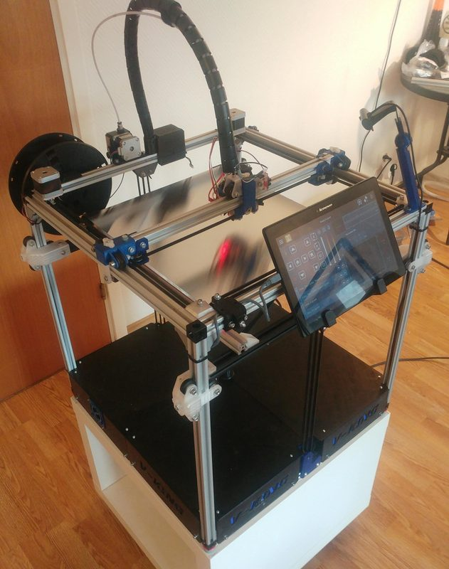</a> Photo: <a href="https://www.myminifactory.com/users/Pro3D">Roy Berntsen</a></td></tr>
<tr><td align="center" width="33%"><a href="9-v-king.jpg">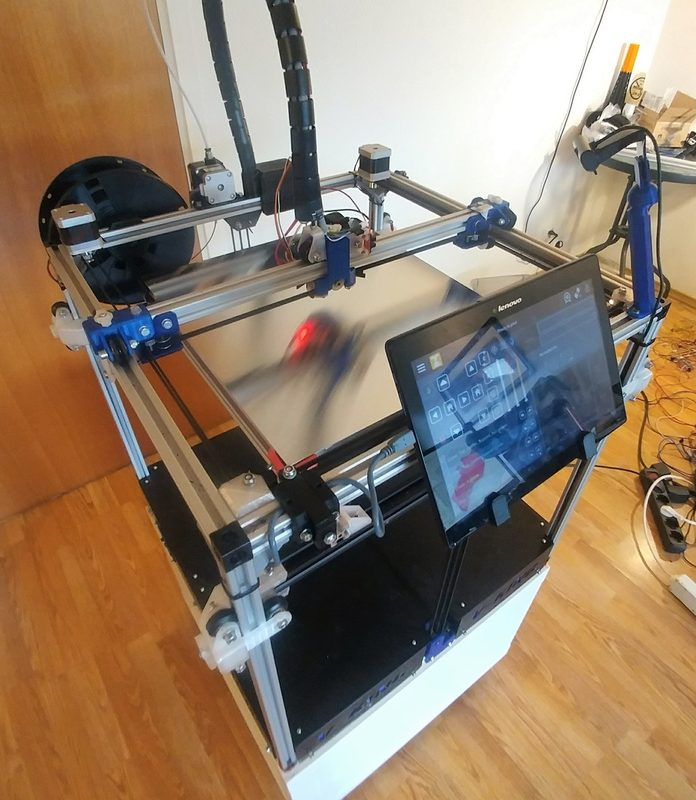</a> Photo: <a href="https://www.myminifactory.com/users/Pro3D">Roy Berntsen</a></td><td align="center" width="33%"><a href="10-v-king.jpg">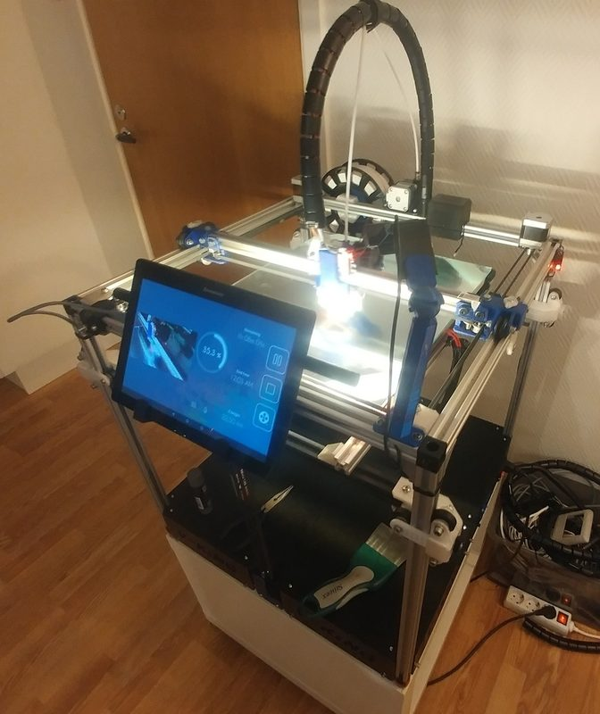</a> Photo: <a href="https://www.myminifactory.com/users/Pro3D">Roy Berntsen</a></td><td align="center" width="33%"><a href="11-v-king.jpg">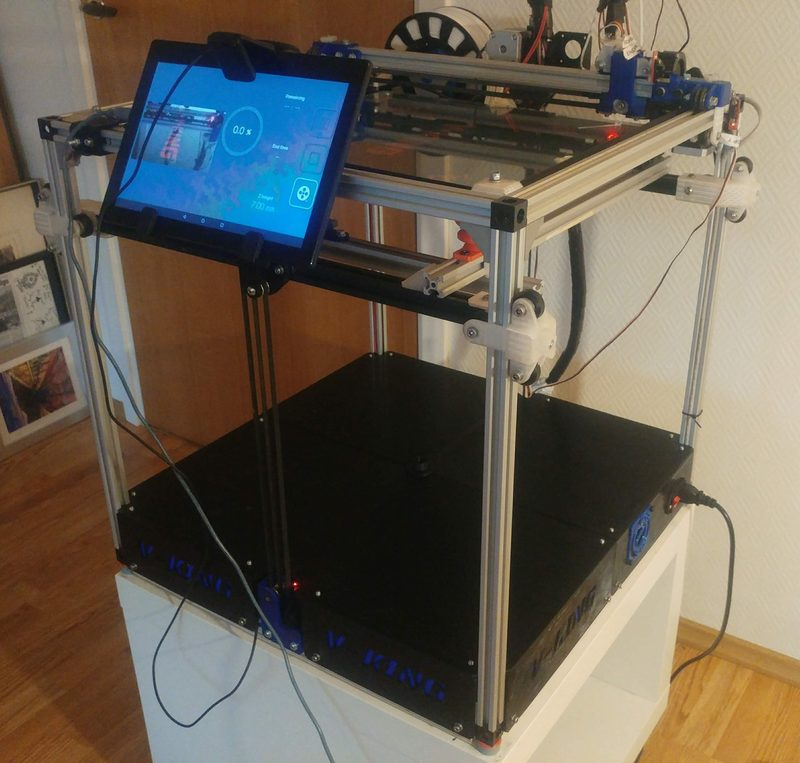</a> Photo: <a href="https://www.myminifactory.com/users/Pro3D">Roy Berntsen</a></td></tr>
<tr><td align="center" width="33%"><a href="12-v-king.jpg">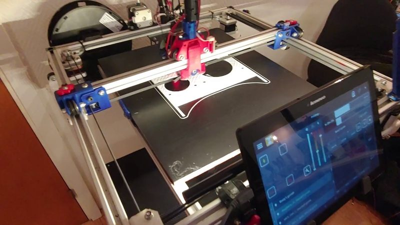</a> Photo: <a href="https://www.youtube.com/@PRO3DESIGN">Roy Berntsen</a></td><td align="center" width="33%"><a href="13-v-king.jpg">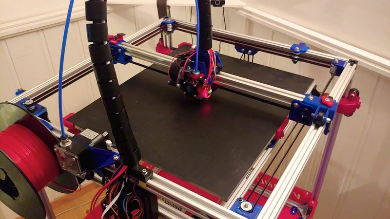</a> Photo: <a href="https://www.youtube.com/@PRO3DESIGN">Roy Berntsen</a></td></tr>
</table>
