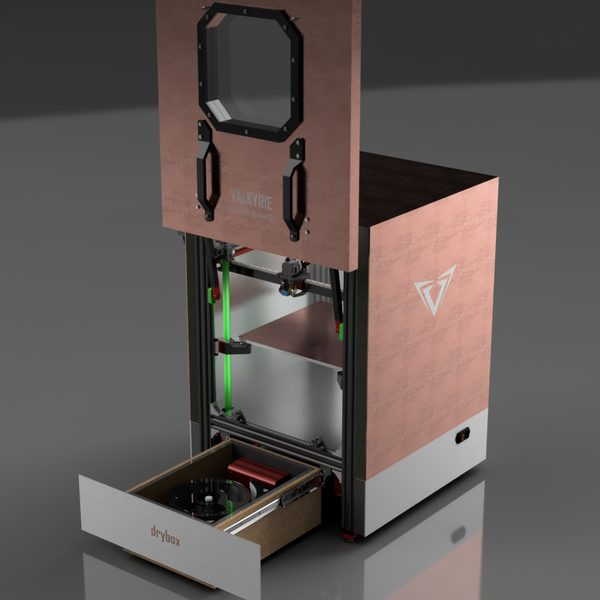
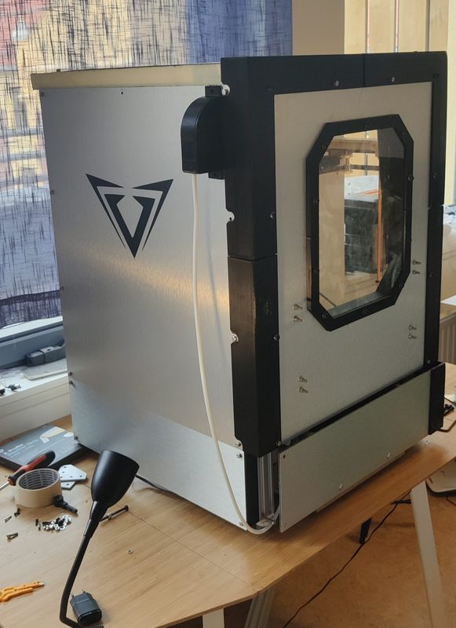
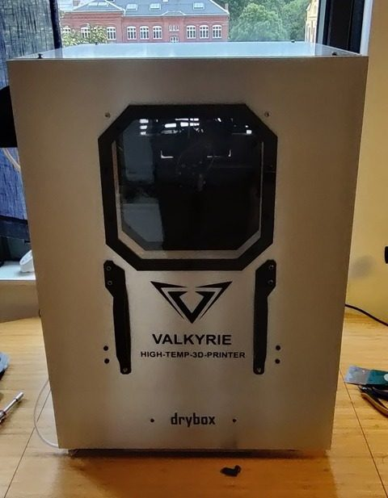
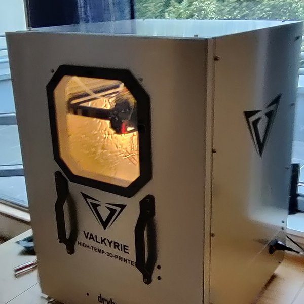

# Project Valkyrie

[Catalog row](../../README.md#valkyrie) · [Gallery](../../GALLERY.md)

| Field | Value |
| --- | --- |
| Section | Legacy designs |
| Project page | [https://github.com/3D-Experiments/Project-Valkyrie](https://github.com/3D-Experiments/Project-Valkyrie) |
| Author | 3D Experiments |
| About | Experimental CoreXY whose maker describes an inverted drive arrangement intended to reduce friction, with a triple-Z bed. No update since 2022 and no active group. |
| Build volume (X×Y×Z) | 310×310×300 |
| Exterior (W×D×H) | — |
| Latest version | CAD [2022-06](https://github.com/3D-Experiments/Project-Valkyrie/commit/f59081c0808398a794080d676051edb70dae6ba7) |
| Stars Likes Views |  [🧡⁠41](https://www.printables.com/model/252348) [⏯️⁠7.3K](https://www.youtube.com/watch?v=Th9y_WY5k54) [❤️⁠224](https://www.youtube.com/watch?v=Th9y_WY5k54) |
| Links | [Files](https://github.com/3D-Experiments/Project-Valkyrie/tree/HEAD/Document%20Library) |
| Groups | — |

## Pictures (5)

<table>
<tr><td align="center" width="33%"></td><td align="center" width="33%"></td><td align="center" width="33%"></td></tr>
<tr><td align="center" width="33%"></td><td align="center" width="33%"></td></tr>
</table>
