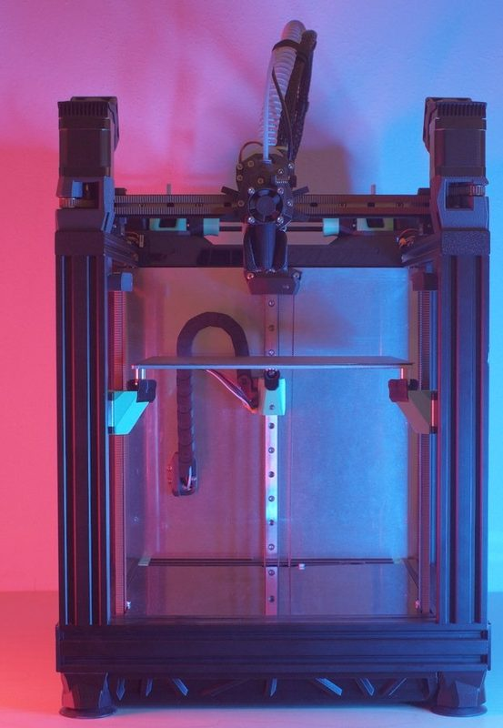

# VIRTU E3

[Catalog row](../../README.md#virtu-e3) · [Gallery](../../GALLERY.md)

| Field | Value |
| --- | --- |
| Section | Conversions |
| Project page | [https://www.printables.com/model/1476283-virtu-e3](https://www.printables.com/model/1476283-virtu-e3) |
| Author | RH3D |
| About | CoreXY rebuild of an Ender 3 and the successor of the Ender-3 NG. It has a bolted aluminium frame, a belt-driven triple Z and the V-ION toolhead. |
| Build volume (X×Y×Z) | 230×230×230 |
| Exterior (W×D×H) | 350×400×500 |
| Latest version | Log [2026-05](https://www.printables.com/model/1476283-virtu-e3) |
| Stars Likes Views | [🧡⁠242](https://www.printables.com/model/1476283-virtu-e3) [⏯️⁠17.8K](https://www.youtube.com/watch?v=Tc4B_fnmx10) [❤️⁠696](https://www.youtube.com/watch?v=Tc4B_fnmx10) |
| Links | [STL](https://www.printables.com/model/1476283-virtu-e3/files) [BOM](https://rh3d.xyz/virtu/build/sourcing_parts/self_sourcing) [Video](https://www.youtube.com/watch?v=Tc4B_fnmx10) |
| Groups | [Discord](https://discord.com/invite/Zkvu6uu2AR) EN 4.8K |
| License | [CC BY-NC-SA 4.0 (Printables, rh3d.xyz)](https://www.printables.com/model/1476283-virtu-e3) |

## Pictures (2)

<table>
<tr><td align="center" width="33%"> Photo: <a href="https://www.printables.com/@radkoko">RH3D</a></td><td align="center" width="33%"> Photo: <a href="https://www.printables.com/@radkoko">RH3D</a></td></tr>
</table>
