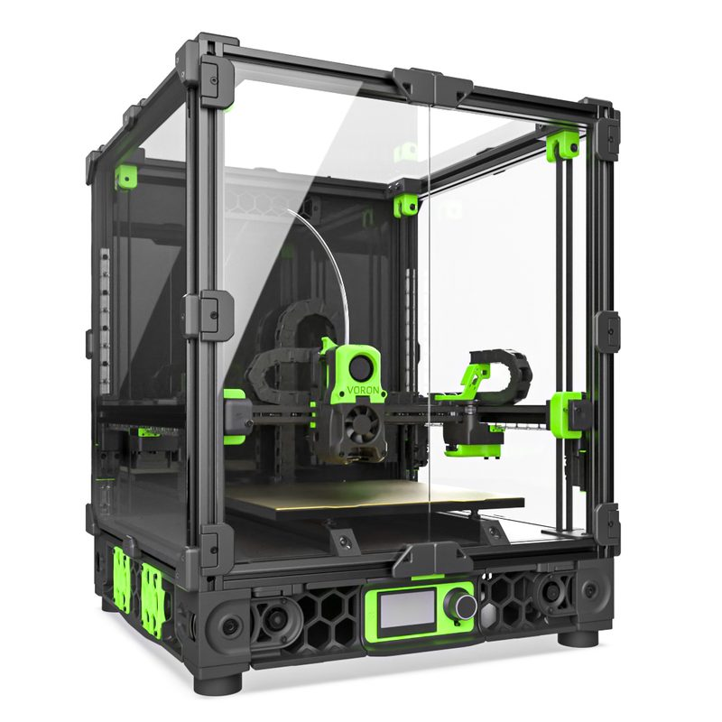
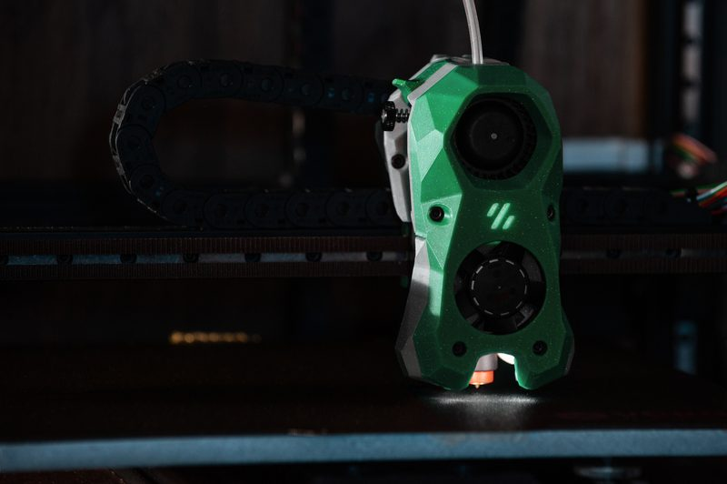

# Voron 2.4

[Catalog row](../../README.md#voron-2-4) · [Gallery](../../GALLERY.md)

| Field | Value |
| --- | --- |
| Section | CoreXY · Medium (181–299 mm representative X/Y size) |
| Project page | [https://github.com/VoronDesign/Voron-2](https://github.com/VoronDesign/Voron-2) |
| Author | Voron family |
| About | Large enclosed design with a moving gantry. |
| Build volume (X×Y×Z) | 250: 250×250×230 300: 300×300×280 350: 350×350×330 |
| Exterior (W×D×H) | 250: 410×410×430 300: 460×460×480 350: 510×510×530 |
| Latest version | V2.4r2 [2022-02](https://github.com/VoronDesign/Voron-2/releases/tag/V2.4r2) |
| Stars Likes Views |  [⏯️⁠21.5K](https://www.youtube.com/watch?v=HqeTA0CJd3c) [❤️⁠226](https://www.youtube.com/watch?v=HqeTA0CJd3c) |
| Links | [CAD](https://github.com/VoronDesign/Voron-2/tree/HEAD/CAD) [Manual](https://github.com/VoronDesign/Voron-2/blob/HEAD/Manual/Assembly_Manual_2.4r2.pdf) |
| Groups | [Discord](https://discord.gg/voron) EN 40.8K [Reddit](https://www.reddit.com/r/VORONDesign/) EN 39.7K [Forum](https://forum.vorondesign.com/) EN 12.8K [Facebook](https://www.facebook.com/groups/voroncorexy/) EN 54.2K [Facebook](https://www.facebook.com/groups/479932403103163/) DE 2.6K [Telegram](https://t.me/aboutvoron) RU 551 [Telegram](https://t.me/voron_siboor_es) ES 212 [Forum](https://www.lesimprimantes3d.fr/forum/154-voron/) FR |
| License | [GPL-3.0](https://github.com/VoronDesign/Voron-2/blob/Voron2.4/LICENSE) |

## Pictures (6)

<table>
<tr><td align="center" width="33%"> Photo: <a href="https://github.com/VoronDesign">Voron Design</a></td><td align="center" width="33%"> Photo: <a href="https://spool3d.ca">Spool3D/LDO</a></td><td align="center" width="33%"> Photo: <a href="https://voron.at">voron.at/LDO</a></td></tr>
<tr><td align="center" width="33%"> Photo: <a href="https://github.com/VoronDesign">Voron Design</a></td><td align="center" width="33%"> Photo: Brian Leonard</td><td align="center" width="33%"> Photo: <a href="https://github.com/VoronDesign">Voron Design</a></td></tr>
</table>
