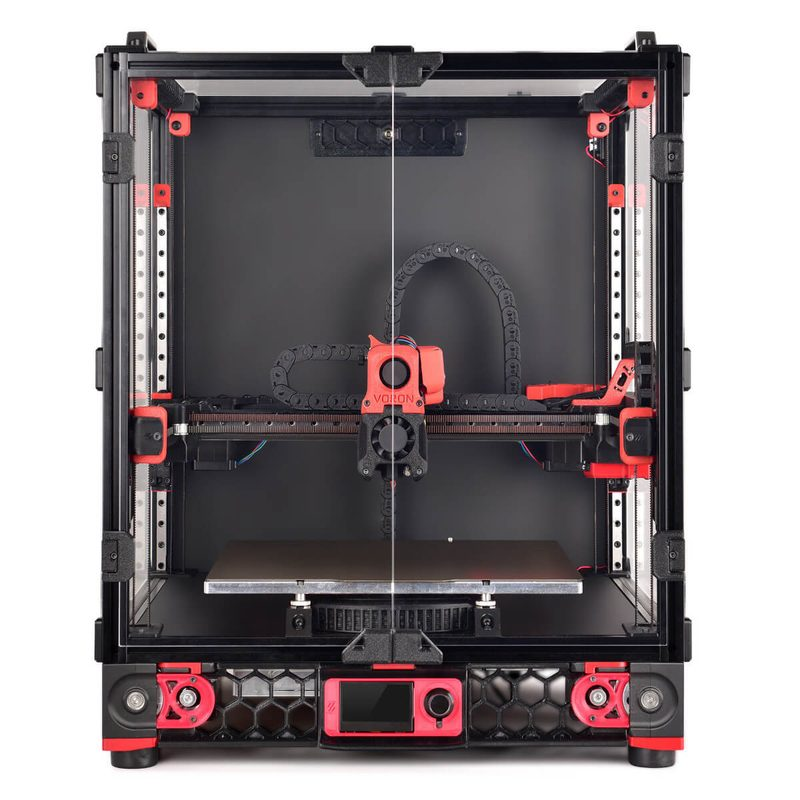
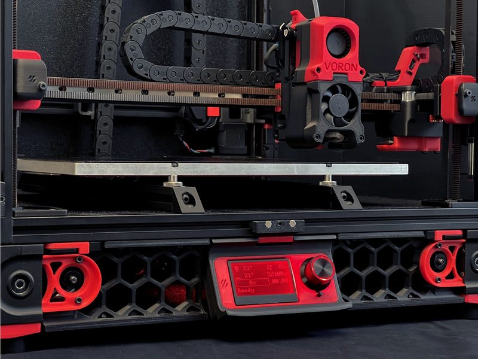
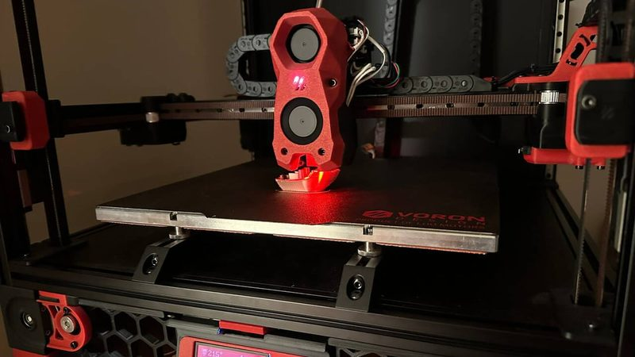

# Voron 2 (2.0 to 2.4)

[Catalog row](../../README.md#voron-2) · [Gallery](../../GALLERY.md)

| Field | Value |
| --- | --- |
| Section | CoreXY · Medium (181–299 mm representative X/Y size) |
| Project page | [https://github.com/VoronDesign/Voron-2](https://github.com/VoronDesign/Voron-2) |
| Author | Voron family |
| About | Large enclosed design with a moving gantry. The 2.0, 2.1 and 2.2 came before the current 2.4. |
| Build volume (X×Y×Z) | 250: 250×250×230 300: 300×300×280 350: 350×350×330 |
| Exterior (W×D×H) | 250: 410×410×430 300: 460×460×480 350: 510×510×530 |
| Latest version | V2.4r2 [2022-02](https://github.com/VoronDesign/Voron-2/releases/tag/V2.4r2) |
| Stars Likes Views |  [⏯️⁠21.5K](https://www.youtube.com/watch?v=HqeTA0CJd3c) [❤️⁠226](https://www.youtube.com/watch?v=HqeTA0CJd3c) |
| Links | [CAD](https://github.com/VoronDesign/Voron-2/tree/HEAD/CAD) [Manual](https://github.com/VoronDesign/Voron-2/blob/HEAD/Manual/Assembly_Manual_2.4r2.pdf) [CAD](https://github.com/VoronDesign/Voron-2/tree/Voron2.2/CAD) old 2.2 [CAD](https://github.com/VoronDesign/Voron-2/tree/Voron2.1/CAD) old 2.1 [STEP](https://github.com/VoronDesign/Voron-2/tree/Voron2.0/STEP) old 2.0 |
| Groups | [Discord](https://discord.gg/voron) EN 40.8K [Reddit](https://www.reddit.com/r/VORONDesign/) EN 39.7K [Forum](https://forum.vorondesign.com/) EN 12.8K [Facebook](https://www.facebook.com/groups/voroncorexy/) EN 54.2K [Facebook](https://www.facebook.com/groups/479932403103163/) DE 2.6K [Telegram](https://t.me/aboutvoron) RU 551 [Telegram](https://t.me/voron_siboor_es) ES 212 [Forum](https://www.lesimprimantes3d.fr/forum/154-voron/) FR |
| License | [GPL-3.0](https://github.com/VoronDesign/Voron-2/blob/Voron2.4/LICENSE) |

## Pictures (6)

<table>
<tr><td align="center" width="33%"> Photo: <a href="https://github.com/VoronDesign">Voron Design</a></td><td align="center" width="33%"> Photo: <a href="https://spool3d.ca">Spool3D/LDO</a></td><td align="center" width="33%"> Photo: <a href="https://voron.at">voron.at/LDO</a></td></tr>
<tr><td align="center" width="33%"> Photo: <a href="https://github.com/VoronDesign">Voron Design</a></td><td align="center" width="33%"> Photo: Brian Leonard</td><td align="center" width="33%"> Photo: <a href="https://github.com/VoronDesign">Voron Design</a></td></tr>
</table>

## Other homes of the files

- [voron.zip](https://voron.zip/done/V2.zip): official release download of the 2.4 files, and the [manual PDF](https://voron.zip/web/viewer.html?file=manuals/Assembly_Manual_2.4r2.pdf). License not stated on the page.
- Wayback Machine: [latest snapshot](https://web.archive.org/web/20261001005403/https://github.com/VoronDesign/Voron-2), 2026-10-01.

## Popular mods

- [VoronUsers](https://github.com/VoronDesign/VoronUsers) by Voron community: official collection of community mods, sorted by printer and author. GPL-3.0.
- [ERCF v2 (Enraged Rabbit Carrot Feeder)](https://github.com/Carrot-collective/ERCF_v2) by Carrot Collective (original ERCF by Ette): multi-material unit that selects one of many filaments and feeds it to a single direct-drive toolhead. GPL-3.0.
- [Klicky Probe](https://github.com/jlas1/Klicky-Probe) by jlas1: magnetic microswitch Z probe that the toolhead picks up from a dock before probing and returns after. GPL-3.0.
- [Dragon Burner and Rapid Burner toolheads](https://github.com/chirpy2605/voron/tree/main/V0/Dragon_Burner) by chirpy2605: compact toolheads with twin 4010 part-cooling blowers, built for the V0.2 and mounted on the larger Vorons with adapter plates. GPL-3.0.
- [StealthChanger](https://github.com/DraftShift/StealthChanger) by DraftShift Design: tool changer with a bushing-and-pin shuttle that docks several Stealthburner, Dragon Burner, Xol, A4T and other toolheads. GPL-3.0.
- [LED Strip Holder for Voron 2.4](https://www.printables.com/model/84735-led-strip-holder-for-voron-24) by FunFunBoy: clip-on holders that mount LED strips along the top frame extrusions to light the chamber. CC BY-NC-SA 4.0.
- [TapChanger](https://github.com/viesturz/tapchanger) by viesturz: tool changer built on Tap-style nozzle probing, docking up to six Dragon Burner toolheads in a 350 frame. GPL-3.0.
- [Xol Toolhead](https://github.com/Armchair-Heavy-Industries/Xol-Toolhead) by Armchair Heavy Industries: modular toolhead and X carriage, the successor of Mantis Xol 2, with swappable hotend, extruder and toolboard mounts. CC BY-NC-SA 4.0.
- [Clicky-Clack Fridge Door](https://github.com/tanaes/whopping_Voron_mods/tree/main/clickyclacky_door) by tanaes: single framed front door on lift-off hinges with a latch that pulls it shut against foam tape to seal the chamber. GPL-3.0.
- [Galileo 2](https://github.com/JaredC01/Galileo2) by JaredC01: 9:1 planetary drop-in extruder for the Stealthburner (G2E), plus planetary Z drives (G2Z) for V2-style printers. GPL-3.0.
- [Voron Tap](https://github.com/VoronDesign/Voron-Tap) by Voron Design: nozzle Z probe: the whole toolhead slides on a rail carriage and trips an optical switch when the nozzle touches the bed. GPL-3.0.
- [A4T Toolhead](https://github.com/Armchair-Heavy-Industries/A4T) by Armchair Heavy Industries: toolhead built around a 4010 blower for front-rail Vorons, on the Xol, stock CW2 or Tap carriage. CC BY-NC-SA 4.0.
- [Monolith Gantry](https://github.com/Monolith3D/Monolith_Gantry) by Monolith3D: configurable XY gantry with a shorter belt path and optional AWD that keeps the CoreXY layout. CC BY-NC-SA 4.0.
