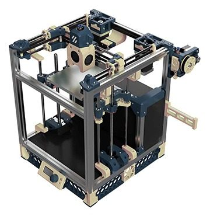
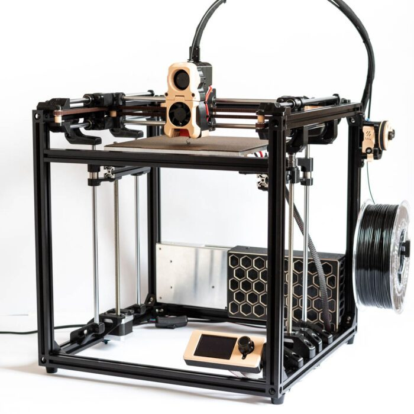
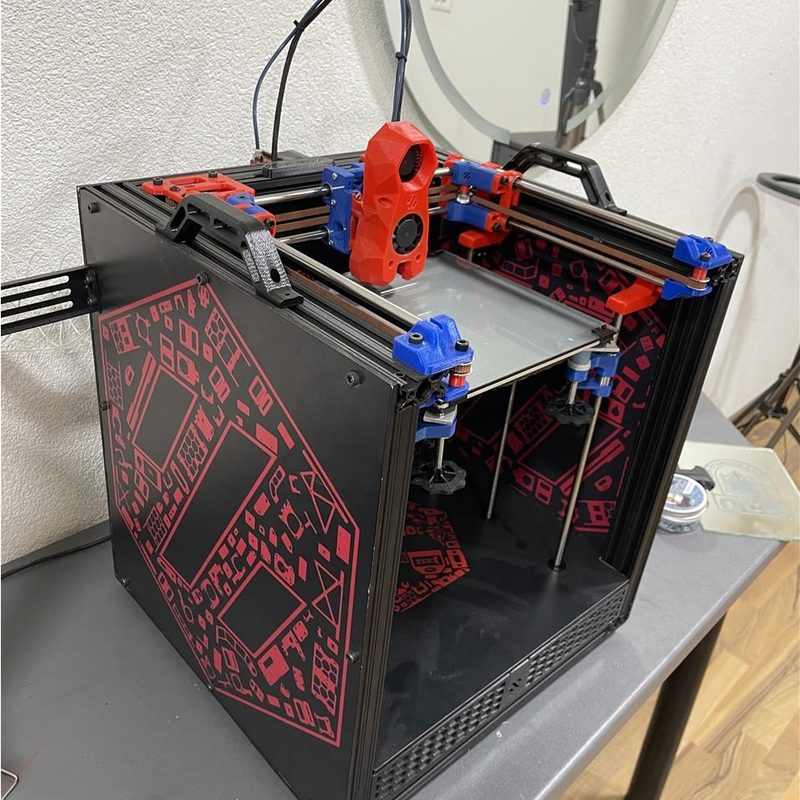
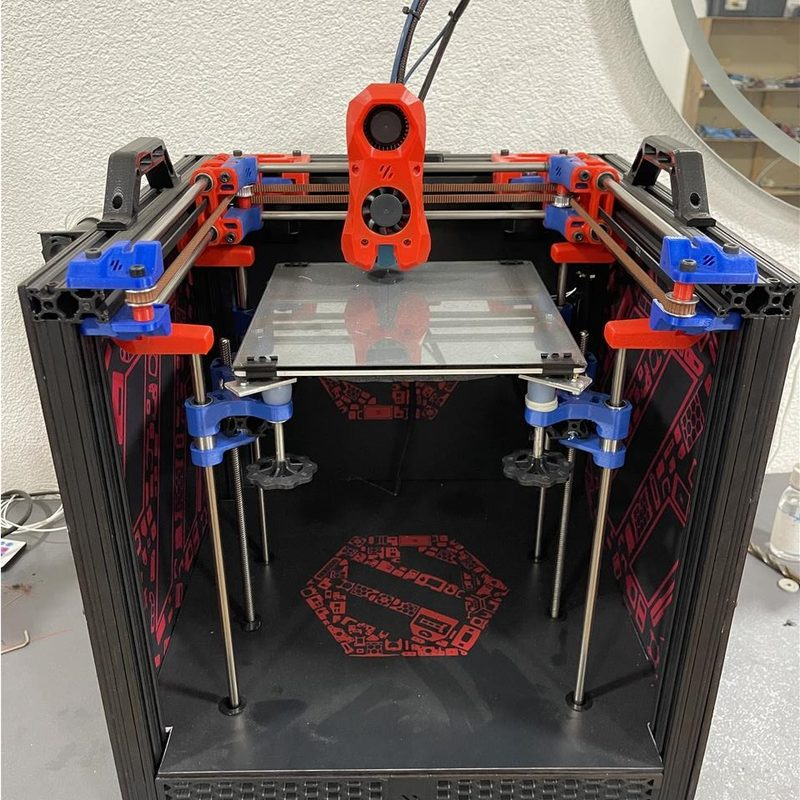
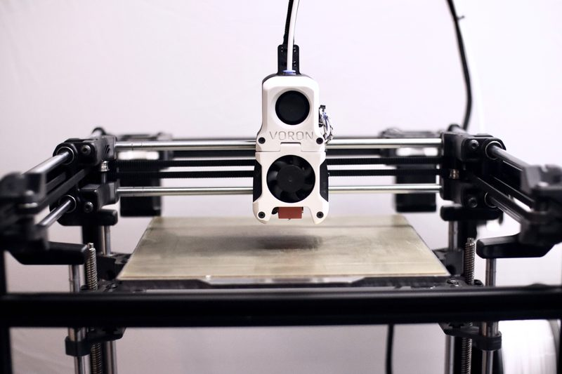

# Voron Legacy

[Catalog row](../../README.md#voron-legacy) · [Gallery](../../GALLERY.md)

| Field | Value |
| --- | --- |
| Section | CoreXY · Medium (181–299 mm representative X/Y size) |
| Project page | [https://github.com/VoronDesign/Voron-Legacy](https://github.com/VoronDesign/Voron-Legacy) |
| Author | Voron family |
| About | A released CoreXY throwback honoring Voron 1.0. |
| Build volume (X×Y×Z) | 230×230×260 |
| Exterior (W×D×H) | — |
| Latest version | V1.0 [2020-12](https://github.com/VoronDesign/Voron-Legacy/releases/tag/V1.0) |
| Stars Likes Views |  [⏯️⁠70.6K](https://www.youtube.com/watch?v=NZqvRLa8ShE) [❤️⁠1.5K](https://www.youtube.com/watch?v=NZqvRLa8ShE) |
| Links | [CAD](https://github.com/VoronDesign/Voron-Legacy/tree/main/CAD) [STL](https://github.com/VoronDesign/Voron-Legacy/tree/main/STLs) [BOM](https://vorondesign.com/voron_legacy) |
| Groups | [Discord](https://discord.gg/voron) EN 40.8K [Reddit](https://www.reddit.com/r/VORONDesign/) EN 39.7K [Forum](https://forum.vorondesign.com/) EN 12.8K [Facebook](https://www.facebook.com/groups/voroncorexy/) EN 54.2K [Facebook](https://www.facebook.com/groups/479932403103163/) DE 2.6K [Telegram](https://t.me/aboutvoron) RU 551 [Telegram](https://t.me/voron_siboor_es) ES 212 [Forum](https://www.lesimprimantes3d.fr/forum/154-voron/) FR |
| License | [GPL-3.0](https://github.com/VoronDesign/Voron-Legacy/blob/main/LICENSE) |

## Pictures (6)

<table>
<tr><td align="center" width="33%"> Photo: <a href="https://provok3d.com">provok3d</a></td><td align="center" width="33%"> Photo: <a href="https://3d-hobbystore.com">3d-hobbystore</a></td><td align="center" width="33%"> Photo: <a href="https://github.com/Zen3Dlab">Zen3Dlab</a></td></tr>
<tr><td align="center" width="33%"></td><td align="center" width="33%"></td><td align="center" width="33%"> Photo: <a href="https://github.com/VoronDesign">Voron Design</a></td></tr>
</table>

## Other homes of the files

- Wayback Machine: [latest snapshot](https://web.archive.org/web/20260413094220/https://github.com/VoronDesign/Voron-Legacy), 2026-04-13.
