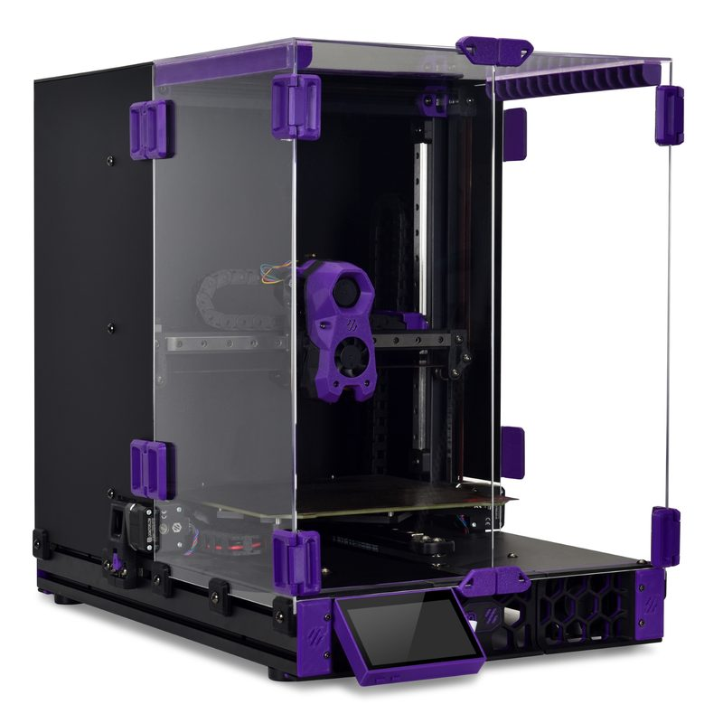
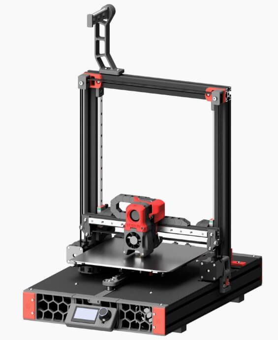
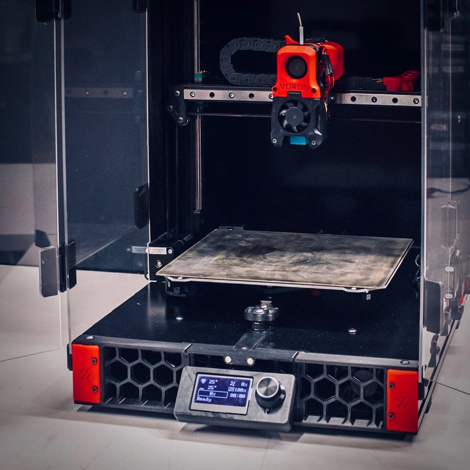
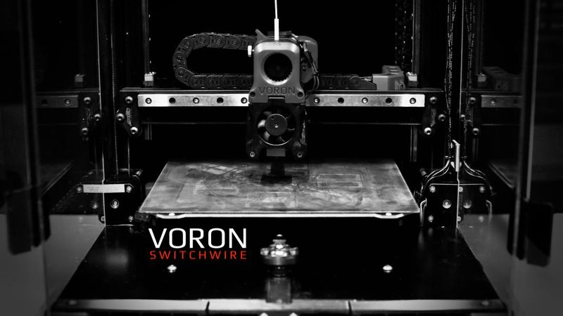
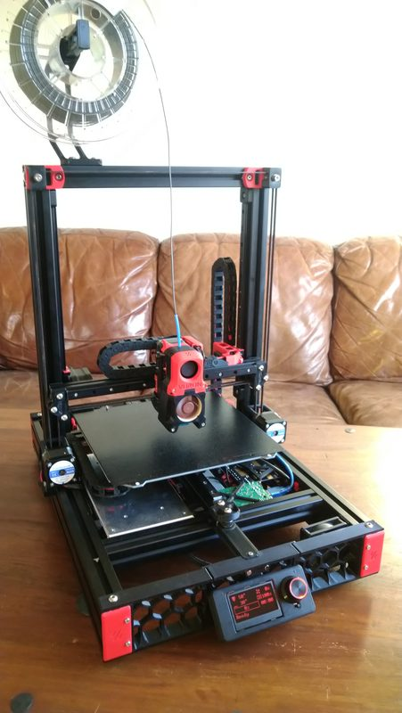
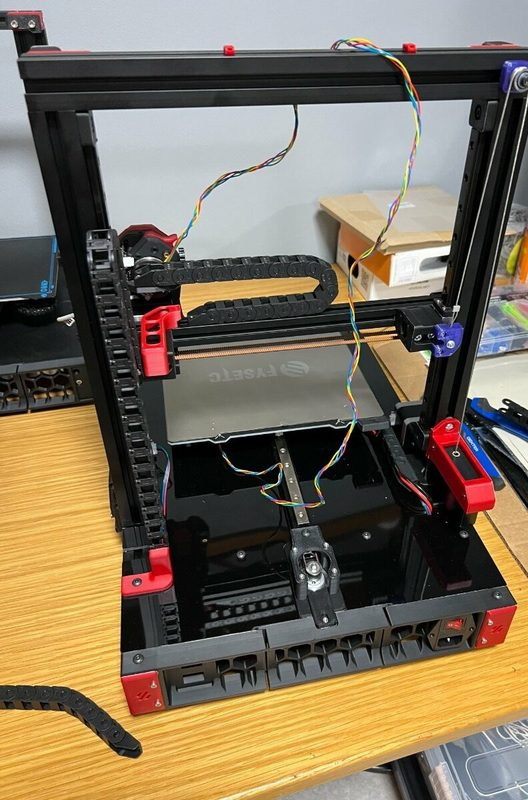

# Voron Switchwire

[Catalog row](../../README.md#voron-switchwire) · [Gallery](../../GALLERY.md)

| Field | Value |
| --- | --- |
| Section | Conversions |
| Project page | [https://github.com/VoronDesign/Voron-Switchwire](https://github.com/VoronDesign/Voron-Switchwire) |
| Author | Voron family |
| About | Official CoreXZ bedslinger with a custom 3030/3060 frame and Prusa MK52 bed; builders can reuse Prusa parts or source a fresh build. |
| Build volume (X×Y×Z) | — |
| Exterior (W×D×H) | — |
| Latest version | V1.0 [2020-08](https://github.com/VoronDesign/Voron-Switchwire/releases/tag/V1.0) |
| Stars Likes Views |  [⏯️⁠88.8K](https://www.youtube.com/watch?v=jwPLl1v5ae4) [❤️⁠1K](https://www.youtube.com/watch?v=jwPLl1v5ae4) |
| Links | [Manual](https://github.com/VoronDesign/Voron-Switchwire/blob/HEAD/Manuals/Assembly_Manual_SW.pdf) [CAD](https://github.com/VoronDesign/Voron-Switchwire/tree/HEAD/CAD) |
| Groups | [Discord](https://discord.gg/voron) EN 40.8K [Reddit](https://www.reddit.com/r/VORONDesign/) EN 39.7K [Forum](https://forum.vorondesign.com/) EN 12.8K [Facebook](https://www.facebook.com/groups/voroncorexy/) EN 54.2K [Facebook](https://www.facebook.com/groups/479932403103163/) DE 2.6K [Telegram](https://t.me/aboutvoron) RU 551 [Telegram](https://t.me/voron_siboor_es) ES 212 [Forum](https://www.lesimprimantes3d.fr/forum/154-voron/) FR |

## Pictures (7)

<table>
<tr><td align="center" width="33%"></td><td align="center" width="33%"></td><td align="center" width="33%"></td></tr>
<tr><td align="center" width="33%"></td><td align="center" width="33%"></td><td align="center" width="33%"></td></tr>
<tr><td align="center" width="33%"></td></tr>
</table>
