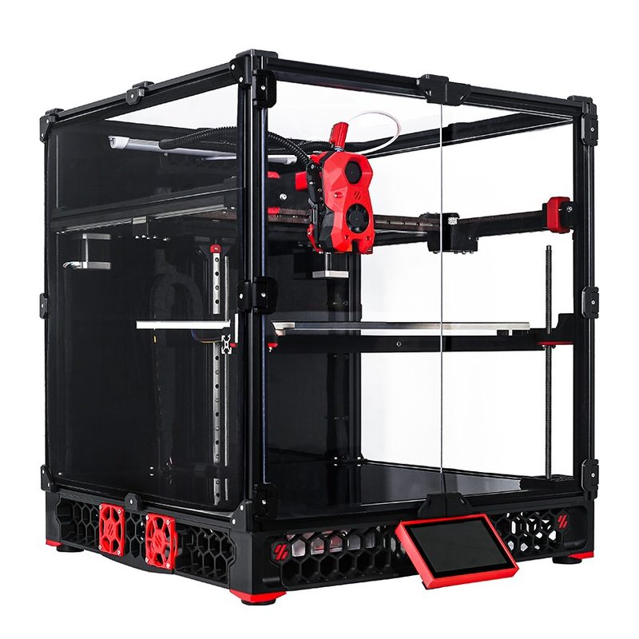
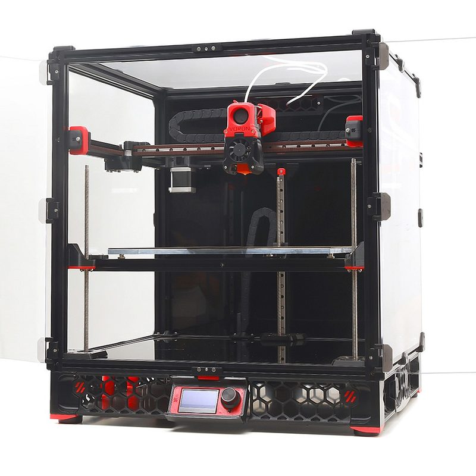
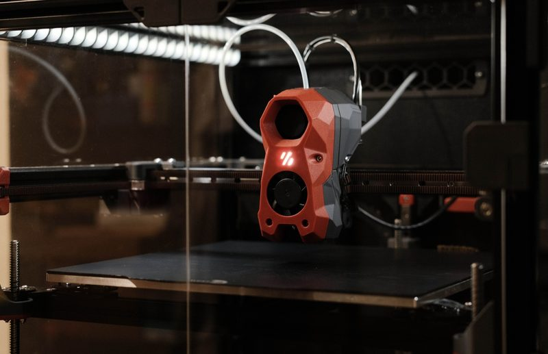
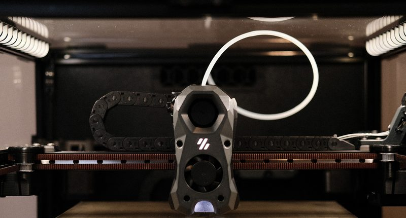
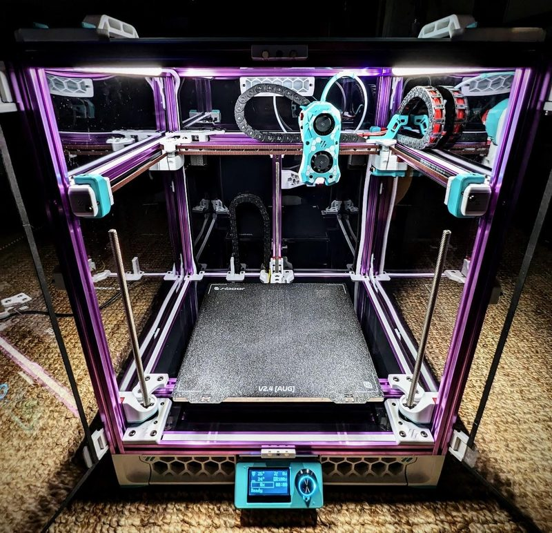
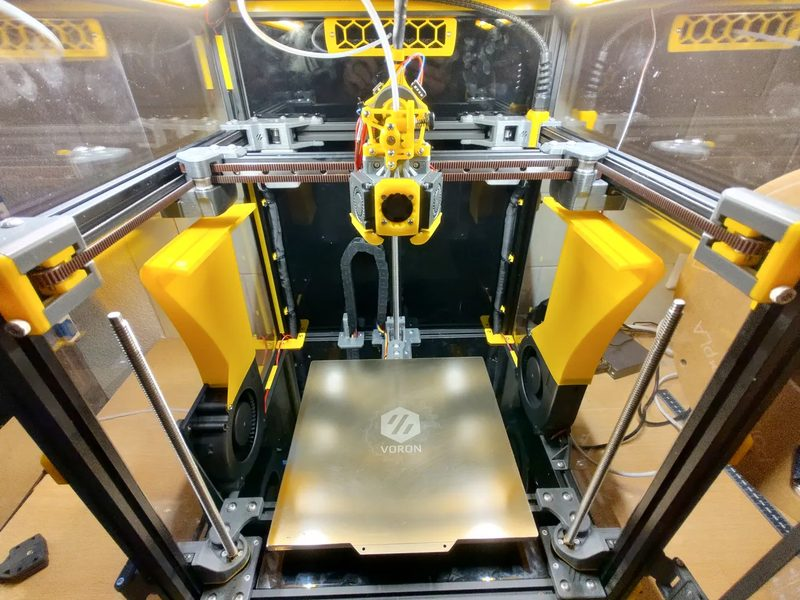
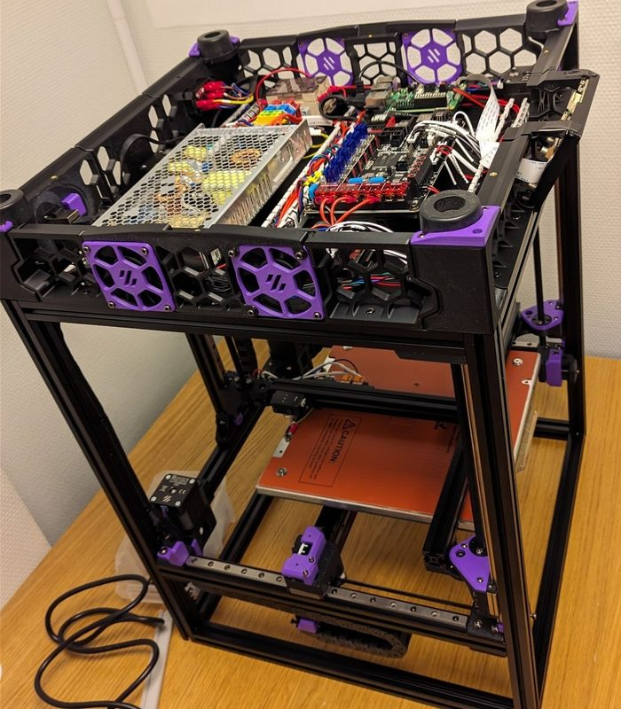

# Voron Trident

[Catalog row](../../README.md#voron-trident) · [Gallery](../../GALLERY.md)

| Field | Value |
| --- | --- |
| Section | CoreXY · Medium (181–299 mm representative X/Y size) |
| Project page | [https://github.com/VoronDesign/Voron-Trident](https://github.com/VoronDesign/Voron-Trident) |
| Author | Voron family |
| About | Fixed gantry and independently driven Z bed; current R2 release revises XY and Z motion. |
| Build volume (X×Y×Z) | 250: 250×250×250 300: 300×300×250 350: 350×350×250 |
| Exterior (W×D×H) | 250: 410×410×500 300: 460×460×500 350: 510×510×500 |
| Latest version | R2 [2026-06](https://github.com/VoronDesign/Voron-Trident/releases/tag/VTr2) |
| Stars Likes Views |  |
| Links | [CAD](https://github.com/VoronDesign/Voron-Trident/tree/HEAD/CAD) [Manual](https://github.com/VoronDesign/Voron-Trident/blob/HEAD/Manual/Assembly_Manual_Trident.pdf) |
| Groups | [Discord](https://discord.gg/voron) EN 40.8K [Reddit](https://www.reddit.com/r/VORONDesign/) EN 39.7K [Forum](https://forum.vorondesign.com/) EN 12.8K [Facebook](https://www.facebook.com/groups/voron.trident/) EN 1.4K [Facebook](https://www.facebook.com/groups/voroncorexy/) EN 54.2K [Facebook](https://www.facebook.com/groups/479932403103163/) DE 2.6K [Telegram](https://t.me/aboutvoron) RU 551 [Telegram](https://t.me/voron_siboor_es) ES 212 [Forum](https://www.lesimprimantes3d.fr/forum/154-voron/) FR |

## Pictures (8)

<table>
<tr><td align="center" width="33%"> Photo: <a href="https://github.com/VoronDesign">Voron Design</a></td><td align="center" width="33%"> Photo: <a href="https://www.formbot3d.com">Formbot</a></td><td align="center" width="33%"> Photo: <a href="https://www.3dprintersonlinestore.com">3dprintersonlinestore</a></td></tr>
<tr><td align="center" width="33%"> Photo: <a href="https://github.com/VoronDesign">Voron Design</a></td><td align="center" width="33%"> Photo: <a href="https://github.com/VoronDesign">Voron Design</a></td><td align="center" width="33%"> Photo: <a href="https://www.reddit.com/user/toastteebun">u/toastteebun</a></td></tr>
<tr><td align="center" width="33%"> Photo: <a href="https://www.printables.com/@HandsomePotato">HandsomePotato</a></td><td align="center" width="33%"> Photo: <a href="https://www.jonashietala.se">Jonas Hietala</a></td></tr>
</table>
